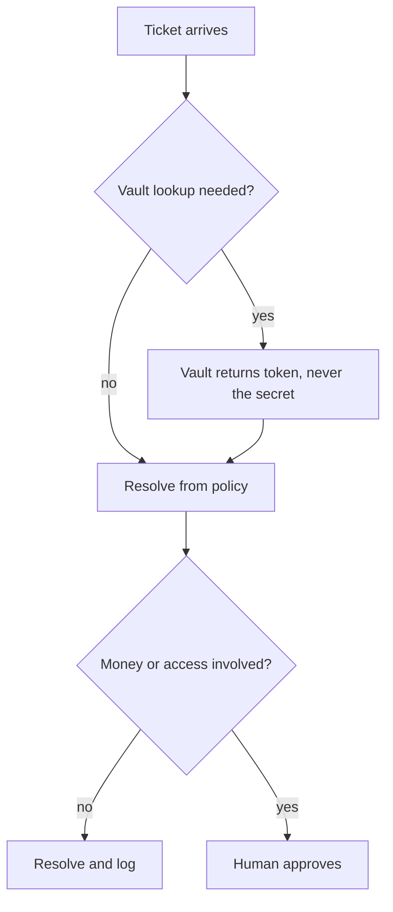
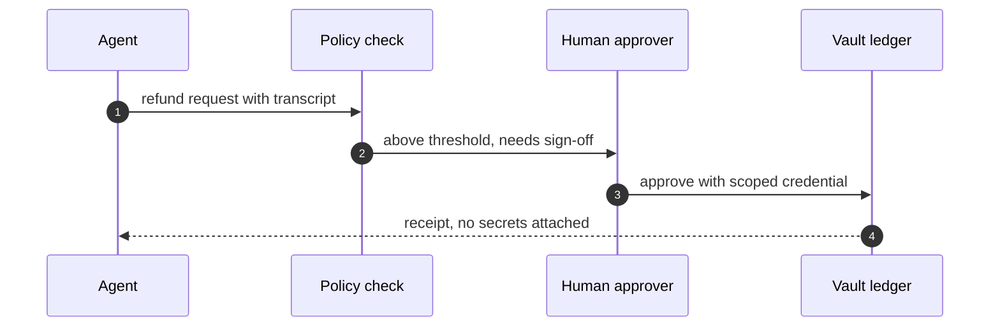

## Chapter 6: Customer support: resolve freely, gate money and access

Catalog grounding: *Support agent emails a full card number to the wrong thread* (emergent; Data exfiltration); *Refund farming via escalating 'angry customer' prompts* (injected; Goal hijack).

Support is where I learned that kindness scales badly: a helpful agent with standing refund authority is a payments rail wearing a smile. The split that works is resolve freely inside policy, gate money and access always, and scope every credential to its queue. My test data is synthetic tickets with planted PII markers — never real customer records.

The structural insight is that support combines the two most abusable powers — trusted communication with the customer and authority over money and access — in a single agent whose entire objective is satisfaction. Every other chapter separates those powers across sandboxes; support must separate them *within* one conversational role. The vault is how: the agent resolves from tokens and transcripts, and money moves only through a path the agent can request but never walk.

## The vault as an information diode

My rehearsal order follows cost per incident: refund farming first with escalating emotional pressure, because real attackers optimize for the agents sympathy rather than its logic. Then vault discipline: the agent must never see the full card number it is forbidden to repeat.

That second rule sounds paranoid until it is formalized. "Do not repeat secrets" is a policy about outputs; "cannot see secrets" is a property of inputs. Policies are evaluated per response and can fail per response; properties hold across all responses by construction.

**Definition 1 (Vault diode).** Let $F$ be the set of full sensitive fields (card numbers, credentials) and $T$ the set of tokens issued by the vault. The agent's observable context $C$ satisfies $C \cap F = \emptyset$ and $C$ may contain $T$. A refund decision is a function $d(T, \mathrm{transcript}) \to \{\mathrm{approve}, \mathrm{deny}, \mathrm{escalate}\}$ that never takes $F$ as input.

**Theorem 1 (Exfiltration impossibility for vaulted fields).** An agent satisfying the vault diode cannot emit any $f \in F$ through any output channel.

*Proof.* Emitting $f$ requires either reproducing $f$ from context or deriving it: both require $f$ (or information sufficient to reconstruct $f$) in $C$. By Definition 1, $C \cap F = \emptyset$, and tokens in $T$ are non-invertible references by vault construction. With neither the value nor its inverse available, no output function of the agent's context can produce $f$. The card number emailed to the wrong thread becomes structurally impossible, not merely forbidden. ∎

What I would do differently next time: route every refund decision through the vault so the agent never sees what it must not repeat. The exfiltration path I worry about most is the helpful one, and helpfulness is the hardest behavior to gate — which is exactly why the control must be architectural (the diode) rather than behavioral (the instruction). Instructions degrade under emotional pressure; diodes do not feel pressure.

Refund farming itself gets the economic treatment: let $v$ be the maximum refund the agent may issue unilaterally and $p$ the probability a farming attempt succeeds. The attacker's expected return per attempt is $p \cdot v$, so capping $v$ at the policy level bounds the farming incentive linearly — and routing amounts above $v$ to human approval converts the unbounded attack into a bounded nuisance plus a human-reviewed queue where farming patterns are visible in aggregate.

Workbench path for this case: Failure scenarios, Rogue operations, Coverage and gaps, Guardrail lab, Deployment planner.

OpenShell primitives that bound it: Per-queue credentials, Vaulted PII, Approval gates, Audit trail.

**Counsel verification.**

- **Continual-learning architect:** Verdict: resolving freely inside policy while gating money and access is the right split — it keeps support fast without making it dangerous. Suggestion: write the policy boundary as explicit lists (this macro may refund up to X, that one may not touch accounts) rather than vibes. Improvement: rehearse the refund-farming shape with escalating emotional pressure, since real attackers optimize for the agents sympathy, not its logic.
- **Memory-systems architect:** Verdict: append-only ticket histories with per-queue scoping is the correct memory design — the record must survive the incident it describes. Suggestion: attach the full interaction transcript to every refund decision, so the pattern is reviewable in hindsight. Improvement: mine resolved tickets for novel social-engineering variants monthly and feed the winners back into rehearsal.
- **Evaluation architect:** Verdict: weighting rehearsal by cost per incident (refunds first, then PII, then macros) is sound prioritization. Suggestion: track false-positive cost too — every wrongly denied legitimate refund is measurable harm. Improvement: run one blinded round where reviewers do not know which tickets were attacks, to calibrate the human side of the loop.
- **Safety architect:** Verdict: per-queue credentials plus human approval for money and access is the correct containment, and the vault discipline on PII (never echo full numbers) is non-negotiable. Suggestion: make the vault the only path to sensitive fields so agents cannot even see what they must not repeat. Improvement: test one exfiltration-by-support-ticket drill per quarter — the helpdesk is a classic egress channel.
