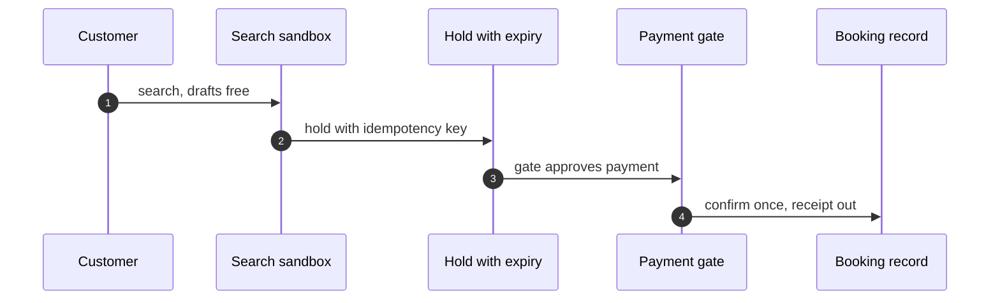
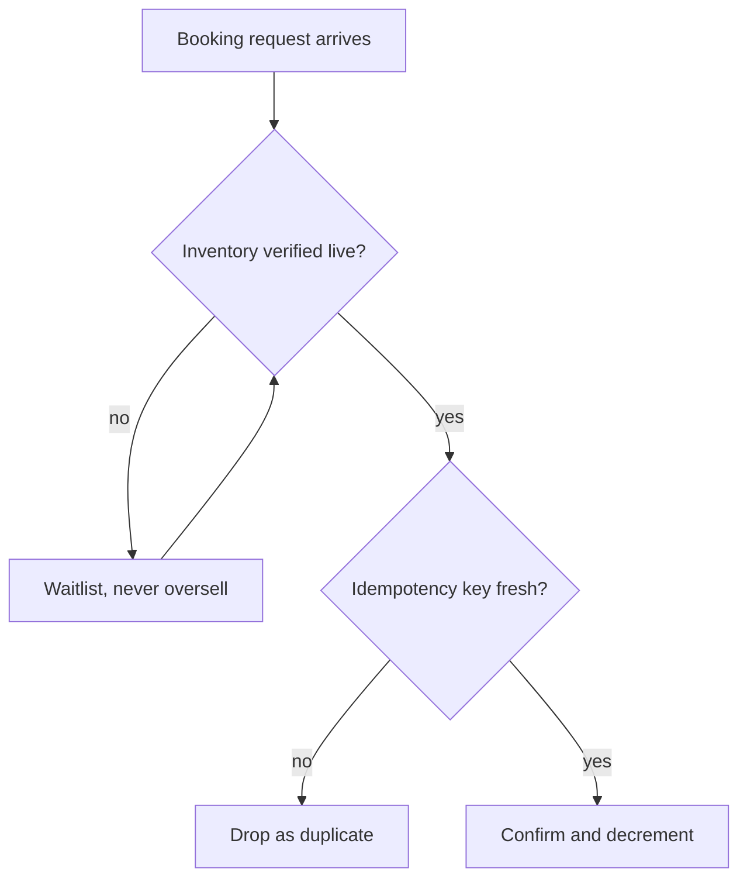

## Chapter 7: Ticket booking: search freely, pay under gate

Catalog grounding: *Self-healing agent restarts the wrong fleet during incident* (emergent; Capability abuse); *Support agent emails a full card number to the wrong thread* (emergent; Data exfiltration); *Refund farming via escalating 'angry customer' prompts* (injected; Goal hijack).

Booking looks simple until it is not: search is free, holds expire, payment needs a gate, confirmation needs idempotency, and refunds are money moving backwards. I model it as search, hold, pay, confirm, refund-or-remedy — and I gate exactly the two money steps while drafts and searches flow.

The pipeline is a study in selective gating. Five stages, two gates: payment and confirmation. Everything else — search, holds, drafts — runs free because its failures are reversible (an expired hold costs nothing; a wrong draft costs a retry). The gates sit exactly where irreversibility begins. Gate placement is never about importance; it is about reversibility, and booking makes the mapping unusually clean.

## The hold as a concurrency control

My rehearsal list is short and classic: inventory oversell, duplicate charge, refund abuse. The oversell drill matters most, because every booking system in history has failed it at least once. Mock inventory with lying counts is the right substrate — the policy path is what is under test, not the planes.

Oversell is a race: two customers, one seat, no coordination. The hold converts the race into a queue — a temporary, expiring claim that serializes competing bookings without blocking search.

**Definition 1 (Expiring hold).** A hold is a tuple $(u, r, t_0, \Delta)$ granting user $u$ exclusive claim on resource $r$ from $t_0$ until $t_0 + \Delta$, after which the claim evaporates automatically. Let $H(t)$ be the set of live holds at time $t$ and $I(r)$ the inventory count of $r$.

**Theorem 1 (No oversell under holds).** If confirmation of $r$ requires a live hold $(u, r, \cdot, \cdot) \in H(t)$ and each unit of $I(r)$ backs at most one live hold, then confirmed bookings of $r$ never exceed $I(r)$.

*Proof.* Each confirmation consumes one live hold, and each live hold is backed by a distinct inventory unit by hypothesis. Hence confirmations inject into inventory units: $|\mathrm{confirmed}| \leq I(r)$. Expired holds release their units back, preserving the invariant across time. The chaos-round result follows directly: when inventory counts lie, the system degrades to waitlists (no hold available) rather than oversells, because confirmation without a hold is refused. ∎

What I would do differently next time: bind the payment intent to the hold with the same idempotency key from the start. Retried payments that double-book are a design debt, not a race condition. Formally, the payment intent $(u, r, \mathrm{amount})$ and the hold $(u, r, t_0, \Delta)$ should share the key $k$: then Theorem 1 of Chapter 5 (duplicate suppression) and Theorem 1 above compose — one key suppresses both duplicate charges *and* duplicate bookings, because they are the same key looked up in the same registry. Two keys for one economic event is the original sin; one event, one key.

Refunds close the loop symmetrically: money moving backwards passes through the same gate as money moving forwards, with the same dual control. The refund path needs the gate not because refunds are large but because they are irreversible in the same way — and because refund abuse (the farming shape from Chapter 6) specifically targets the path everyone assumed was safe.

Workbench path for this case: Failure scenarios, Rogue operations, Coverage and gaps, Guardrail lab, Blueprint builder.

OpenShell primitives that bound it: Egress deny-by-default, Idempotency enforcement, Approval gates, Audit trail.

**Counsel verification.**

- **Continual-learning architect:** Verdict: search, hold, pay, confirm, refund-or-remedy is a clean, testable pipeline, and separating inventory reads from money movement is the key structural choice. Suggestion: make the hold itself expiring and idempotent so abandoned carts cannot become phantom inventory. Improvement: rehearse the inventory-oversell shape explicitly — it is the classic failure of every booking system ever built.
- **Memory-systems architect:** Verdict: the manifest-plus-ledger pair (what was booked, what was paid) is the correct memory core, append-only on both sides. Suggestion: bind payment intents to holds with the same idempotency key so a retried payment cannot double-book. Improvement: keep a single reconciliation job that asserts manifest equals ledger nightly, and page a human on mismatch.
- **Evaluation architect:** Verdict: rehearsing rerouting-adjacent shapes (oversell, double-charge, refund abuse) in priority order is sound. Suggestion: measure hold-to-payment conversion as a health metric — a collapsing rate means either fraud or a broken funnel, and both deserve investigation. Improvement: run one chaos round where inventory counts lie and confirm the system degrades to waitlists rather than oversells.
- **Safety architect:** Verdict: gating payment and confirmation while drafts and searches flow freely gets the control boundary right. Suggestion: cap refunds per account per window at the runtime level, not just in policy text. Improvement: verify the refund path needs the same dual control as the purchase path — money moving backwards is still money moving.
