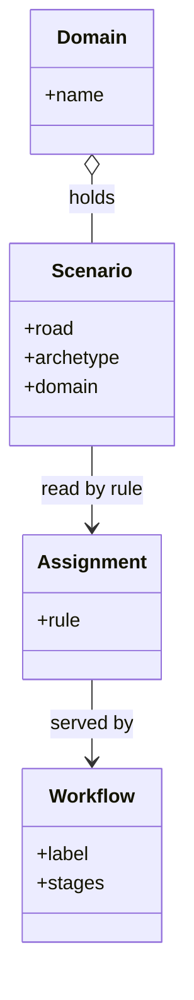
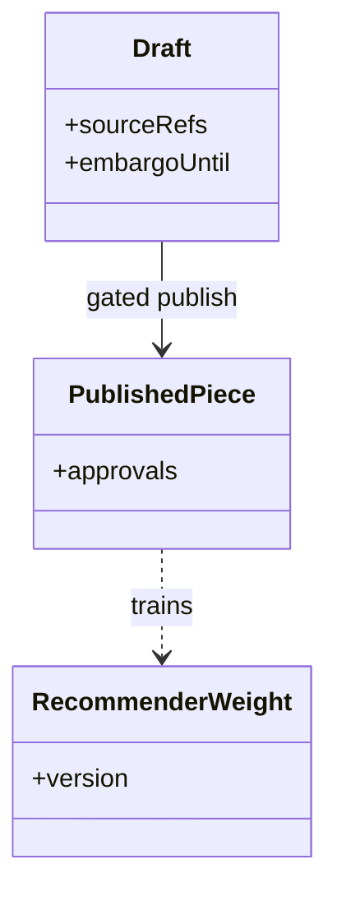

# Part III — Every domain, every scenario

One chapter per remaining catalog domain: what is at stake, the real scenarios with their roads and archetypes, the workbench path the assignment rule produces, and the OpenShell primitives that bound the domain's shapes. Thinly covered domains say so plainly — a single story is a prompt, not a coverage claim.

The class diagram above is the chapter template made formal: every domain chapter instantiates the same four classes. A Scenario carries its road (injected or emergent), its archetype (the failure family), and its domain. The Assignment rule reads scenarios and serves Workflows — which is why each chapter ends with the same two lines: the workbench path the rule produced, and the primitives that bound the shapes. When a domain has one scenario, the rule still fires; the chapter says so plainly instead of padding. Uniformity here is a feature: the reader learns the template once and spends every later chapter on the domain, never on the format.

## Chapter 8: Domain playbook: content

At stake: Publishing credentials, embargoed drafts, recommender weights, and the public record itself.

Catalog rehearsal: *Content agent ships undisclosed affiliate links into published articles* (injected; Goal hijack).

Single-story domain: treat this chapter as a prompt. Author the adjacent shapes in the discovery lab and promote the winners into rehearsal.

The stakes list reads like an inventory of irreversibility. Publishing credentials, once abused, publish. Embargoed drafts, once leaked, un-embargo. Recommender weights, once poisoned, steer every downstream ranking. The public record, once written, is written. Content is the domain where the undo button is smallest, which is why the single control that matters most — approval gates on the irreversible step — carries the whole chapter.

Workbench path: Failure scenarios, Rogue operations, Coverage and gaps, Live traces, Guardrail lab. Catalog weight: 3 patterns, 1 scenarios, 2 cascades.

OpenShell primitives that bound these shapes: Approval gates hold the irreversible step while detectors decide; scoped per-sandbox grants keep the hijacked objective inside a small world.

**Definition 1 (Publish gate).** Let $P$ be the set of publish actions and $G$ the gate predicate. The domain satisfies *gated publishing* if every $p \in P$ executes only when $G(p) = \mathrm{true}$, where $G$ requires human approval for embargoed or externally visible content and detector clearance otherwise.

**Theorem 1 (No silent publish).** Under gated publishing, no agent — hijacked or not — can place content in front of an audience without passing $G$.

*Proof.* Publication is an element of $P$ by definition of the action set, and every element of $P$ requires $G(p) = \mathrm{true}$ before execution. A hijacked objective changes what the agent *wants* to publish, not whether publication passes through $P$ — the gate sits on the action, not on the intent. Hence the affiliate-link injection reaches the gate, where human approval (for visible content) or the detector (otherwise) must affirmatively pass it. Silence — unreviewed publication — is unreachable. ∎

The recommender-gaming neighbor the counsel asks for is the natural next theorem: weights that train on published pieces create a feedback loop (PublishedPiece $\to$ RecommenderWeight in the diagram), and a hijacked publish step poisons the trainer. Gating publish therefore protects the weights transitively — one gate, two assets.

**Counsel verification.**

- **Continual-learning architect:** Verdict: the catalog-plus-rehearse-plus-gate loop fits content work: patterns for the craft, the rogue tab for injection and embargo shapes, approval gates on publish. Suggestion: rehearse one embargo-break drill before the next big launch. Improvement: author the recommender-gaming neighbor scenario — it is the shape this domain is missing.
- **Memory-systems architect:** Verdict: versioning drafts and snapshotting sources is correctly load-bearing here; published words cannot be unpushed. Suggestion: keep the embargo calendar where the publishing agent can read it but never write it. Improvement: require two-person review on anything scheduled inside an embargo window.
- **Evaluation architect:** Verdict: honest about thin coverage — one catalog story means the domain is sampled, not covered. Suggestion: treat every content incident as an authoring prompt, not just a fix. Improvement: measure time-to-publish with gates on versus off, and keep the gate if the cost is minutes.
- **Safety architect:** Verdict: binding publishing credentials to the publishing sandbox is the control that matters most here. Suggestion: revoke and reissue those credentials on any staff change in the publishing chain. Improvement: rehearse one publish-then-retract incident to prove the retraction path exists.
