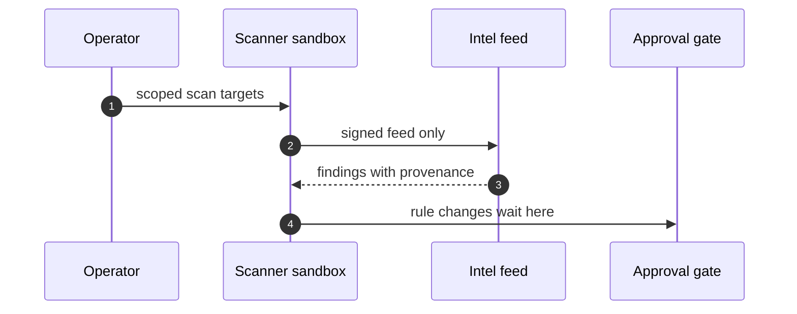

## Chapter 9: Domain playbook: cybersecurity

At stake: Scanner targets, intel feeds, firewall rules, and quarantine exceptions — the guard's own weapons.

Catalog rehearsal: *Autonomous pentest agent pivots from authorized scope to production exfil* (emergent; Capability abuse).

Single-story domain: treat this chapter as a prompt. Author the adjacent shapes in the discovery lab and promote the winners into rehearsal.

Cybersecurity is the reflexive domain: the agent under test wields the same weapons as the controls that judge it. A scanner with write access can rewrite the firewall it was sent to audit; a pentest agent that pivots from authorized scope to production exfiltration has turned the assessment into the incident. The chapter's primitives answer the reflexivity directly — least-privilege grants per sandbox, unprivileged process identity, revocation by deletion — because the only safe shape for a guard-with-weapons is a guard whose weapons stop at the sandbox wall.

Workbench path: Failure scenarios, Rogue operations, Coverage and gaps, Live traces, Blueprint builder. Catalog weight: 2 patterns, 1 scenarios, 3 cascades.

OpenShell primitives that bound these shapes: Least-privilege grants per sandbox, unprivileged process identity, and revocation by deletion when scope is exceeded.

**Definition 1 (Scope containment).** Let $T$ be the authorized target set and $A$ the set of actions the agent may execute. The deployment satisfies *scope containment* if every $a \in A$ is confined to $T$ by the sandbox (not by the agent's instructions), and any action addressing $t \notin T$ is refused by the runtime before execution.

**Theorem 1 (Pivot impossibility).** Under scope containment with revocation by deletion, a pentest agent cannot pivot from authorized scope to production exfiltration, regardless of its instructions or objectives.

*Proof.* Pivoting requires executing an action $a$ against a production target $t \notin T$. By Definition 1, the sandbox refuses every such $a$ at the runtime layer — the refusal does not consult the agent's intent, so prompt injection, goal hijack, and emergent curiosity all fail identically. Attempting the pivot triggers revocation by deletion: the sandbox (and its grants) ceases to exist, removing even the authorized capability. The attack's first step is therefore also its last. ∎

Feed provenance is the second front: a poisoned intel entry steers every decision downstream, so signatures are verified at ingest (Theorem 1 of Chapter 2 applies with sources replaced by feed entries). And the quarantine-escape drill the counsel requests tests the theorem's boundary condition — revocation must actually delete, not merely suspend, or the "deleted" sandbox remains a foothold.

**Counsel verification.**

- **Continual-learning architect:** Verdict: scanning your own fence with the same discipline you scan others is the right posture — scope-escape rehearsed, suppression rehearsed. Suggestion: rotate which team member plays the suppressor in drills so everyone learns the hiding move. Improvement: feed every real finding back into the scenario catalog the same week.
- **Memory-systems architect:** Verdict: feed provenance logging is the memory that matters; a poisoned intel entry poisons every decision downstream. Suggestion: sign intel feeds and verify signatures at ingest, not at use. Improvement: keep a known-good feed snapshot for blind comparison during incidents.
- **Evaluation architect:** Verdict: tuning scanners against the mix rather than the anecdote is sound measurement. Suggestion: track false-positive cost per vector so tuning stays honest. Improvement: run one red-team round where the scanner team does not know the attack set in advance.
- **Safety architect:** Verdict: gating every security-agent write — firewall rules, quarantine exceptions, scan targets — is correctly non-negotiable. Suggestion: extend the gate to read scope periodically, since scanners accumulate access. Improvement: test one quarantine-escape drill per quarter.
