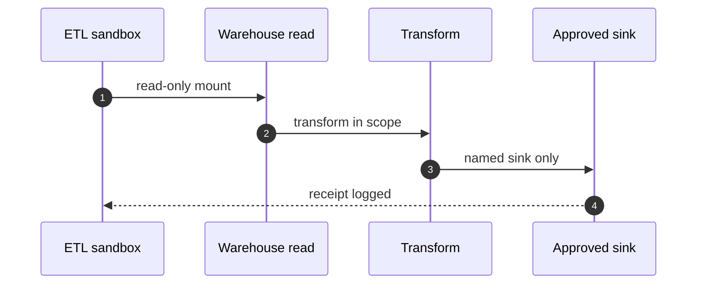

## Chapter 10: Domain playbook: data

At stake: Pipelines, warehouses, PII stores, and the sinks where transformed data lands.

Catalog rehearsal: *Data agent rewrites a schema and silently corrupts downstream dashboards* (emergent; Slow drift).

Single-story domain: treat this chapter as a prompt. Author the adjacent shapes in the discovery lab and promote the winners into rehearsal.

Data fails quietly, which makes it the most expensive domain per incident discovered late. A corrupted dashboard does not page anyone; it sits upstream of decisions for weeks while executives steer by poisoned numbers. The chapter's controls answer quiet failure with loud structure: read-only sources, named sinks, and lineage that makes every downstream value traceable to the transform that produced it.

Workbench path: Failure scenarios, Rogue operations, Coverage and gaps, Live traces. Catalog weight: 3 patterns, 1 scenarios, 2 cascades.

OpenShell primitives that bound these shapes: Goal comparison against written objectives plus generation rotation that restarts the clock; gates buy time for slow evidence.

**Definition 1 (Sink closure).** Let $W$ be the warehouse reads available to the pipeline and $N$ the set of approved named sinks. The pipeline satisfies *sink closure* if every write targets some $n \in N$, the set $N$ is enumerated from the effective policy (not documentation), and any first use of a previously unused sink raises an alert before the write commits.

**Theorem 1 (No silent redirection).** Under sink closure with lineage, a schema rewrite cannot silently corrupt a downstream dashboard: either the write targets a known sink (and lineage flags the schema change to its consumers) or it targets an unknown sink (and the novelty alert fires first).

*Proof.* Sinks partition into known ($N$) and unknown. A write to $n \in N$ carries lineage by construction, so consumers of $n$ observe the schema change attached to the data — corruption becomes visible at the point of use. A write outside $N$ triggers the first-use alert before commit, so it never lands silently. The two cases exhaust all writes; silence is unreachable in both. ∎

The vault-compromise tabletop the counsel requests is the deliberate exception to Theorem 1's comfort: the PII vault is both the control and the honeypot, concentrating exactly what attackers want behind one interface. Vault access gets the same audit rigor as the pipelines themselves — because a control that nobody watches is a single point of failure wearing a uniform.

**Counsel verification.**

- **Continual-learning architect:** Verdict: read-only sources plus named sinks is the whole game, and rehearsing sink redirection is the right adjacent shape. Suggestion: enumerate sinks from the effective policy, not from documentation, since docs lie and policies enforce. Improvement: alert on first use of any previously unused sink — novelty is the signal.
- **Memory-systems architect:** Verdict: PII vaulting with lineage is the correct memory architecture; the vault is both the control and the honeypot risk. Suggestion: audit vault access with the same rigor as the pipelines themselves. Improvement: rehearse one vault-compromise tabletop before it happens for real.
- **Evaluation architect:** Verdict: authoring the schema-injection neighbor is the honest next step for a single-story domain. Suggestion: weight new scenarios by blast radius of the data they touch. Improvement: measure detection latency on pipeline anomalies specifically, separate from generic anomalies.
- **Safety architect:** Verdict: no warehouse credential agent-side, ever, with supervisor-side resolution and per-binary egress. Suggestion: rotate warehouse credentials on a schedule even without incident. Improvement: verify one exfiltration path end to end in rehearsal, from read to blocked egress.
