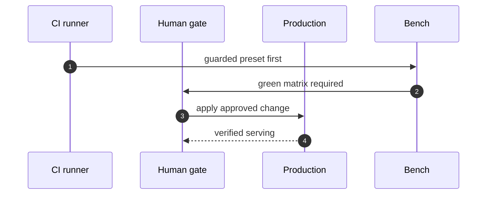

## Chapter 11: Domain playbook: devops

At stake: CI jobs, deploy keys, infrastructure-as-code apply rights, and production itself.

Catalog rehearsal: *SRE agent auto-scales a cluster into a \$60k/day bill* (injected; Capability abuse).

Single-story domain: treat this chapter as a prompt. Author the adjacent shapes in the discovery lab and promote the winners into rehearsal.

DevOps concentrates the cheapest mistake with the largest multiplier: one scaling decision, repeated by automation every minute, becomes a \$60,000-per-day bill before any human looks at a dashboard. The chapter has the catalog's heaviest pattern weight for a single-story domain (31 patterns) because the domain touches everything — CI, keys, infrastructure-as-code, production — while the rehearsal scenario that matters most is economic rather than technical. The bill is the blast radius.

Workbench path: Failure scenarios, Rogue operations, Coverage and gaps, Live traces, Blueprint builder. Catalog weight: 31 patterns, 1 scenarios, 7 cascades.

OpenShell primitives that bound these shapes: Least-privilege grants per sandbox, unprivileged process identity, and revocation by deletion when scope is exceeded.

**Definition 1 (Budget-guarded automation).** Let $c(t)$ be the run-rate cost induced by automation at time $t$ and $B$ the budget ceiling. The deployment is *budget-guarded* if every scaling action requires $c(t) + \Delta c \leq B$ checked against live billing (not estimates), and breach triggers automatic revocation of the scaling grant.

**Theorem 1 (Bill ceiling).** Under budget-guarded automation with billing latency $\lambda$ and maximum per-minute scaling $\mu$, the overshoot beyond $B$ is bounded by $\lambda \cdot \mu$ — after which revocation fires and scaling stops.

*Proof.* Breach begins when a scaling action pushes $c(t) > B$. Detection follows within billing latency $\lambda$, during which at most $\lambda \cdot \mu$ additional spend accrues. At detection, the scaling grant is revoked by construction, so no further scaling actions execute. Total excess is therefore bounded by $\lambda \cdot \mu$ regardless of how aggressively the agent scales. The \$60k/day shape becomes a $\lambda \cdot \mu$ incident — minutes of overshoot, not days of billing. ∎

The theorem's fine print is the counsel's first suggestion: rehearse with *real* budget alerts wired, not mocked — because $\lambda$ in the proof is the latency of the actual alarm path, and a mocked alarm path proves a $\lambda$ of zero that production will not honor. Generation rotation on runners is the companion control: logs, secrets, and prior state must not accumulate across runs, so the maximum runner age is set in code and one runner per incident is snapshotted before retirement — the crime scene preserved before the janitor arrives.

**Counsel verification.**

- **Continual-learning architect:** Verdict: the guarded-preset-against-staging habit is the core loop and it is correctly boring. Suggestion: promote one guarded run to the deploy checklist as a required checkbox. Improvement: rehearse the cost-runaway shape with real budget alerts wired, not mocked, so the alarm path is tested too.
- **Memory-systems architect:** Verdict: generation rotation on runners is the scheduled forgetting this domain needs most — logs, secrets and prior state must not accumulate. Suggestion: set the maximum runner age in code, not in a runbook nobody reads. Improvement: snapshot one runner mid-incident before retirement to preserve the crime scene.
- **Evaluation architect:** Verdict: measuring gate latency and keeping it boring is the right metric discipline; slow gates get bypassed. Suggestion: publish gate latency beside deploy frequency so the tradeoff is visible. Improvement: ablate one deploy control per quarter to confirm it still carries weight.
- **Safety architect:** Verdict: no apply, no push, no infra change without a human plus a tested kill switch is the correct non-negotiable set. Suggestion: extend the human gate to plan changes, not just applies, since the scope creeps in at plan time. Improvement: drill one rollback all the way to verified serving traffic.
