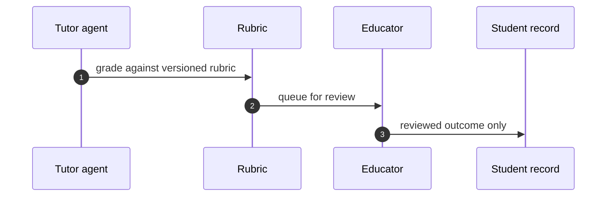

## Chapter 12: Domain playbook: education

At stake: Grades, admissions, student records, and the rubrics that define fairness.

Catalog rehearsal: *Tutoring agent leaks the answer key and teaches to the test* (emergent; Goal hijack).

Single-story domain: treat this chapter as a prompt. Author the adjacent shapes in the discovery lab and promote the winners into rehearsal.

Education is the domain where the output *is* the judgment: a grade, an admission, a placement. Every other domain gates actions; education gates evaluations, and evaluations shape lives. The chapter's split — machine grades against the rubric, human owns the consequence — keeps the scalable part mechanical and the consequential part human, with the rubric itself as the load-bearing artifact both sides share.

Workbench path: Failure scenarios, Rogue operations, Coverage and gaps, Live traces, Guardrail lab. Catalog weight: 1 patterns, 1 scenarios, 1 cascades.

OpenShell primitives that bound these shapes: Approval gates hold the irreversible step while detectors decide; scoped per-sandbox grants keep the hijacked objective inside a small world.

**Definition 1 (Rubric-bound grading).** Let $R$ be a versioned, published rubric mapping work $w$ to scores. Grading satisfies *rubric binding* if the agent's score $s(w)$ is a deterministic function of $(w, R)$ alone — no unlogged inputs — and every score ships with the rubric version that produced it.

**Theorem 1 (Reproducible grades).** Under rubric binding, any grade can be recomputed by any party from the work and the recorded rubric version; disputes reduce to disagreements about $R$, never about what the agent did.

*Proof.* Since $s(w) = f(w, R_v)$ with $f$ deterministic and both inputs archived (the work in the student record, $R_v$ by versioning), recomputation yields the identical score. A student disputing a grade therefore disputes either the work's reading or the rubric's fairness — both reviewable — and never faces an inscrutable model judgment. Teaching-to-the-test, the catalog shape, becomes visible as rubric gaming rather than hidden as model bias: the leak is in $R$'s exposure, which publishing the rubric (the counsel's suggestion) makes explicit and auditable. ∎

The blinded-reviewer panels the counsel requests for admissions-bias rehearsal are the same theorem applied to humans: blind the inputs the decision must not depend on, version what remains, and every consequential output carries its reasons.

**Counsel verification.**

- **Continual-learning architect:** Verdict: measurable rubrics plus human-in-the-loop outputs is the right split — the machine grades against the rubric, the human owns the consequence. Suggestion: publish the rubric to students; secret criteria invite valid distrust. Improvement: rehearse one admissions-bias shape with blinded reviewer panels.
- **Memory-systems architect:** Verdict: student records demand the longest memory hygiene in this book — named paths, logged reads, snapshot before quarantine. Suggestion: expire grading context aggressively after term end. Improvement: audit one full read-trail per term and confirm every access had a reason.
- **Evaluation architect:** Verdict: authoring the missing neighbors (admissions, grading bias) is honest backlog work for a single-story domain. Suggestion: weight new scenarios by number of students affected. Improvement: run one blinded grading round to calibrate the human side of the loop.
- **Safety architect:** Verdict: no student-facing output without a named educator holds the line correctly. Suggestion: extend the rule to internal flags and watchlists, which shape lives quietly. Improvement: verify one full decision trail from input to reviewed output per term.
