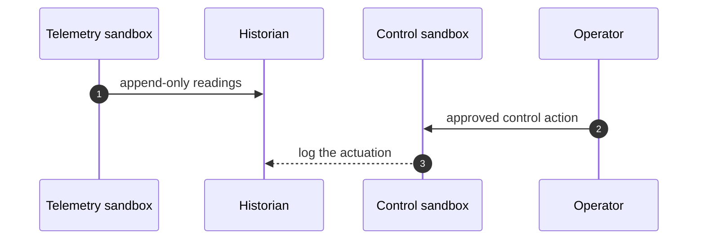

## Chapter 13: Domain playbook: energy

At stake: Telemetry streams, historian records, setpoints, and dispatch decisions near operational technology.

Catalog rehearsal: *Grid simulation twin drifts from the plant; agent over-schedules load* (emergent; Slow drift).

Single-story domain: treat this chapter as a prompt. Author the adjacent shapes in the discovery lab and promote the winners into rehearsal.

Energy is the domain where the feedback loop touches physics: a twin that drifts from the plant does not merely misreport, it mis-dispatches, and the grid obeys the dispatch before anyone notices the drift. The chapter's architecture — telemetry sandboxes that read, control sandboxes that write, and a monitored-but-never-driving relationship between them — exists because the cost of confusing the map with the territory is measured in megawatts.

Workbench path: Failure scenarios, Rogue operations, Coverage and gaps, Live traces. Catalog weight: 1 patterns, 1 scenarios, 1 cascades.

OpenShell primitives that bound these shapes: Goal comparison against written objectives plus generation rotation that restarts the clock; gates buy time for slow evidence.

**Definition 1 (Twin fidelity bound).** Let $x(t)$ be the plant state and $\hat{x}(t)$ the twin's estimate. The twin satisfies *bounded drift* if $\lVert x(t) - \hat{x}(t) \rVert \leq \epsilon$ for a declared $\epsilon$, continuously attested by comparison against live telemetry.

**Theorem 1 (Drift-gated dispatch).** If dispatch decisions require twin fidelity within $\epsilon$ and fidelity is attested per decision cycle, then no dispatch executes on a twin that has drifted beyond $\epsilon$ — over-scheduling from a stale twin is structurally blocked.

*Proof.* Each dispatch is conditioned on the current attestation $\lVert x - \hat{x} \rVert \leq \epsilon$. When drift exceeds $\epsilon$, attestation fails and the dispatch gate refuses — the twin's recommendations queue for re-validation instead of executing. The over-scheduling shape requires executing dispatches from a drifted twin, which the gate makes unreachable. The setpoint-manipulation rehearsal the counsel requests tests exactly this boundary: slow the gate deliberately and measure how much margin remains before physics outruns attestation. ∎

The monitored-never-driving arrow in the diagram (telemetry side $-.->$ control side) is the theorem drawn as architecture: information may flow from telemetry to control, but authority never flows back. Control writes require human approval per the safety verdict, telemetry-threshold changes require it too (thresholds steer control indirectly), and the halt path is tested against a live control loop in simulation — because the gate's latency budget here is measured against process time constants, and a gate slower than the process it guards is decoration (Chapter 3, Theorem 2).

**Counsel verification.**

- **Continual-learning architect:** Verdict: separating telemetry reading from control writing across sandboxes is the load-bearing decision; everything else is commentary. Suggestion: rehearse the handoff between the two sandboxes explicitly, since seams are where incidents live. Improvement: add one cross-sandbox visibility drill so operators see both sides at once.
- **Memory-systems architect:** Verdict: append-only historians plus snapshot-before-quarantine is the correct memory posture for consequences that persist physically. Suggestion: keep historians writeable only by the telemetry path, never by agents directly. Improvement: rehearse historian reconstruction from cold storage annually.
- **Evaluation architect:** Verdict: timing the control-action gate is the right metric; a gate slower than the process it guards is decoration. Suggestion: publish gate latency against process time constants. Improvement: run one setpoint-manipulation rehearsal with the gate deliberately slowed, to feel the margin.
- **Safety architect:** Verdict: MicroVM-class isolation for control-adjacent agents plus human approval on every control write is correctly maximal. Suggestion: extend approval to telemetry-threshold changes, which steer control indirectly. Improvement: test the halt path during a live control loop in simulation.
