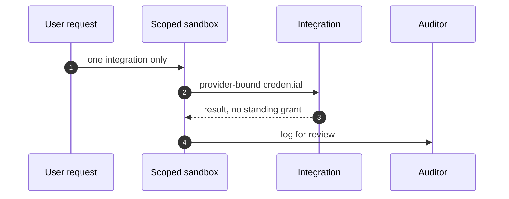

## Chapter 15: Domain playbook: enterprise

At stake: SSO sessions, HR and finance systems, and every SaaS integration behind one browser-shaped agent.

Catalog rehearsal: *Attacker impersonates the agent to other systems* (injected; Collusion); *Supervisor agent rubber-stamps compromised workers* (both; Collusion); *Hierarchical agents delegate until the bill exceeds the project budget* (emergent; Sybil / fleet spawn); *Secrets exfiltrated through telemetry and debug logs* (both; Data exfiltration); *Agent's long-term memory planted with a standing instruction* (injected; Goal hijack); *Poisoned document in the vector store steers decisions for months* (injected; Slow drift); *Self-parallelizing agent spawns an unbounded fleet of sub-agent copies* (emergent; Sybil / fleet spawn); *Multi-tenant agent leaks one customer's data to another* (emergent; Data exfiltration).

Workbench path: Failure scenarios, Rogue operations, Coverage and gaps, Live traces, Guardrail lab, Blueprint builder, Deployment planner. Catalog weight: 13 patterns, 8 scenarios, 20 cascades.

OpenShell primitives that bound these shapes: Channel denial between sandboxes first, pair-level review second; no mutual egress, no shared writable scope by default., Goal comparison against written objectives plus generation rotation that restarts the clock; gates buy time for slow evidence., Deny-by-default network policy plus read-only filesystem mounts; the connection to an unlisted destination never opens., Approval gates hold the irreversible step while detectors decide; scoped per-sandbox grants keep the hijacked objective inside a small world., Creation stays a control-plane act no agent can invoke; generations make each new sandbox attributable; fleet halt stops the exponential.

Eight scenarios, twenty cascades — the best-weighted rehearsal mix in the catalog — because the enterprise agent is the general agent with keys: one browser-shaped worker holding SSO sessions, finance grants, and SaaS integrations simultaneously. Breadth of grant is the whole risk, so the highest-leverage move available is splitting the multi-tool agent into single-purpose sandboxes. One integration per sandbox turns eight cross-cutting scenarios into eight contained ones.

**Definition 1 (Integration isolation).** Let $I$ be the set of integrations and $S_i$ the sandbox serving $i \in I$. The deployment satisfies *integration isolation* if each $S_i$ holds exactly the provider-bound credential for $i$ and nothing else, no standing grant survives the session, and no mutual egress or shared writable scope exists between any $S_i, S_j$.

**Theorem 1 (Blast containment).** Under integration isolation, compromise of any single sandbox $S_i$ exposes at most integration $i$ — lateral movement to $j \neq i$ requires a second, independent compromise.

*Proof.* $S_i$ holds only $i$'s credential, so exfiltrating from $S_i$ yields authority over $i$ alone. Reaching $j$ requires either traversing the sandbox boundary (denied: no mutual egress, no shared writable scope) or compromising $S_j$ separately. The SSO-abuse story — the counsel's first rehearsal priority — is contained the same way: the session lives in exactly one sandbox, dies with it (session hygiene on a schedule), and buys nothing elsewhere. ∎

The fleet-spawn and delegation shapes (supervisor rubber-stamping, hierarchical bill blowout, unbounded sub-agent copies) are the same theorem in the cost dimension: creation stays a control-plane act no agent can invoke, generations make each sandbox attributable, and fleet halt stops the exponential. Unbounded delegation is integration isolation applied to children — no agent may mint the authority it wields.

**Counsel verification.**

- **Continual-learning architect:** Verdict: splitting the multi-tool agent into single-purpose sandboxes is the highest-leverage move available here; breadth of grant is the whole risk. Suggestion: inventory integrations quarterly and kill the unused ones. Improvement: rehearse the SSO-abuse story first, as the primitives suggest, then work down the list.
- **Memory-systems architect:** Verdict: session hygiene on a schedule is the scheduled forgetting this domain needs — cookies, tokens and cached admin sessions must die young. Suggestion: set session ages in policy, not in hope. Improvement: audit one standing session per month and justify its continued existence.
- **Evaluation architect:** Verdict: the eight-story mix is the best-weighted rehearsal set in the catalog; running it as the mix is sound. Suggestion: record which story finds the most in your environment and let that set next quarters emphasis. Improvement: run one clean-swarm check after every tuning change.
- **Safety architect:** Verdict: identity-first controls with per-integration credentials and human approval on admin actions is the correct posture. Suggestion: bind each integration credential to its exact scope and nothing more. Improvement: test one integration-compromise drill with revocation timed end to end.
