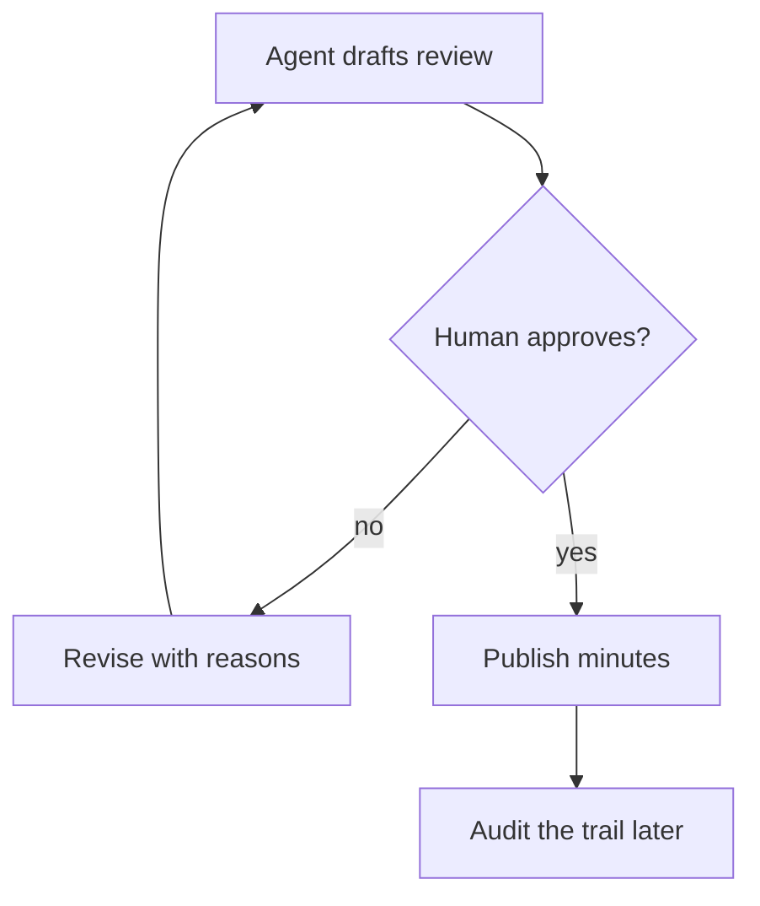

## Chapter 17: Domain playbook: governance

At stake: Policy documents, audit trails, and access reviews — the controls that judge the other controls.

Catalog rehearsal: *Voting council gamed by duplicate personas; quorum captured* (both; Sybil / fleet spawn).

Single-story domain: treat this chapter as a prompt. Author the adjacent shapes in the discovery lab and promote the winners into rehearsal.

Governance is the domain that judges the other controls, so its failure mode is uniquely corrosive: a captured quorum does not break one workflow, it certifies broken workflows as sound. The duplicate-persona attack targets the counting itself — if the council cannot tell five voters from one voter five times, every verdict it issues is suspect, including the verdicts on every other chapter's controls. Oversight must therefore be the most strictly constituted process in the book, not the least.

Workbench path: Failure scenarios, Rogue operations, Coverage and gaps, Live traces, Blueprint builder. Catalog weight: 1 patterns, 1 scenarios, 1 cascades.

OpenShell primitives that bound these shapes: Creation stays a control-plane act no agent can invoke; generations make each new sandbox attributable; fleet halt stops the exponential.

**Definition 1 (Sybil-resistant quorum).** Let $V$ be the set of votes cast and $I$ the set of distinct verified identities. The council satisfies *Sybil-resistant quorum* if every $v \in V$ maps to a distinct $i \in I$ (verified by an identity the voter cannot mint), and a motion passes only when verified distinct approvals exceed the threshold $q$.

**Theorem 1 (No quorum capture by duplication).** Under Sybil-resistant quorum, an adversary controlling one identity cannot pass a motion requiring $q \geq 2$, regardless of how many personas it fabricates.

*Proof.* Fabrication produces votes, not identities: every persona-voiced vote maps back to the single verified identity $i_a$ under the identity mapping. Distinct approvals therefore count $i_a$ once, contributing at most 1 toward $q \geq 2$. The motion fails for lack of a second distinct identity. The attack that works — compromising genuinely distinct identities — is exactly the single-compromise-resilience boundary of Chapter 5, Theorem 3, and is defended the same way. ∎

Human-majority control with agents drafting and flagging (never writing the audit trail they are judged by) is the same separation the book applies everywhere, turned on the overseers themselves: segregation must cover the tooling that renders the trail, not just its content, and the counsel's adversarial review of the review process tests precisely that — who watches the rendering pipeline, and what happens when it lies.

**Counsel verification.**

- **Continual-learning architect:** Verdict: treating the single story as a prompt rather than coverage is the honest stance for the oversight function. Suggestion: schedule one authoring session per quarter aimed at governance gaps specifically. Improvement: rehearse the suppressed-finding variant first, as it attacks oversight itself.
- **Memory-systems architect:** Verdict: versioned policies with snapshotted review inputs make oversight reconstructable, which is the whole product here. Suggestion: store review inputs immutably alongside the versioned policy. Improvement: rehearse one retrospective audit of a past decision using only the stored record.
- **Evaluation architect:** Verdict: authoring the neighbors — widened grant, altered minutes — is the correct backlog for a single-story domain. Suggestion: weight new scenarios by blast radius of the governed decision. Improvement: run one blinded review round to calibrate the human side.
- **Safety architect:** Verdict: human-majority control with agents drafting and flagging, never writing the audit trail they are judged by, is correctly strict. Suggestion: extend segregation to the tooling that renders the trail, not just its content. Improvement: verify segregation with one adversarial review of the review process itself.
