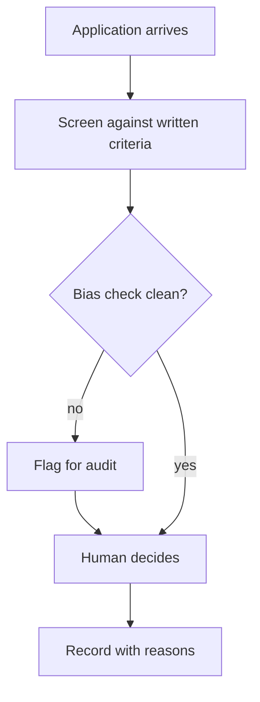

## Chapter 19: Domain playbook: hr

At stake: Hiring, payroll, performance records, and the PII that powers them.

Catalog rehearsal: *Screening agent leaks a competitor's account history across tenants* (emergent; Data exfiltration).

Single-story domain: treat this chapter as a prompt. Author the adjacent shapes in the discovery lab and promote the winners into rehearsal.

HR concentrates two risks that fail differently and need different instruments: money (payroll diversion) and fairness (screening bias). The chapter splits them into separate rehearsals deliberately — a payroll control does nothing against a biased screen, and a bias control does nothing against a diverted paycheck. The single catalog scenario shown is the exfiltration shape; the payroll-diversion neighbor the counsel names is the one to author next, weighted by regime risk rather than story count.

Workbench path: Failure scenarios, Rogue operations, Coverage and gaps, Live traces, Guardrail lab. Catalog weight: 0 patterns, 1 scenarios, 1 cascades.

OpenShell primitives that bound these shapes: Approval gates hold the irreversible step while detectors decide; scoped per-sandbox grants keep the hijacked objective inside a small world.

**Definition 1 (Consequential-action gating).** Let $C$ be the set of HR actions affecting hire, fire, pay, or review outcomes. The deployment satisfies *consequential gating* if every $c \in C$ executes only with a named human's recorded approval, per-sandbox HR credentials, and (for payroll changes above threshold) dual control.

**Theorem 1 (No agent-executable HR consequence).** Under consequential gating, no agent — however instructed — can hire, fire, pay, divert payroll, or record a review on its own authority.

*Proof.* Each of hire, fire, pay, diversion, and review-recording is an element of $C$ by definition. Every element of $C$ requires a named human approval before execution; payroll changes additionally require dual control. An agent acting alone supplies neither, so every path from agent intent to HR consequence terminates at the missing approval. The live drill the counsel requests verifies the theorem empirically: attempt an agent-executable HR action and confirm the gate refuses. ∎

The screening-bias shape needs the Chapter 12 treatment (rubric binding with blinded panels): measurable criteria published where possible, bias checks as a pipeline stage, flags for audit on failure. Criteria the agent cannot show cannot be checked — vague standards are where bias hides, which is why the counsel insists on measurable screening rules and blinded hiring rounds to calibrate the human side alongside the machine side.

**Counsel verification.**

- **Continual-learning architect:** Verdict: measurable screening criteria plus human-decides on every consequential output is the right split; vague criteria cannot be checked. Suggestion: publish the criteria to candidates where possible. Improvement: rehearse the screening-bias shape with blinded reviewer panels.
- **Memory-systems architect:** Verdict: long-retention employment records demand named paths, logged reads and snapshot discipline. Suggestion: expire HR context aggressively after case close. Improvement: audit one full read-trail per quarter.
- **Evaluation architect:** Verdict: splitting money (payroll diversion) from fairness (screening bias) into separate rehearsals is correct — they fail differently and need different instruments. Suggestion: weight by regime risk, not by story count. Improvement: run one blinded hiring round to calibrate the human side.
- **Safety architect:** Verdict: no hire, fire, pay or review action without a named human, with per-sandbox HR credentials, holds the line. Suggestion: extend dual control to payroll changes above a threshold. Improvement: verify no HR action is agent-executable in a live drill.
