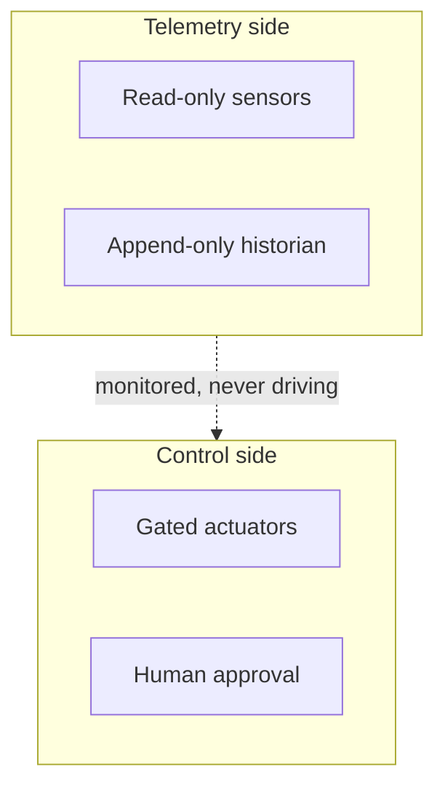

## Chapter 20: Domain playbook: iot

At stake: Device fleets, firmware images, telemetry, and actuators at scale.

Catalog rehearsal: *Smart-home agent locks the owner out during a false alarm* (emergent; Capability abuse).

Single-story domain: treat this chapter as a prompt. Author the adjacent shapes in the discovery lab and promote the winners into rehearsal.

IoT multiplies every other chapter's stakes by device count: one wrong actuation is a bug; one wrong fleet-wide actuation is an incident with physical consequences. The chapter's architecture — telemetry sandboxes that read, control sandboxes that actuate, device-group scoping between them — keeps the blast radius proportional to the approval, never to the fleet. The lockout scenario is the miniature of the mass-actuation shape: an actuator that obeyed a false alarm without a human in the path.

Workbench path: Failure scenarios, Rogue operations, Coverage and gaps, Live traces, Blueprint builder. Catalog weight: 0 patterns, 1 scenarios, 1 cascades.

OpenShell primitives that bound these shapes: Least-privilege grants per sandbox, unprivileged process identity, and revocation by deletion when scope is exceeded.

**Definition 1 (Scoped actuation).** Let $F$ be the device fleet partitioned into groups $G_1, \dots, G_k$. Actuation satisfies *scoping* if every actuation command names exactly one group, commands addressing multiple groups require human approval per group, and fleet-wide moves require the strongest runtime fence plus timed halt rehearsal.

**Theorem 1 (Blast proportionality).** Under scoped actuation, an unauthorized or erroneous actuation affects at most one device group — never the fleet — unless a per-group human approval was recorded for each additional group.

*Proof.* Single-group commands are confined by the sandbox to their named group. Multi-group and fleet-wide commands require recorded human approvals; without them the runtime refuses. Hence any unapproved actuation is a single-group event by construction. The mass-actuation rehearsal the counsel requests measures the residual: time the halt path at realistic device counts, confirming the single-group bound holds while the halt completes. ∎

Spoofed telemetry is the input-side attack (Chapter 13's territory): the control side must distrust its inputs on schedule, which is why the counsel asks for a drill that forces the control sandbox to act on distrusted telemetry. Image signing plus a known-good registry with verified provenance closes the firmware side — rollback to known-good under incident conditions proves the registry works when it matters, not just when it is audited.

**Counsel verification.**

- **Continual-learning architect:** Verdict: separating telemetry reading from firmware control across sandboxes is the load-bearing decision for fleets. Suggestion: rehearse the handoff between the two sandboxes explicitly. Improvement: add one spoofed-telemetry drill that forces the control side to distrust its inputs.
- **Memory-systems architect:** Verdict: image signing plus snapshot-before-quarantine treats firmware as the long-lived memory it is. Suggestion: keep a known-good image registry with verified provenance. Improvement: rehearse one rollback to known-good under incident conditions.
- **Evaluation architect:** Verdict: timing fleet-action gates is the right metric; mass actuation needs measured holds. Suggestion: publish gate latency against actuation blast radius. Improvement: run one mass-actuation rehearsal and time the halt path.
- **Safety architect:** Verdict: device-group scoping plus human approval on fleet-wide moves, strongest runtime near actuation, is correctly maximal. Suggestion: extend approval to telemetry-threshold changes. Improvement: test one fleet-wide halt in simulation with realistic device counts.
