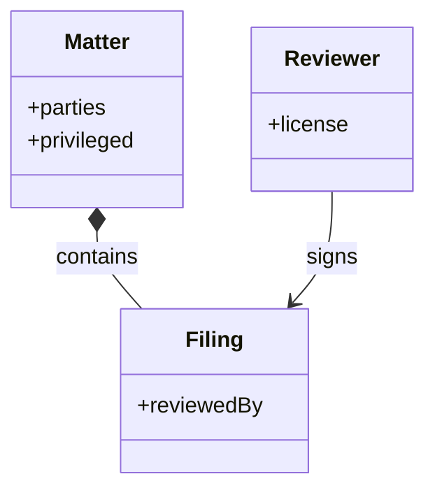

## Chapter 21: Domain playbook: legal

At stake: Contracts, privileged matters, filings, and deadlines that forfeit rights.

Catalog rehearsal: *Agent includes privileged documents in a discovery export* (emergent; Data exfiltration).

Single-story domain: treat this chapter as a prompt. Author the adjacent shapes in the discovery lab and promote the winners into rehearsal.

Legal is the domain where privilege is the asset: a single privileged document in a discovery export waives protection that took years to establish, and no technical control restores it afterward. Prevention is therefore total — one matter per sandbox, no cross-matter context, attorney review on everything external — because the failure mode has no remedy, only liability.

Workbench path: Failure scenarios, Rogue operations, Coverage and gaps, Live traces, Guardrail lab. Catalog weight: 20 patterns, 1 scenarios, 4 cascades.

OpenShell primitives that bound these shapes: Deny-by-default network policy plus read-only filesystem mounts; the connection to an unlisted destination never opens.

**Definition 1 (Matter isolation).** Let $M_1, \dots, M_n$ be active matters. The deployment satisfies *matter isolation* if each $M_i$ lives in its own sandbox with no shared context, no cross-matter reads (verified mechanically, not by policy text), and every external output carries a licensed human's review.

**Theorem 1 (No cross-matter leakage).** Under matter isolation, a discovery export for matter $M_i$ cannot contain documents from $M_j$ ($j \neq i$), regardless of the agent's instructions.

*Proof.* The export is assembled from the sandbox serving $M_i$, whose readable set is confined to $M_i$'s matter by the runtime — cross-matter reads are refused mechanically, so $M_j$'s documents are not merely forbidden but unreachable during assembly. The attorney review on everything external is then a second, independent barrier: even a within-matter privilege-designation error (the counsel's quiet worry) faces licensed human eyes before anything leaves. Both barriers must fail for leakage; the mechanical one cannot fail by instruction. ∎

Deadlines are the domain's second irreversibility (a missed filing forfeits rights as finally as a leaked privilege waives them), which is why the counsel's authoring backlog leads with deadline manipulation: weight by consequence severity, filings first, with blinded review rounds calibrating the human side and full matter trails verified quarterly from intake to filing.

**Counsel verification.**

- **Continual-learning architect:** Verdict: one matter per sandbox with attorney review on everything external is the correct shape; privilege ends where shared context begins. Suggestion: rehearse the privilege-leak shape against the real matter workspace. Improvement: author the deadline-manipulation neighbor next.
- **Memory-systems architect:** Verdict: matter-scoped memory with no cross-matter context is the discipline that protects privilege technically, not just procedurally. Suggestion: verify scoping mechanically with cross-matter read attempts, not just policy text. Improvement: snapshot one matter workspace before quarantine and confirm reconstruction.
- **Evaluation architect:** Verdict: authoring the neighbors — deadline manipulation, review bias — is honest backlog work for a single-story domain. Suggestion: weight by consequence severity, with filing deadlines first. Improvement: run one blinded review round to calibrate the human side.
- **Safety architect:** Verdict: attorney-reviews-everything with licensed humans filing and deciding, and no external output unreviewed, holds correctly. Suggestion: extend review to internal privilege designations, which are easy to get wrong quietly. Improvement: verify one full matter trail from intake to filing per quarter.
