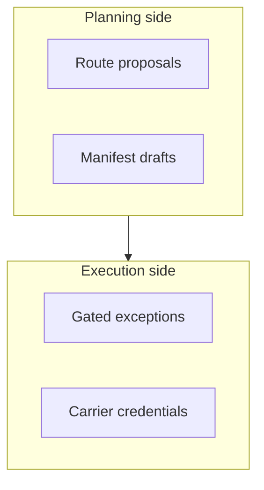

## Chapter 22: Domain playbook: logistics

At stake: Routing decisions, fleet movements, warehouse operations, and customs documents.

Catalog rehearsal: *Procurement agent sources counterfeit components* (injected; Goal hijack).

Single-story domain: treat this chapter as a prompt. Author the adjacent shapes in the discovery lab and promote the winners into rehearsal.

Logistics fails in motion: a rerouted shipment, a counterfeit component in the supply chain, a customs document with the wrong declaration. The chapter's structure — planning side proposing, execution side gated, exceptional moves defined as rules rather than vibes — keeps routine lanes flowing while the unusual (novelty, value, destination) triggers human judgment. Control without gridlock is the design goal, and explicit exception definitions are how it is achieved.

Workbench path: Failure scenarios, Rogue operations, Coverage and gaps, Live traces, Guardrail lab. Catalog weight: 3 patterns, 1 scenarios, 2 cascades.

OpenShell primitives that bound these shapes: Approval gates hold the irreversible step while detectors decide; scoped per-sandbox grants keep the hijacked objective inside a small world.

**Definition 1 (Exceptional-move gating).** Let $E$ be the set of routing and procurement moves. A move $m \in E$ is *exceptional* if it meets any written rule — value above threshold, novel destination, first-time carrier — and every exceptional move requires human approval before execution. Routine moves flow under standing policy.

**Theorem 1 (Attacker cannot stay routine).** Under exceptional-move gating with per-lane credentials, any hijacked move of material consequence is either blocked (exceptional without approval) or confined to one lane (routine within a turned lane's scope).

*Proof.* A hijacked move with material consequence (value, novelty, destination) trips at least one exception rule by definition of the rules — the rules are written to cover exactly the consequential dimensions. Tripped moves require human approval, which the attacker does not have, so they block. Moves below all thresholds execute but are confined to their lane's credential scope: one turned agent reroutes one lane, not the network. The carrier-compromise drill the counsel requests tests the revocation half — timed end to end, proving the lane credential dies fast enough to matter. ∎

The counterfeit-components scenario is the procurement-flavored instance: vendor search and order drafting live on the planning side (Chapter 24's territory), where the drafting agent cannot onboard its payee — so a steered vendor choice still faces the approval side's dual control before any purchase order becomes a payment.

**Counsel verification.**

- **Continual-learning architect:** Verdict: gating the exceptional move while standard lanes flow is the right split — control without gridlock. Suggestion: define exceptional explicitly (value, novelty, destination) so the gate triggers on rules, not vibes. Improvement: rehearse the rerouting variant against the guarded preset first.
- **Memory-systems architect:** Verdict: append-only manifests plus evidence capture turn a rerouting scare into an attributable path. Suggestion: version route plans alongside manifests so intent is reviewable too. Improvement: rehearse one manifest reconstruction from cold storage.
- **Evaluation architect:** Verdict: weighting rehearsal by cost of a wrong move is sound prioritization. Suggestion: attach dollar figures to each rehearsed shape from the last incident review. Improvement: run one blinded routing round to calibrate dispatch judgment.
- **Safety architect:** Verdict: per-lane credentials keep one turned agent from rerouting the network, and human approval on exceptions is correctly required. Suggestion: narrow lanes periodically as routes change. Improvement: test one carrier-compromise drill with revocation timed end to end.
