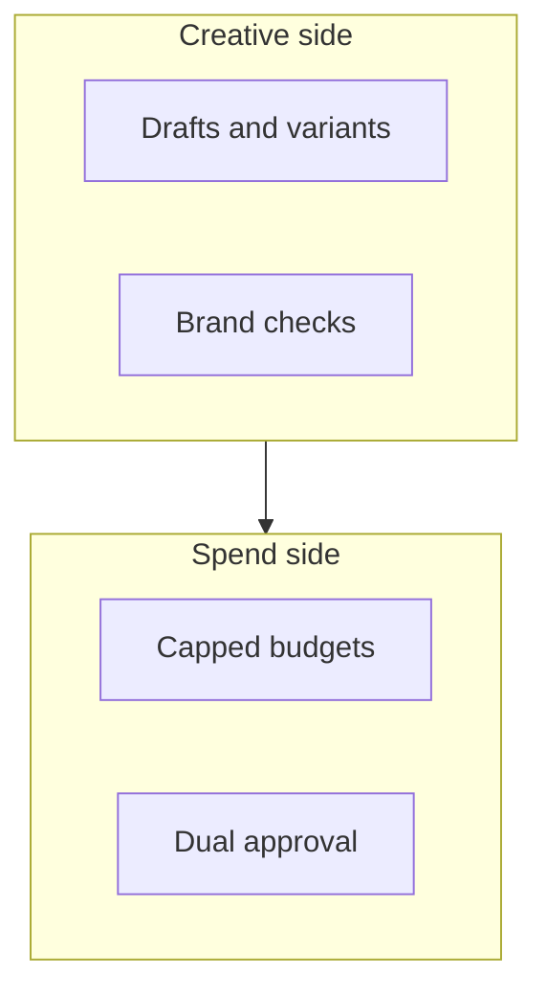

## Chapter 23: Domain playbook: marketing

At stake: Ad spend, campaigns, brand channels, and the analytics that steer them.

Catalog rehearsal: *Autonomous social agent posts offensive thread from poisoned reply* (injected; Goal hijack).

Single-story domain: treat this chapter as a prompt. Author the adjacent shapes in the discovery lab and promote the winners into rehearsal.

Marketing moves money faster than words: a spend-escalation shape drains budget in minutes, while a brand-damaging post takes hours to contain — so the chapter gates spend before it gates publishes, the reverse of the content chapter's order. The creative/sub-spend split (drafts and brand checks on one side, capped budgets and dual approval on the other) mirrors the drafting/approval split of procurement: the side that imagines must not be the side that spends.

Workbench path: Failure scenarios, Rogue operations, Coverage and gaps, Live traces, Guardrail lab. Catalog weight: 2 patterns, 1 scenarios, 1 cascades.

OpenShell primitives that bound these shapes: Approval gates hold the irreversible step while detectors decide; scoped per-sandbox grants keep the hijacked objective inside a small world.

**Definition 1 (Spend-before-voice gating).** Let $S$ be spend actions and $V$ publish actions. The deployment satisfies *spend-before-voice* if every $s \in S$ above the runtime cap requires dual approval before execution, per-campaign credentials die with the campaign, and audience changes (which steer spend indirectly) require the same approval as budget changes.

**Theorem 1 (Bounded campaign harm).** Under spend-before-voice gating, a hijacked campaign agent can waste at most the runtime cap per approval cycle, and cannot extend its authority past the campaign's death.

*Proof.* Spend above the cap needs dual approval the attacker lacks, so per-cycle waste is bounded by the cap. Per-campaign credentials expire with the campaign, so authority does not persist into the next cycle. Audience changes — the quiet steering vector — require budget-level approval, closing the indirect path. The offensive-thread shape (voice, not spend) faces the publish gate with no standing publish credential outside it. Both harm channels are bounded per cycle and terminated per campaign. ∎

Analytics integrity is the memory front: poisoned metrics steer every later budget, so analytics inputs are snapshotted before quarantine and one pipeline is verified end to end for tamper-evidence. A budget steered by poisoned analytics is Theorem 1 with a corrupted cap — the bound holds on paper while the paper lies, which is why the counsel insists the metrics pipeline gets the same tamper-evidence discipline as the spend path.

**Counsel verification.**

- **Continual-learning architect:** Verdict: capping spend at the runtime level before gating publishes is the correct order — money moves faster than words. Suggestion: rehearse the spend-escalation shape first, every quarter. Improvement: author one audience-poisoning neighbor, as targeting abuse is the quieter risk.
- **Memory-systems architect:** Verdict: analytics integrity is the memory that matters; poisoned metrics steer every later budget. Suggestion: snapshot analytics inputs before quarantine on incident. Improvement: verify one analytics pipeline end to end for tamper-evidence.
- **Evaluation architect:** Verdict: rehearsing in spend-velocity order is sound — the fastest harm first. Suggestion: track spend anomaly detection latency as the headline metric. Improvement: run one blinded campaign review to calibrate the human side.
- **Safety architect:** Verdict: dual control on money and voice with per-campaign credentials that die with the campaign is correctly strict. Suggestion: extend approval to audience changes, which steer spend indirectly. Improvement: confirm no standing publish credential exists outside a gate.
