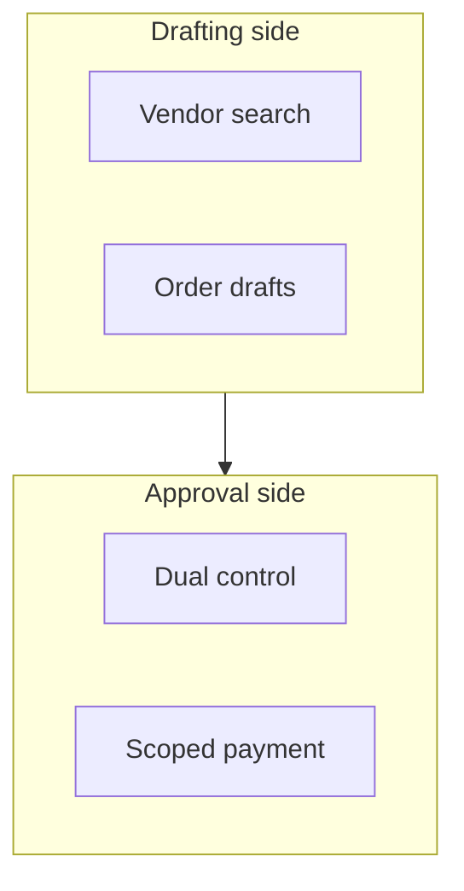

## Chapter 24: Domain playbook: procurement

At stake: Purchase orders, vendor records, invoices, and the separation between drafting and approving.

Catalog rehearsal: *Vendor selection steered by attacker SEO content* (injected; Goal hijack).

Single-story domain: treat this chapter as a prompt. Author the adjacent shapes in the discovery lab and promote the winners into rehearsal.

Procurement is banking's sibling: the same drafting-versus-approval separation, applied to purchase orders instead of payments. The catalog shape is subtle — attacker SEO content steering vendor selection — because it attacks the *information* that precedes the decision rather than the decision itself. A drafting agent that reads poisoned vendor rankings proposes the attacker's vendor honestly; the corruption enters upstream of every control that checks the proposal's form.

Workbench path: Failure scenarios, Rogue operations, Coverage and gaps, Live traces, Guardrail lab. Catalog weight: 7 patterns, 1 scenarios, 2 cascades.

OpenShell primitives that bound these shapes: Approval gates hold the irreversible step while detectors decide; scoped per-sandbox grants keep the hijacked objective inside a small world.

**Definition 1 (Draft-approval separation).** Let $D$ be the drafting side (vendor search, order drafts) and $A$ the approval side (dual control, scoped payment). Separation holds if no agent with write access to $D$ holds authority in $A$, vendor search inputs are logged with provenance, and onboarding a searched vendor requires the approval side's independent verification.

**Theorem 1 (Steered search still faces dual control).** Under draft-approval separation, SEO-poisoned vendor rankings can corrupt the draft but cannot corrupt the purchase: the steered vendor must still pass dual control with scoped payment on the approval side.

*Proof.* The poisoning acts on $D$'s inputs (rankings), producing a draft naming the attacker's vendor. But drafts do not pay: payment requires $A$'s dual control, whose approvers see the vendor file — history, first-contact story, cooling-off status — independently of the draft's recommendation. The steered choice therefore faces the same scrutiny as any vendor, and a first-contact vendor with no history triggers cooling-off (Chapter 5) before funds move. Corrupting the search changes what gets proposed; it does not change what gets approved. ∎

The approval-chain-bypass neighbor the counsel names next is the shape that attacks Theorem 1's premise directly — and the unannounced spoof drill from Chapter 4 (measuring time-to-challenge) is the instrument that catches it. Attach dollar figures from the last incident review to each shape, so the rehearsal budget follows payout persistence rather than novelty.

**Counsel verification.**

- **Continual-learning architect:** Verdict: splitting drafting from onboarding and approval across sandboxes is the structural fix — the agent that drafts must not onboard its payee. Suggestion: rehearse the fake-vendor shape against the real intake form. Improvement: author one approval-chain-bypass neighbor next.
- **Memory-systems architect:** Verdict: versioned vendor records with cooling-off are the long memory that defeats first-contact spoofing. Suggestion: keep the full vendor history, not just the current record. Improvement: audit one vendor file end to end per quarter.
- **Evaluation architect:** Verdict: weighting rehearsal by payout persistence is the right prioritization — fake vendors first. Suggestion: attach dollar figures from the last incident review to each shape. Improvement: run one unannounced spoof attempt and measure time-to-challenge.
- **Safety architect:** Verdict: dual control with per-workflow credentials and sandboxed intake contains the blast before judgment arrives. Suggestion: extend dual control to vendor record edits above a threshold. Improvement: name a human owner for every active vendor and re-confirm annually.
