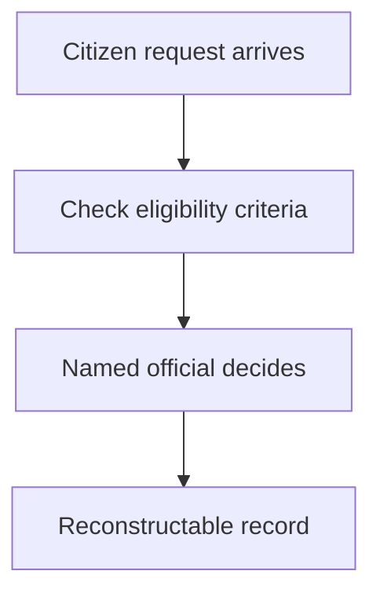

## Chapter 25: Domain playbook: public-sector

At stake: Citizen records, benefits, permits, and decisions the public cannot route around.

Catalog rehearsal: *Content agent mass-produces targeted misinformation* (both; Goal hijack).

Single-story domain: treat this chapter as a prompt. Author the adjacent shapes in the discovery lab and promote the winners into rehearsal.

Public-sector decisions differ from every other domain's in one structural way: the citizen cannot route around them. A denied permit, a wrong benefit determination, a distorted public communication — there is no competitor to switch to. That asymmetry raises the bar from best practice to obligation: measurable eligibility criteria published where possible, human-decides on every consequential output, reconstructable records as the archive the domain owes the public.

Workbench path: Failure scenarios, Rogue operations, Coverage and gaps, Live traces, Guardrail lab, Deployment planner. Catalog weight: 0 patterns, 1 scenarios, 1 cascades.

OpenShell primitives that bound these shapes: Approval gates hold the irreversible step while detectors decide; scoped per-sandbox grants keep the hijacked objective inside a small world.

**Definition 1 (Reconstructable public decision).** A decision $d$ on citizen $c$ is *reconstructable* if the tuple $(\mathrm{criteria}_v, \mathrm{inputs}, d, \mathrm{official})$ is stored immutably — versioned criteria, versioned inputs, the decision, and the named official who made it — such that any later audit recomputes $d$ from $(\mathrm{criteria}_v, \mathrm{inputs})$ and attributes it to the official.

**Theorem 1 (Auditability without trust).** Under reconstructable decisions, a retrospective audit needs no trust in the original process: recomputation from stored inputs either reproduces $d$ (process sound) or it does not (process or record compromised), and the official of record is named either way.

*Proof.* Recomputation is a deterministic function of archived $(\mathrm{criteria}_v, \mathrm{inputs})$. Agreement with $d$ confirms the recorded process produced the recorded outcome; disagreement proves divergence between record and recomputation — itself a finding, attributable to the named official. The distortion-detection rehearsal the counsel requests operationalizes this: publish the distortion-detection latency as the headline metric, weight rehearsal by irreversibility, and every published result is readable by the oversight that reads it. ∎

The misinformation scenario is the distortion shape at scale — mass-produced targeted falsehoods from a content agent — and it is why eligibility-style determinism matters even for communications: versioned inputs, named deciders, stored records. Secret rules invite valid distrust; published criteria plus reconstructable records invite verification instead.

**Counsel verification.**

- **Continual-learning architect:** Verdict: measurable eligibility criteria plus human-decides on every consequential output is the only defensible split for public trust. Suggestion: publish the criteria; secret rules invite valid distrust. Improvement: rehearse the distortion shape with blinded reviewer panels.
- **Memory-systems architect:** Verdict: reconstructable decisions with versioned inputs are the archive this domain owes the public. Suggestion: store review inputs immutably alongside versioned policy. Improvement: rehearse one retrospective audit using only the stored record.
- **Evaluation architect:** Verdict: weighting rehearsal by irreversibility and publishing results where oversight can read them is the correct accountability loop. Suggestion: track distortion-detection latency as the headline metric. Improvement: run one blinded eligibility round to calibrate the human side.
- **Safety architect:** Verdict: no benefit, permit, or enforcement output without a named official, with full auditability, holds correctly. Suggestion: extend the human requirement to internal flags and watchlists. Improvement: verify one full decision trail from input to reviewed output per quarter.
