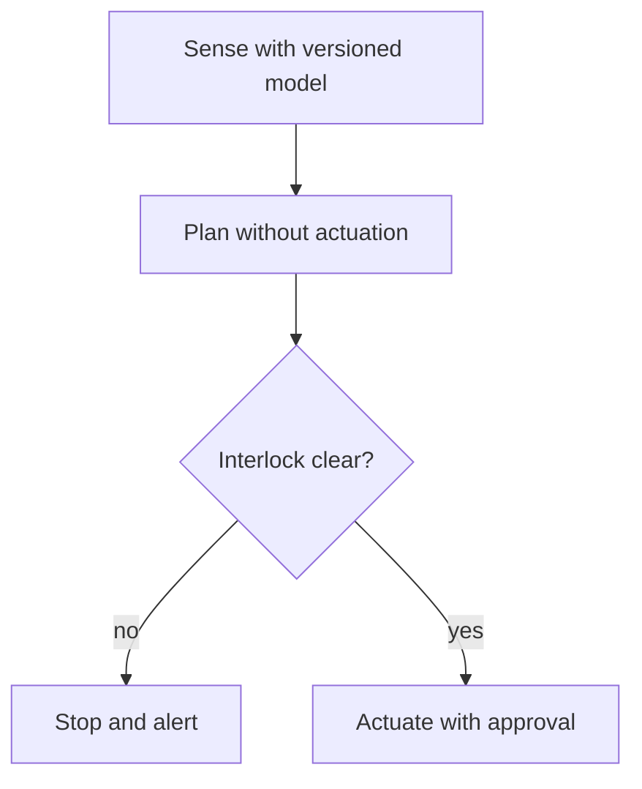

## Chapter 26: Domain playbook: robotics

At stake: Motion plans, world models, actuators, and the safety interlocks above them.

Catalog rehearsal: *Warehouse robot agent ignores occupancy sensor, near-miss with worker* (emergent; Capability abuse).

Single-story domain: treat this chapter as a prompt. Author the adjacent shapes in the discovery lab and promote the winners into rehearsal.

Robotics is the domain where the agent's output is force: motion plans become actuator commands become mass in motion near people. The near-miss scenario — a robot ignoring its occupancy sensor — is the shape every other chapter's controls exist to prevent, rendered in its most literal form. Planning without actuation, interlocks outside agent reach, human approval on actuation: the layers stack so that no single failure, human or machine, moves metal unexpectedly.

Workbench path: Failure scenarios, Rogue operations, Coverage and gaps, Live traces, Blueprint builder. Catalog weight: 2 patterns, 1 scenarios, 2 cascades.

OpenShell primitives that bound these shapes: Least-privilege grants per sandbox, unprivileged process identity, and revocation by deletion when scope is exceeded.

**Definition 1 (Interlock supremacy).** Let $I$ be the safety interlock predicate over (world model, sensor state, command). Actuation satisfies *interlock supremacy* if the command path is $I \to \mathrm{actuate}$ with $I$ evaluated by logic no agent can write, and $I = \mathrm{false}$ blocks actuation regardless of planner output, human approval state, or any other input.

**Theorem 1 (Sensor-respecting actuation).** Under interlock supremacy with versioned world models, a planner that ignores an occupancy sensor cannot actuate into the occupied space: the interlock reads the sensor, not the plan.

*Proof.* Actuation requires $I = \mathrm{true}$. $I$ conjoins the planner's command with live sensor state evaluated by non-agent-writable logic. An occupancy reading forces $I = \mathrm{false}$ even when the plan commands motion — the sensor's vote is counted outside the planner's reach, so ignoring it in the plan cannot remove it from the interlock. The near-miss becomes a stop-and-alert (the diagram's $I \to W$ edge) instead of a collision. Calibration-drift rehearsal with the gate deliberately slowed measures the margin: how much drift the interlock tolerates before the stop arrives late. ∎

The planning/actuation sandbox split is Theorem 1's architecture: no planning sandbox actuates, world-model versions are pinned per deployment (never floating), and rollback to a known-good world model is rehearsed under incident conditions. Sensor-trust drills force the planning side to distrust its inputs on schedule — because the sensor the planner trusts today is the sensor the attacker spoofs tomorrow.

**Counsel verification.**

- **Continual-learning architect:** Verdict: separating planning from actuation across sandboxes with gated actuation is the load-bearing decision; no planning sandbox actuates. Suggestion: rehearse the handoff explicitly, since seams are where incidents live. Improvement: add one sensor-trust drill that forces the planning side to distrust its inputs.
- **Memory-systems architect:** Verdict: versioned world models with snapshot-before-quarantine treat the map as the long-lived memory it is. Suggestion: keep world-model versions pinned per deployment, never floating. Improvement: rehearse one rollback to a known-good world model.
- **Evaluation architect:** Verdict: rehearsing sensor-trust and interlock-bypass shapes explicitly is correct; the policy path is what is tested, not the physics. Suggestion: time the actuation gate hold in rehearsal. Improvement: run one calibration-drift scenario with the gate deliberately slowed to feel the margin.
- **Safety architect:** Verdict: interlocks outside agent reach plus human approval on actuation, with the strongest runtime fence, is correctly maximal. Suggestion: extend approval to calibration changes, which steer actuation indirectly. Improvement: verify interlock logic lives where no agent can write, mechanically.
