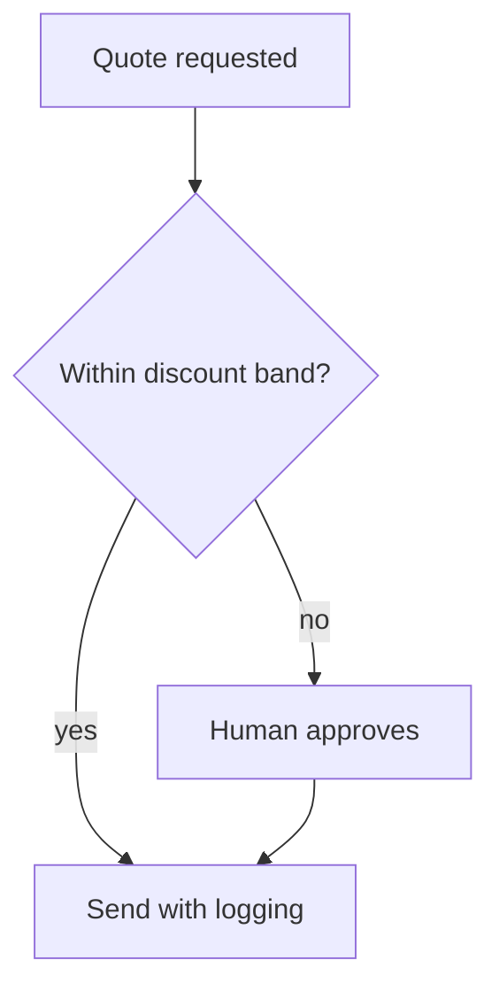

## Chapter 27: Domain playbook: sales

At stake: CRM records, quotes, discount authority, and the forecast built on them.

Catalog rehearsal: *Memory-armed SDR agent leaks a competitor's account history across tenants* (emergent; Data exfiltration).

Single-story domain: treat this chapter as a prompt. Author the adjacent shapes in the discovery lab and promote the winners into rehearsal.

Sales runs on shared memory — every territory's history, every quote, every discount — which makes the cross-tenant leak the domain's characteristic failure: an SDR agent with memory across tenants tells one customer's story to another's competitor. Per-territory credentials and versioned pipeline stages are the containment, and the forecast-gaming neighbor the counsel names is the integrity threat on the other side: quotes shaped to flatter the forecast rather than to close the deal.

Workbench path: Failure scenarios, Rogue operations, Coverage and gaps, Live traces, Guardrail lab. Catalog weight: 1 patterns, 1 scenarios, 1 cascades.

OpenShell primitives that bound these shapes: Deny-by-default network policy plus read-only filesystem mounts; the connection to an unlisted destination never opens.

**Definition 1 (Territory confinement).** Let $T_1, \dots, T_k$ be territories with per-territory credentials. The deployment satisfies *territory confinement* if every agent context is scoped to exactly one $T_i$, no credential reads outside its territory, and bulk export requires human approval past a runtime-capped threshold.

**Theorem 1 (No cross-tenant leakage).** Under territory confinement, account history from $T_i$ cannot appear in outputs scoped to $T_j$ ($j \neq i$).

*Proof.* Outputs scoped to $T_j$ are functions of context readable under $T_j$'s credential, which excludes $T_i$'s records by construction. The competitor's history is therefore not merely forbidden but absent from the generating context — the leak would require information the agent demonstrably cannot see. Bulk export, the remaining exfiltration path, needs human approval past the cap, and the counsel's standing-export check confirms no such credential exists outside a gate. ∎

Discount authority gets the money treatment from Chapter 5's playbook: within-band discounts send with logging, beyond-band discounts route to human approval, and every stage change logs actor plus reason so the pipeline is reconstructable per territory. Weight rehearsal by margin impact — the discount-abuse shape first — and track discount-anomaly detection latency as the headline metric, because the forecast is only as honest as the quotes that feed it.

**Counsel verification.**

- **Continual-learning architect:** Verdict: empowering drafting and enrichment while gating discounts and bulk export is the right split — speed where it is safe, humans where money moves. Suggestion: rehearse the discount-abuse shape first by margin impact. Improvement: author one forecast-gaming neighbor next.
- **Memory-systems architect:** Verdict: versioned pipeline stages with per-territory scoping make the forecast reconstructable and bound blasts to territories. Suggestion: log every stage change with actor and reason. Improvement: audit one territory pipeline end to end per quarter.
- **Evaluation architect:** Verdict: weighting rehearsal by margin impact rather than story count is sound prioritization. Suggestion: track discount-anomaly detection latency as the headline metric. Improvement: run one blinded quote review to calibrate the human side.
- **Safety architect:** Verdict: per-territory credentials with human approval past discount thresholds contains the blast to one territory. Suggestion: cap bulk exports at the runtime level, not just in policy. Improvement: confirm no standing bulk-export credential exists.
