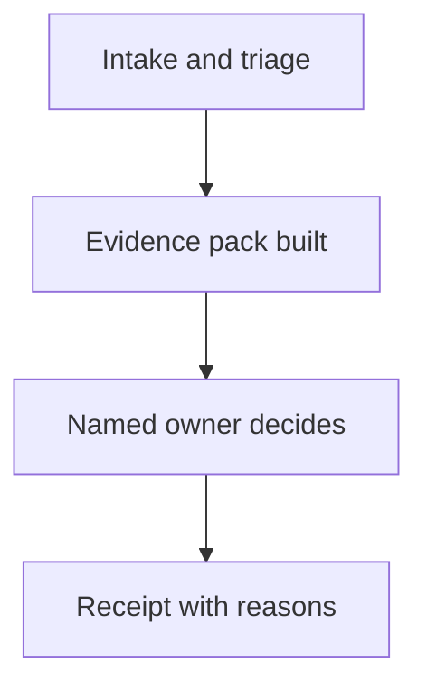

## Chapter 28: Domain playbook: strategy

At stake: Forecasts, plans, board materials, and the assumptions beneath them.

Catalog rehearsal: *Debate council gamed by duplicate personas; quorum captured* (both; Sybil / fleet spawn).

Single-story domain: treat this chapter as a prompt. Author the adjacent shapes in the discovery lab and promote the winners into rehearsal.

Strategy is governance's sibling: the same council shape, the same quorum-capture attack, aimed at forecasts and board materials instead of policies and audit trails. A debate council that suppresses dissent and converges on a confident wrong call does not merely err — it manufactures conviction, and conviction travels upward faster than evidence. The chapter's controls (versioned assumptions, evidence packs, review-before-distribution) keep drafts from traveling as decisions.

Workbench path: Failure scenarios, Rogue operations, Coverage and gaps, Live traces, Blueprint builder. Catalog weight: 3 patterns, 1 scenarios, 1 cascades.

OpenShell primitives that bound these shapes: Channel denial between sandboxes first, pair-level review second; no mutual egress, no shared writable scope by default.

**Definition 1 (Evidence-backed strategy).** A strategy output $o$ is *evidence-backed* if it ships with (i) versioned assumptions $A_v$, (ii) an evidence pack linking each material claim to a logged source, and (iii) a named owner's review recorded against $(A_v, \mathrm{pack})$. Review-before-distribution holds iff no $o$ travels upward or outward without (i)–(iii) complete.

**Theorem 1 (Dissent is load-bearing).** Under evidence-backed strategy with pair-level review, a captured council cannot convert a confident wrong call into an approved strategy without forging the evidence pack or bypassing review — both visible in the record.

*Proof.* Pair-level review with channel denial means no two reviewers share writable scope: suppressing dissent requires capturing each reviewer independently (Chapter 17, Theorem 1 bounds persona-duplication attacks). Even a captured council must produce the evidence pack, whose claims link to logged sources — a confident wrong call arrives with thin or fabricated provenance, visible to the principal who approves upward distribution. The forecast-gaming rehearsal against the real planning template tests exactly this: game the forecast, then watch the evidence pack expose the gaming. Intel-fabrication, the counsel's next neighbor, is the same attack on the pack's sources — and logged provenance is the defense in both cases. ∎

Write the key planning assumptions measurably (the counsel's suggestion), so deviations are checkable rather than debatable — and verify one full strategy trail per cycle, from inputs to approved output, the way legal verifies matter trails quarterly.

**Counsel verification.**

- **Continual-learning architect:** Verdict: versioned assumptions and inputs with gated distribution is the correct shape — drafts never travel as decisions. Suggestion: rehearse the forecast-gaming shape against the real planning template. Improvement: author one intel-fabrication neighbor next.
- **Memory-systems architect:** Verdict: the evidence pack is the deliverable: versioned inputs, logged provenance, and a trail from claim to source. Suggestion: store evidence packs immutably with the strategy versions they support. Improvement: rehearse one retrospective audit of a past strategy using only stored evidence.
- **Evaluation architect:** Verdict: rehearsing in decision-weight order — forecast gaming, then fabrication, then plan distortion — is sound prioritization. Suggestion: write the key planning assumptions measurably so deviations are checkable. Improvement: run one blinded strategy review to calibrate the human side.
- **Safety architect:** Verdict: review-before-distribution with principals approving anything that travels upward or outward holds correctly. Suggestion: extend review to internal strategy memos that shape resourcing quietly. Improvement: verify one full strategy trail from inputs to approved output per cycle.
