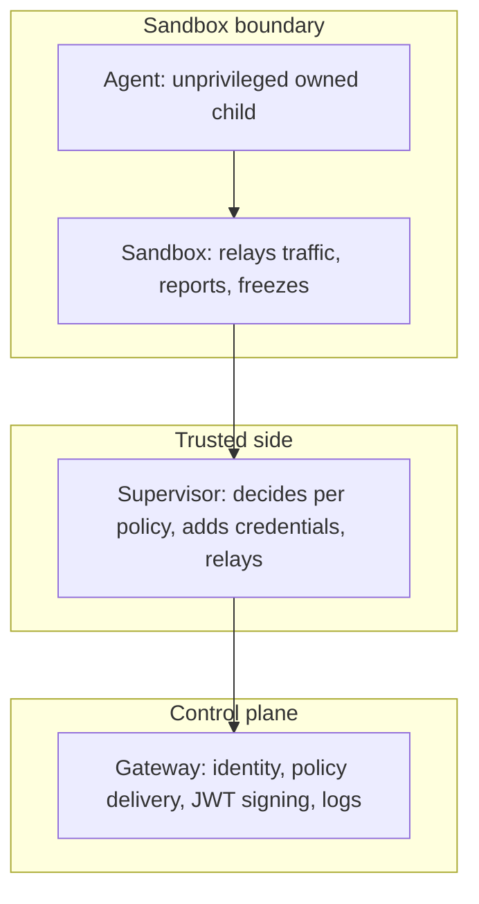

# Introduction: containment before detection

Three actors, one rule: the gateway knows who everyone is, the supervisor decides what is allowed, and the sandbox reports what the agent does without ever deciding anything. The arrows show the trust gradient running upward — the agent is an unprivileged owned child, the sandbox relays traffic and freezes on disconnect, the supervisor decides per policy and adds credentials, the gateway signs identity and delivers policy. No arrow points down with authority the lower layer could abuse: the sandbox holds no keys, no gateway token, no provider credentials.

The catalog behind this book holds 107 patterns, 54 failure scenarios and 191 cascades across 26 domains. Every count in this book is read from that catalog at build time; every scenario named is recorded against it; every YAML sketch is labeled illustrative. Catalog edition: counts below are read from data/*.json at build time; no figure is hand-typed.

The argument in one paragraph: detection tells you a rogue exists, containment decides what that fact costs. OpenShell moves the containment decision into the runtime — supervisor, sandbox, gateway, generations, deny-by-default egress — so the response the quarantine board orders is a runtime act, not a ticket queue. The chapters that follow map each archetype and each domain onto that runtime.

**Definition 1 (Runtime-act response).** A quarantine response is a *runtime act* if isolation, revocation, evidence capture, and memory retirement execute through supervisor/gateway operations (freeze, token death by deletion, log snapshot, generation retirement) rather than through human-operated tickets or manual console steps.

**Theorem 1 (Ticket-queue elimination).** If every quarantine step maps to a runtime primitive, then the machine-speed steps (isolate, revoke, snapshot, retire) complete in runtime latency regardless of staffing, queue depth, or time of day — the board's clocks measure automation, and humans enter only where judgment is required (handoff, remediation).

*Proof.* Runtime acts execute through the same supervisor channel that enforces policy: freeze is a supervisor command, revocation is token deletion, evidence is the supervisor and gateway logs, retirement is generation deletion. None waits on a human, a ticket assignment, or business hours — the latency is the runtime's, seconds to minutes. The reference workflow's machine-speed steps (5/15/30/60-minute SLAs) are therefore properties of the deployment, reproducible in every rehearsal. Humans enter at handoff (owned case, 120 minutes) and remediation (24 hours), where attribution and root cause need judgment no runtime possesses. List what your agents can reach that no policy names, and treat the list as the incident: everything on it is reachable without any quarantine step firing, because the runtime was never told to refuse it. ∎

**Council deliberation.**

- **Continual-learning researcher:** I define the reference architecture as three actors with one rule: the gateway knows who everyone is, the supervisor decides what is allowed, and the sandbox reports what the agent does without ever deciding anything. The agent runs as an unprivileged, owned child; every file access, syscall and connection is checked at the boundary; credentials are added only to requests bound for approved endpoints. My dispute is with teams that treat this as slowdown; the mediated channel adds a policy check, not a committee. Monday morning, draw your current agent stack and mark which component could say no to the agent today.
- **Memory-systems researcher:** I emphasize why generations matter more than they look. Restarting a sandbox issues fresh tokens and certificates and kills the old ones, which means rotation is a restart rather than a migration project. Long-lived agents accumulate stale grants, cached credentials and poisoned context; generations bound all three by construction. Others focus on the cryptography, and the mutual TLS matters, yet I insist the lifecycle property is the point: nothing trusted survives a restart unless policy re-grants it. Monday morning, ask how you would rotate every credential your agents hold, and time the answer.
- **Evaluation methodologist:** I read the introduction as scoping what this book proves versus what it shows. What it proves, from the catalog: every archetype and every domain has a containing primitive, with scenario counts to say where the weight lies. What it shows, as illustration: policy sketches, protocol flows and workflow mappings taken from the published architecture. The honest line between the two runs through the whole book. My caution is against exporting a sketch as a deployment; sketches are reviewed, then the prover checks them, then drills confirm them. Monday morning, restate that boundary whenever a sketch travels upward.
- **Safety researcher:** I translate the architecture into an operating stance: deny everything, then allow named things, and verify every change before it applies. The outer fence kills all egress except the supervisor channel, the sandbox holds launch until the supervisor confirms, and the freeze on disconnect means a lost supervisor is a stopped workload rather than an unobserved one. My disagreement is with teams that start from allowlists inherited from development; start from the default policy and add named needs. Monday morning, list what your agents can reach that no policy names, and treat the list as the incident.
