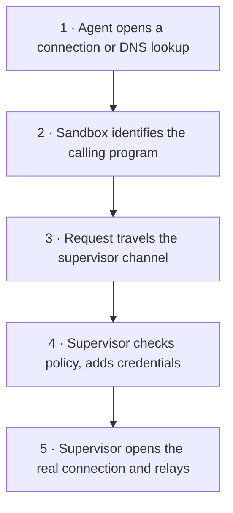
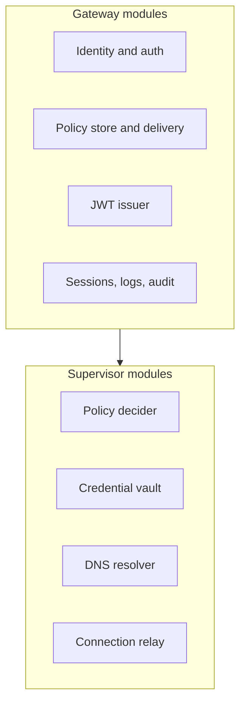
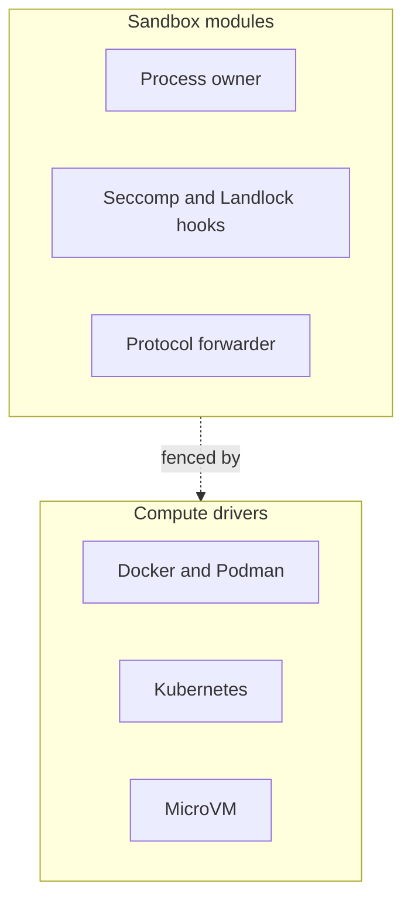

## Chapter 2: Gateway, supervisor, sandbox

Three actors, one rule: the gateway knows who everyone is, the supervisor decides what is allowed, and the sandbox watches what happens without ever deciding anything. Compromising the workload buys nothing — the sandbox holds no keys, no gateway token, and no provider credentials.

| Component | What it does |
|---|---|
| Sandbox | Owns the agent processes, knows which program made each request, applies process controls, forwards TCP and DNS to the supervisor. |
| Outer network fence | Denies all workload egress except the protected channel to the supervisor; each runtime builds it with native tools. |
| Supervisor | Checks requests against policy, supplies credentials, resolves DNS, opens approved connections; works with every runtime through one isolation backend. |
| Policies | Declare what the agent can touch: files, processes, network destinations, API calls, provider credential scope. |
| Providers | Connect a service name to a stored credential the supervisor hands out only where policy allows. |
| Policy prover | Formally verifies network-rule changes in the gateway; ships as openshell-prover for CI. |
| Gateway | Identity, policy and settings delivery, provider attachment, sandbox lifecycle, sessions and logs. |
| Compute runtime | Provisions workload and supervisor, builds the boundary and the fence, reports status, cleans up. |

The compute driver proves the boundary and reports readiness; it never decides whether a request is allowed. That decision always belongs to the shared supervisor and policy engine, which is why the same policy behaves the same way on every runtime — while each runtime advertises its capabilities so the gateway knows what each deployment can and cannot do.

**Definition 1 (Separation of powers).** The architecture satisfies *separation of powers* if (i) no component both observes requests and approves them, (ii) no workload-side component holds credentials, tokens, or keys, and (iii) revocation is a lifecycle act (delete the sandbox) that needs no cooperation from the compromised side.

**Theorem 1 (Workload compromise buys nothing).** Under separation of powers, full compromise of the agent and sandbox yields no credentials, no gateway tokens, no provider secrets, and no path to another sandbox — the attacker owns the observation deck with the controls on the other side of the glass.

*Proof.* By (ii) the sandbox holds no keys, no gateway token, no provider credentials — only the gateway public key needed to verify it talks to the right supervisor. There is nothing to steal because there is nothing stored: credentials are added by the supervisor per approved request and never persist workload-side. By (i) the sandbox cannot approve anything either — it relays, reports, and freezes; approval lives in the supervisor, unreachable from the workload except through the mediated channel that policy governs. By (iii) the defender's response needs nothing from the compromised side: deleting the sandbox cuts its supervisor, kills its tokens, and ends every capability at once. The reachable side is worthless and the valuable side is unreachable — which is the design winning, not the incident response. Ask which of your components could both see the request and approve it, then split them. ∎

**Council deliberation.**

- **Continual-learning researcher:** I see the three actors as a separation of powers: the gateway knows who everyone is, the supervisor decides what is allowed, and the sandbox watches what happens. No single component can both observe and permit, which is why compromising the workload buys nothing — the sandbox holds no keys, no gateway token, no provider credentials. My dispute is with designs that put policy decisions in the workload for latency; OpenShell puts them one mediated channel away instead. Monday morning, ask which of your components could both see the request and approve it, and split them.
- **Memory-systems researcher:** I emphasize that the sandbox is deliberately ignorant: it verifies the supervisor, relays traffic, and freezes the agent on disconnect, holding nothing worth stealing. This is what makes the compromise economics work — breaching the agent side yields no credentials to pivot with, since only the same supervisor process can resume a frozen workload. Others focus on the supervisor as the crown jewel, and it is hardened accordingly, yet I insist the design wins by making the reachable side worthless. Monday morning, inventory what an attacker learns from owning your agent runtime today.
- **Evaluation methodologist:** I read the compute driver as the portability proof: Docker, Podman, Kubernetes and MicroVM each build the boundary with native tools, yet policy behaves identically because decisions never live in the runtime. The capability advertisement answers it by declaring what each runtime supports. My caution is against assuming identical security postures; the contract is the same, the mechanisms differ in strength. Monday morning, record which runtime each of your sandboxes uses and what it advertises.
- **Safety researcher:** I map the actors to incident response: the gateway is where you revoke, the supervisor is where you observe, and the sandbox is where you freeze. Deleting a sandbox cuts off its supervisor because renewal only works while the sandbox exists — revocation is a lifecycle act, not a ticket queue. My disagreement is with programs that treat containment as a network problem alone; identity, tokens and generations are containment too. Monday morning, rehearse deleting a sandbox and confirm everything tied to it dies.
