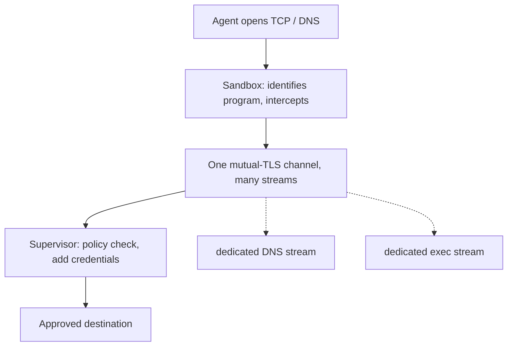
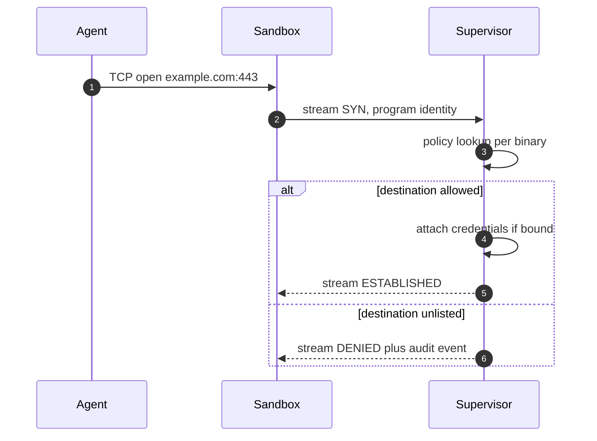

## Chapter 3: The mediated channel

Supervisor and sandbox talk over the OpenShell Sandbox Protocol: one mutually authenticated HTTP/2 connection carrying independent streams for control, DNS and per-connection TCP, each with its own backpressure — so a slow download cannot wedge exec or process control. The driver picks the transport (Unix socket for Docker and Podman, TCP for Kubernetes, vsock for MicroVM) with identical authentication and behavior on all of them.

| Guarantee | Sandbox provides | Supervisor gets |
|---|---|---|
| Process ownership | Runs the agent as an owned child, keeps process and terminal state. | Handles to wait on, attach to, signal, exec in, and stop. |
| Program identity | Identifies the calling program from trusted /proc data. | The real program behind each request, not a path the agent claims. |
| Network mediation | Intercepts TCP opens and DNS queries with seccomp and hands them over. | Requests that wait for a policy decision before going anywhere. |
| Fail closed | Holds launch until the supervisor confirms; freezes the agent on disconnect. | A short window to reconnect, or a stopped workload. |

Only the same supervisor process can resume a frozen workload; a new supervisor cannot take over a running sandbox even with valid credentials. The agent side holds nothing worth stealing: no gateway signing key, no gateway JWT, no provider credentials — only the gateway public key it needs to verify it is talking to the right supervisor.

**Definition 1 (Mediated-only egress).** All workload network activity satisfies *mediation* if every TCP open and DNS query is intercepted by the sandbox, carried over the mutual-TLS channel with program identity from trusted process data, and decided per-binary by the supervisor before any packet leaves — with launch held until confirmation and freeze on disconnect.

**Theorem 1 (No ungoverned packet).** Under mediated-only egress with fail-closed pairing, no agent byte reaches any destination without a supervisor policy decision, and no agent runs for a moment without a confirmed supervisor watching.

*Proof.* Every egress path begins at interception (seccomp hands TCP/DNS to the sandbox) and continues only through the channel (stream SYN with kernel-verified program identity — the agent asserting a binary name is not evidence; the sandbox reading /proc is). The supervisor decides per binary before opening anything; unlisted destinations get DENIED plus an audit event, which is also the detection stream. Fail-closed closes the two temporal gaps: launch waits for supervisor confirmation (no running before controls), disconnect freezes the agent (no running after controls vanish). Only the same supervisor process resumes — continuity is unforgeable, so credential theft cannot adopt a running sandbox. Independent per-stream backpressure removes the availability wedge (a slow download cannot block exec or process control). Every packet is governed, every moment is watched, every resumption is continuous — or nothing moves at all. Enumerate every egress path your agents have besides the governed one, and close them; then kill a supervisor in rehearsal and watch the freeze happen. ∎

**Council deliberation.**

- **Continual-learning researcher:** I view the mediated channel as the architectural bet: one mutually authenticated HTTP/2 connection carrying control, DNS and per-connection TCP streams with independent backpressure, so a slow download cannot wedge exec or process control. Every byte the agent sends outward passes a policy check in the supervisor before it leaves. My dispute is with multiplexing skeptics; separate streams per connection mean head-of-line blocking is designed out rather than tuned out. Monday morning, find the single path your agent traffic must take and confirm there is exactly one.
- **Memory-systems researcher:** I focus on program identity from trusted process data, because the agent claiming a binary name is not evidence — the sandbox reading /proc is. Policy that keys network access per binary is only as good as the identification behind it, and here identification comes from the kernel side of the boundary rather than the agent side. Others emphasize the crypto, and mutual TLS matters, yet I insist identity of the caller is the subtler property. Monday morning, check whether your egress rules name programs the agent asserted or programs the platform observed.
- **Evaluation methodologist:** I insist on the fail-closed pairing: the sandbox holds launch until the supervisor confirms, and freezes the agent if the connection drops. Together they remove the two classic gaps — starting before controls are confirmed, and running unobserved after they vanish. Only the same supervisor process can resume, so takeover requires continuity an attacker cannot borrow. My caution is about the reconnect window: short enough to preserve work, strict enough to preserve the guarantee. Monday morning, kill a supervisor in rehearsal and watch the freeze happen.
- **Safety researcher:** I read the protocol as removing the agent from the trust path entirely: the agent never connects to the gateway, DNS, or any private address directly, and the outer fence denies everything except the supervisor channel. There is no direct egress to misconfigure, only the mediated path to govern. My disagreement is with defense that starts at the application layer; start where packets cannot go. Monday morning, enumerate every egress path your agents have besides the governed one, and close them.
