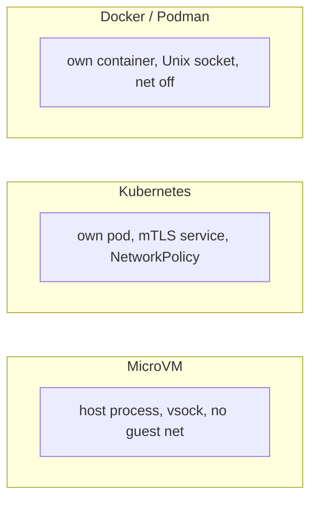

## Chapter 4: Four runtimes, one contract

Every runtime follows the same contract but builds the boundary with the tools it already has. The runtime's job is to place the supervisor, connect it to the sandbox, fence off the network, and prove it — never to decide whether a request is allowed.

| Runtime | Where the supervisor runs | Channel to the sandbox | How direct egress is blocked |
|---|---|---|---|
| Docker | Its own container | Authenticated Unix socket on a driver-owned volume | Workload container networking off |
| Podman | Its own container | Authenticated Unix socket on a driver-owned volume | Workload container networking off |
| Kubernetes | Its own pod | Private service with mutual TLS | NetworkPolicy allows only the supervisor service |
| MicroVM | A process on the host | Authenticated vsock | Guest has no network device |

Match the workload to the fence you understand best, and put the highest-authority agents behind the strongest fence. Runtimes can differ in readiness reporting and features; each advertises its capabilities so the gateway — and the operator — knows what a given deployment can do.

**Definition 1 (Contract-conformant runtime).** A runtime is *contract-conformant* if it (i) places the supervisor outside the workload, (ii) connects it over an authenticated private channel, (iii) blocks all direct workload egress by construction (not by rule), and (iv) advertises its capabilities and readiness to the gateway truthfully.

**Theorem 1 (Policy portability).** If all runtimes in a deployment are contract-conformant, then the same policy produces the same allow/deny decisions on every runtime — portability of policy with declared (not assumed) parity of strength.

*Proof.* Decisions live in the shared supervisor and policy engine, never in the runtime (Chapter 2): the same policy input yields the same decision output regardless of transport (Unix socket, mTLS service, vsock) or fence tooling (net-off, NetworkPolicy, no guest device). Behavioural differences between runtimes are therefore confined to mechanism strength — MicroVM's missing network device vs. a container's networking-off flag — never to policy semantics. Capability advertisement makes the strength differences declared: the gateway knows what each deployment can and cannot do, so assuming identical postures is replaced by reading the advertisement. Test the fence on every runtime you deploy (same policy, same workload, compare the boundary), rehearse one workload on a second runtime before you need to, and put the highest-authority agents behind the strongest fence — the contract matches everywhere, but the fences do not. ∎

**Council deliberation.**

- **Continual-learning researcher:** I see the four runtime rows as one contract with four dialects: the supervisor always decides, the sandbox always relays, the fence always denies direct egress, and only the tools differ. Docker and Podman use a driver-owned Unix socket with networking off; Kubernetes uses a private mTLS service with NetworkPolicy; MicroVM removes the guest network device and talks vsock. My dispute is with teams that standardize on one runtime for familiarity rather than fit; the contract lets you mix. Monday morning, match each workload to the runtime whose fence you understand best.
- **Memory-systems researcher:** I emphasize that runtimes never decide, which keeps policy portable when infrastructure changes. A move from Docker to Kubernetes changes transports and fencing tools but not a single rule, because rules live in the shared supervisor and policy engine. Others worry about behavioral drift across runtimes; the capability advertisement answers it by declaring what each runtime supports. My insistence is on testing the move anyway, since declared and delivered can differ. Monday morning, rehearse one workload on a second runtime before you need to.
- **Evaluation methodologist:** I treat the runtime table as a comparability matrix for evaluation: same policy, same workload, different fence, and any behavioral difference is a finding about the runtime rather than noise. Reporting readiness per runtime closes the gap between declared and delivered isolation. My caution is that most teams evaluate once on one runtime and assume the rest; assume nothing, measure each. Monday morning, run your containment checks on every runtime you deploy, not just the first.
- **Safety researcher:** I rank the runtimes by blast containment rather than convenience: no network device beats a firewall rule, and a separate pod beats a shared daemon. MicroVM isolation is the strongest fence in the table, Kubernetes NetworkPolicy is good governance at fleet scale, and container runtimes with networking off are a solid default. My disagreement is with treating all four as equivalent because the contract matches; the contract matches, the fences do not. Monday morning, put your highest-authority agents behind your strongest fence.
