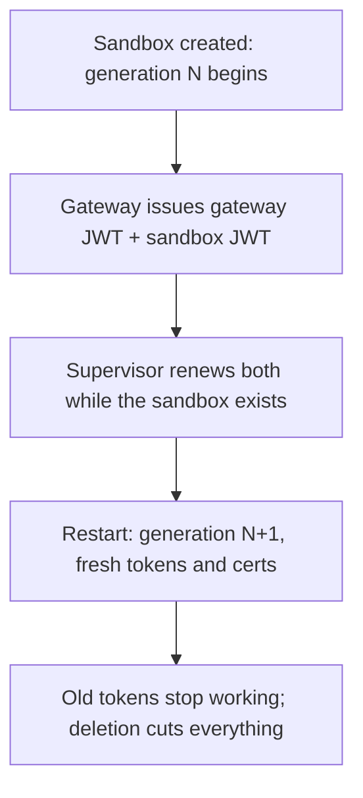
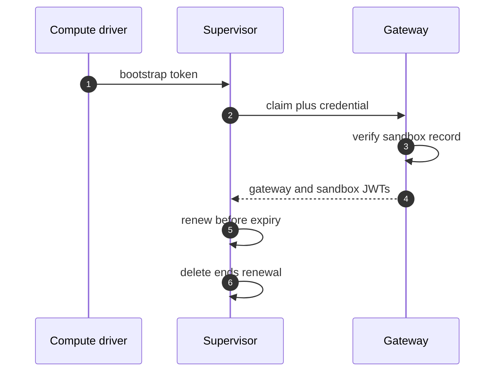

## Chapter 5: Authentication: generations and JWTs

Three connections tie a sandbox together, and the gateway is the only component that signs credentials — every credential names exactly one sandbox. Restarting a sandbox starts a new generation with fresh tokens and fresh certificates, and the old ones stop working: rotation is a restart, not a project.

| Connection | Who connects | How it is protected |
|---|---|---|
| Supervisor to gateway | Supervisor dials out. | Gateway JWT, over TLS when enabled. |
| Supervisor to sandbox | Supervisor dials in over the private channel. | Mutual TLS plus a sandbox JWT. |
| Agent to supervisor | Never directly; the sandbox relays. | Covered by the supervisor-to-sandbox channel. |

The gateway JWT allows only supervisor RPCs — fetching policy, pushing logs, relaying sessions — never managing other sandboxes. The sandbox JWT is verified with the gateway public key the sandbox holds, so the sandbox can verify but never mint. Renewal happens in memory, both tokens together, and only while the sandbox exists: deleting the sandbox cuts off its supervisor. Shared deployments should set token TTLs; local single-user gateways may leave them unset so tokens last the run.

Bootstrapping differs by runtime but verifies identically: Docker, Podman and MicroVM hand the supervisor its first tokens in files only it can read, while Kubernetes presents the pod ServiceAccount token for the gateway to verify against its own sandbox record before issuing anything.

**Definition 1 (Generation-bound credentials).** Credentials are *generation-bound* if every token and certificate is issued for exactly one sandbox generation, renewal requires the sandbox's continued existence, restart mints generation $N+1$ with fresh credentials while revoking $N$'s, and deletion ends all renewal — no credential outlives its generation.

**Theorem 1 (Rotation by restart).** Under generation-bound credentials, every restart is a complete rotation (new tokens, new certs, old ones dead) and every deletion is total revocation — credential hygiene with zero dedicated rotation work.

*Proof.* Issuance binds each credential to $(sandbox, N)$; renewal re-issues only while that sandbox exists. Restart creates $(sandbox, N+1)$ with fresh credentials; $N$'s credentials are not renewed and expire (or die immediately on deletion, which ends renewal). No migration, no rotation project, no stale-secret audit: the lifecycle performs rotation as a side effect of operations the team already performs. The two-JWT split bounds blast radius per channel — the gateway JWT reaches only supervisor RPCs, the sandbox JWT verifies but never mints, and compromise of one yields no leverage on the other. Deleting the sandbox cuts the supervisor off because renewal requires existence; only the same supervisor process resumes a frozen workload, so theft cannot adopt a running sandbox. Count the long-lived secrets your agents hold that no restart would kill — under generations, the answer should be none. Set gateway_jwt.ttl_secs wherever more than one human can reach the gateway; verify every derived credential stops working after a delete. ∎

**Council deliberation.**

- **Continual-learning researcher:** I read generations as the quiet revolution in credential hygiene: every restart mints fresh tokens and certificates and kills the old ones, so rotation is an operation you already perform rather than a project you keep postponing. Renewal works only while the sandbox exists, which ties credential lifetime to workload lifetime by construction. My dispute is with static-secret cultures that treat rotation as an event; here it is a property. Monday morning, count the long-lived secrets your agents hold that no restart would kill.
- **Memory-systems researcher:** I focus on the two-JWT split: the gateway JWT can only call supervisor RPCs and the sandbox JWT can only be verified by the sandbox that holds the gateway public key. Neither token creates the other, neither manages other sandboxes, and each works on exactly one connection. Compromise of one channel yields no leverage on the other by design. Others emphasize TLS, and mutual TLS matters, yet I insist token scoping is what bounds a breach. Monday morning, map every credential in your stack to the connections it unlocks, and shrink the map.
- **Evaluation methodologist:** I value the bootstrap diversity: file-delivered tokens for Docker, Podman and MicroVM versus ServiceAccount verification for Kubernetes, with the gateway checking every claim against its own sandbox record before issuing anything. Two paths, one verification discipline — the gateway never trusts a claim it cannot check. My caution concerns the single-user gateway default of unset token TTL; convenience there trades away expiry. Monday morning, set gateway_jwt.ttl_secs wherever more than one human can reach the gateway.
- **Safety researcher:** I staff to the revocation story: deleting the sandbox cuts the supervisor off because renewal requires existence, and only the same supervisor process resumes a frozen workload, so theft of credentials cannot adopt a running sandbox. The agent side holds no gateway key, no provider secrets, nothing to pivot with. My disagreement is with revocation plans that end at disabling accounts; here revocation is deleting the workload and watching the tokens die with it. Monday morning, delete a sandbox and verify every derived credential stops working.
