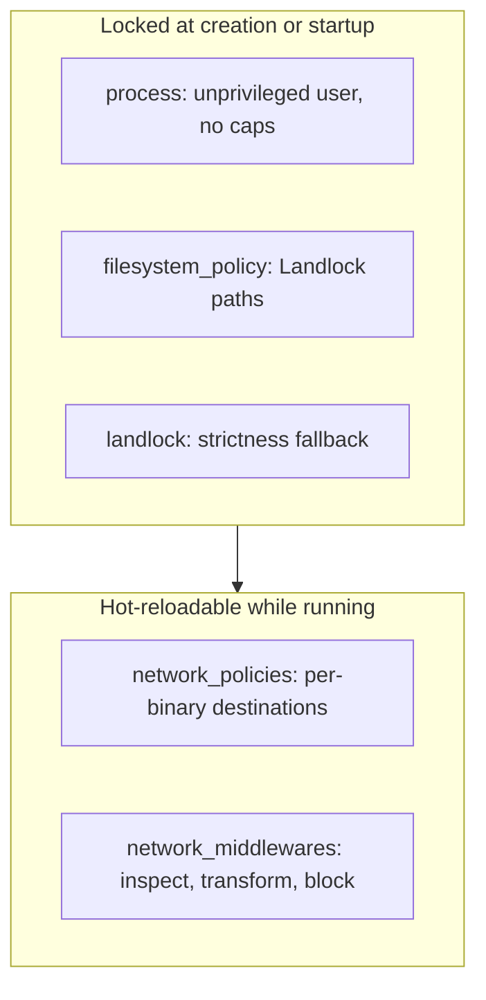

## Chapter 6: Policy layers

A sandbox policy is versioned YAML that denies everything it does not allow. Filesystem, landlock and process settings lock at creation or startup; network rules and middlewares stay live and hot-reloadable. What defines the shape of the world is fixed early; what describes conversations can evolve mid-run.

| Section | Controls | Enforced by | Takes effect |
|---|---|---|---|
| filesystem_policy | Paths sandbox processes can read, or read and write. | Landlock LSM in the kernel. | At sandbox startup. |
| landlock | Whether the sandbox still starts, without filesystem rules, if OpenShell cannot apply them. | Sandbox runtime. | At sandbox startup. |
| process | User and group sandbox processes run as. | Docker and Podman, at creation. | At sandbox creation. |
| network_policies | Destinations each binary can reach, and the requests it can send. | Sandbox network proxy. | While running. |
| network_middlewares | Extra inspection, transformation, or blocking of allowed traffic. | Sandbox network proxy. | While running. |

Every sandbox runs under a policy even when none is supplied: global policy first, then the saved per-sandbox policy, then the image policy, then the restrictive default. An invalid image policy keeps the workload from starting rather than falling back. The selected policy is the base; attached providers contribute network rules on top, and the combination — the effective policy — is what the sandbox enforces. Start edits from the base, inspect the effective.

**Definition 1 (Effective-policy truth).** For sandbox $sb$, the *effective policy* $E(sb) = \mathrm{base} \cup \bigcup_{p \in \mathrm{providers}(sb)} \mathrm{rules}(p)$ (minus global-override suppression) is the only policy that matters: it is what the sandbox enforces, and any reachability claim must be evaluated against $E(sb)$, never against the base alone.

**Theorem 1 (Edit base, inspect effective).** If providers contribute rules invisibly to authors who read only base, then every reachability audit must print $E(sb)$ — and any line in $E(sb)$ unattributable to base or a named provider is an unauthorized widening by definition.

*Proof.* Enforcement consumes $E(sb)$, not base: an auditor reading base sees a subset of the enforced rules and may miss provider-contributed reach entirely. Attribution partitions $E(sb)$ into base lines (authored, reviewed) and provider lines (contributed, visible). A line in neither partition was added by no known mechanism — unauthorized by construction, whether by drift, global-override residue, or error. The discipline follows: print the effective policy per sandbox, attribute every line, start edits from base (never copy provider rules into base where they rot), and treat global policy mode (which suppresses provider rules) as a mode to know you are in. Coverage is computable from $E(sb)$: enumerate allowed destinations per binary and review the list like code, because it is code — per-binary scoping turns a vague allowlist into attributable permissions, and narrow binaries preserve the attribution. ∎

**Council deliberation.**

- **Continual-learning researcher:** I see the five sections as a division of time as well as of concern: filesystem, landlock and process lock at creation or startup, while network policies and middlewares stay live and hot-reloadable. The things that define the shape of the world are fixed early; the things that describe conversations can evolve while the agent works. My dispute is with operators who want everything hot-reloadable; some guarantees are only guarantees because they cannot change mid-run. Monday morning, sort your current controls into locked-early versus live-tunable and defend each placement.
- **Memory-systems researcher:** I emphasize the effective-versus-base distinction: attached providers contribute network rules, so what the sandbox enforces is the combination, and operators must inspect the effective policy to know what is reachable. Starting edits from the base policy avoids copying provider-owned rules into your own config where they rot. The global policy override is the emergency counterpart: one administrator action replaces every policy and suppresses provider rules until deleted. Others focus on authoring; I insist on reading — inspect effective, edit base. Monday morning, print the effective policy of a running sandbox and compare it to what you thought it was.
- **Evaluation methodologist:** I treat deny-by-default as the measurable claim: every outbound connection needs a rule naming destinations and binaries, optionally constraining methods so an API can be read but not written. Coverage is then computable — enumerate allowed destinations per binary and review the list like code, because it is code. Per-binary scoping turns a vague allowlist into attributable permissions. My caution is that broad binary identities dilute attribution; name programs narrowly. Monday morning, export one sandbox network policy and read every line aloud.
- **Safety researcher:** I rank the sections by what they take away from the attacker: process identity removes privilege escalation, filesystem rules remove credential theft and lateral reads, network rules remove exfiltration and unapproved model routing, and provider binding removes credential possession itself. Defense in depth here is layered removal of attacker options, not layered alarms. My disagreement is with teams that write network rules first; start with process and filesystem, which survive even a proxy misconfiguration. Monday morning, write the filesystem section before the network section for every new sandbox.
