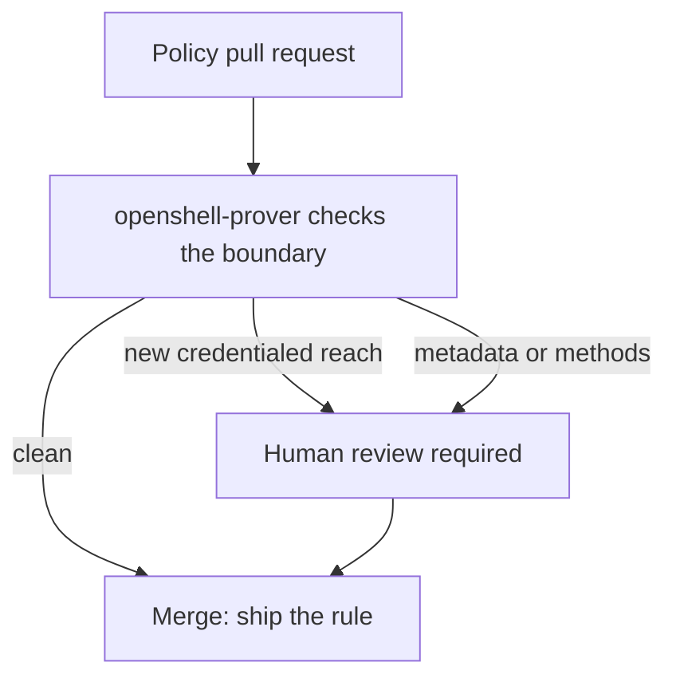
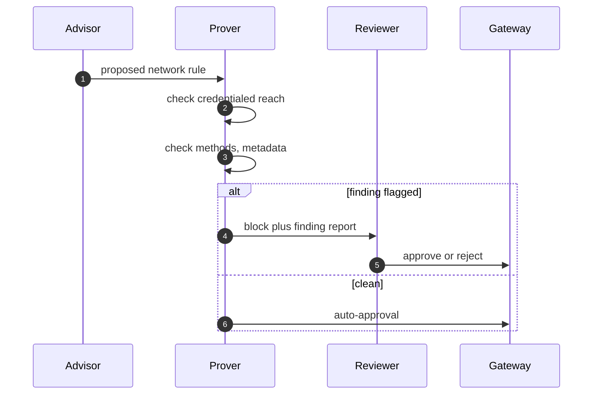

## Chapter 7: The prover: verification before approval

Before a policy change is approved, OpenShell formally verifies what the change would newly allow — new credentialed reach, new HTTP methods, access to cloud metadata endpoints — and findings block auto-approval for human review. Policy proposals from agents themselves therefore cannot self-authorize their own widening: the mechanical check holds the line until a human wakes.

The prover runs in the gateway and ships as the standalone openshell-prover command for checking a policy against a boundary in CI — boundaries tested like code, on every pull request that touches policy. Measure it like any control: flag precision, review latency, and the false-positive rate that determines whether findings still get read.

**Definition 1 (Blocking verification).** A prover is *blocking* if (i) every policy change is formally verified against the declared boundary before approval, (ii) findings (new credentialed reach, new methods, metadata access) prevent auto-approval, (iii) overrides require a named human with recorded reasons, and (iv) the check runs in CI on every touching pull request plus at the gateway before apply.

**Theorem 1 (No self-authorizing widening).** Under blocking verification, no agent — however privileged its advisory role — can widen its own reach: the widening rule it proposes is verified against the boundary it tries to cross, and the verification blocks exactly the crossings that matter.

*Proof.* Agent-proposed rules (the advisor flow) enter through the same pull-request path as human rules — no fast lane. The prover checks the proposal against the declared boundary: new credentialed reach (the widening that matters), new methods (read-to-write escalation), metadata access (credential minting that escapes every other control). Any finding blocks auto-approval; only a named human with recorded reasons overrides. The agent therefore cannot self-authorize: its proposal needs either a clean proof (no widening — harmless) or a human who sees the finding (widening with a witness). The night-shift property follows: proposals arriving at any hour meet the mechanical check before any human wakes, and the check holds the line meanwhile. Findings must block — advisory-only proving is theater with logs. Track every finding to its disposition and tune from the log; a verifier nobody trusts gets bypassed, a verifier that cries wolf gets ignored, and only surgical findings survive both failure modes. ∎

**Council deliberation.**

- **Continual-learning researcher:** I view the prover as review that cannot be skipped or skimmed: formal verification over a proposed network change, flagging new credentialed reach, new methods, or cloud metadata access, with findings that block auto-approval for human review. Policy proposals from agents themselves — the advisor flow — therefore cannot self-authorize their own widening. My dispute is with change processes that treat review as ceremony; here the check is mechanical and the block is real. Monday morning, route one real policy change through the prover and read what it flags.
- **Memory-systems researcher:** I emphasize that verification happens before approval, not after deployment, which is the only order that prevents the bad rule from ever existing. An invalid image policy already keeps workloads from starting rather than falling back to default; the prover extends that posture to every change. The standalone openshell-prover command brings the same check into CI, so boundaries are tested like code. Others focus on runtime enforcement; I insist prevention at the change edge is cheaper than any runtime save. Monday morning, add the prover to the pipeline that ships your policies.
- **Evaluation methodologist:** I insist the prover be measured like any control: precision and recall on flagged changes, review latency, and the false-positive rate that determines whether humans still read findings. A verifier nobody trusts gets bypassed; a verifier that cries wolf gets ignored. The block-on-finding design earns its trust only if findings are surgical. My caution is against treating formal methods as infallible; scope the proof to network reach and keep humans on semantics. Monday morning, track every finding to its disposition and tune from the log.
- **Safety researcher:** I staff the prover as the night-shift reviewer that never gets tired: agent-proposed rules arrive at any hour, and the mechanical check holds the line until a human wakes. Cloud metadata endpoints deserve special attention, since reaching them can mint credentials that escape every other control. My disagreement is with teams that run the prover advisory-only; findings must block, or the whole device is theater. Monday morning, confirm your prover findings actually prevent the change from applying.
