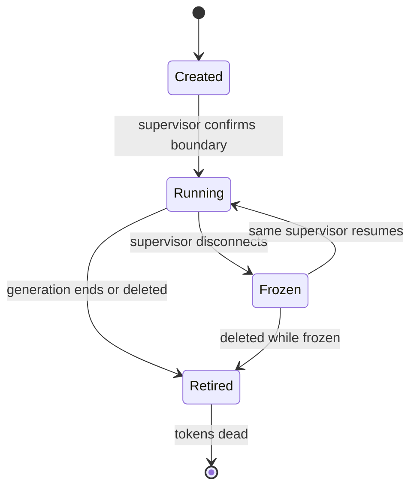

# Part III — Operating swarms on OpenShell

## Chapter 14: Generations: rotation as a security primitive

Every restart mints fresh tokens and certificates and kills the old ones, so rotation is an operation already performed rather than a project postponed. Long-lived compromise, cached context, accumulated permission drift and poisoned retrieved entries all die on a schedule set by the operator, not by suspicion.

Renewal works only while the sandbox exists, which ties credential lifetime to workload lifetime by construction — and deleting a workload is total revocation. Tune the cadence against detector persistence windows: rotate so fast that scores never accumulate and slow shapes hide inside the churn.

**Definition 1 (Rotation cadence).** A fleet runs on a *rotation cadence* $T$ if every sandbox generation is retired (at latest) $T$ after creation — tokens, certificates, context, and accumulated grants all die with it — and renewal is impossible outside the generation's lifetime.

**Theorem 1 (Dwell time bound).** Under rotation cadence $T$, no compromise — detected or not — persists longer than $T$ plus the persistence window of the slowest detector: dwell time is bounded by schedule, not by detection speed.

*Proof.* At retirement, everything the compromise could inhabit dies: tokens (revoked by non-renewal), certificates (expired), context (flushed), accumulated permission drift (reset to policy), poisoned retrievals (gone with the generation). The fresh generation starts from policy, not from history. A compromise established just after rotation therefore lives at most until the next retirement: $T$. The detector-persistence caveat sets the floor, not the ceiling — rotate faster than the slowest persistence window and slow evidence never accumulates (drift hides in the churn), so tune $T$ against the windows: long enough for level-shift and goal-comparison evidence to build, short enough that nothing precious accumulates. Record rotation events alongside detections and look for the interaction; set a maximum generation age and enforce it with restarts, not reminders. ∎

**Council deliberation.**

- **Continual-learning researcher:** I read generations as scheduled forgetting for the whole trust stack: tokens, certificates, context and grants all die on restart unless policy re-grants them. Long-lived compromise cannot outlive the rotation cadence, which bounds dwell time by construction rather than by detection speed. My dispute is with immortal-workload cultures; nothing agent-side should be precious. Monday morning, set a maximum generation age and enforce it with restarts, not reminders.
- **Memory-systems researcher:** I focus on what rotation flushes beyond credentials: cached context, accumulated permission drift, and poisoned retrieved entries that no detector flagged. A fresh generation is the cheapest memory scrub available — wholesale rather than surgical. Others emphasize the cryptography refresh; I insist the context refresh matters more operationally. Monday morning, compare one long-lived agent behavior before and after a forced generation rollover.
- **Evaluation methodologist:** I value generations as comparable units: same policy, same workload, new identity, which makes before-and-after measurement clean. Rotation cadence becomes a tunable parameter with observable effects on incident rates and false positives. My caution is against rotating so fast that persistence-based detection never accumulates evidence; tune the cadence against detector windows. Monday morning, record rotation events alongside detections and look for the interaction.
- **Safety researcher:** I staff generations as the revocation primitive: leaked, suspected, or merely old credentials die with the generation, no per-secret rotation project needed. Combined with renewal that only works while the sandbox exists, deleting a workload is total revocation. My disagreement is with secret-by-secret rotation programs that never finish; rotate the world instead. Monday morning, rehearse total revocation by deleting rather than by rotating.
