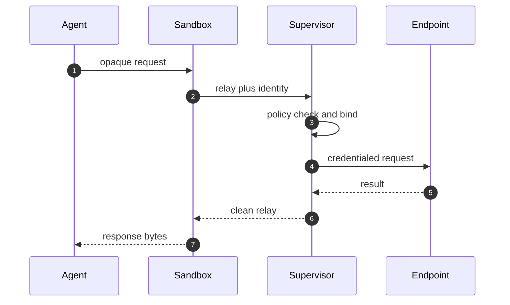

## Chapter 16: Credentials the agent never sees

The supervisor resolves opaque placeholders only at policy-authorized endpoints, so agents handle references while the trusted side handles values. Attachments, rotation and revocation update at runtime; new environment variables require a new process, so running code never silently gains scope.

Audit the effective policy per sandbox — base plus provider contributions — and attribute every line. Debug the supervisor decision, never the secret: verify that no debug path can print a resolved provider credential, because there is nothing agent-side to print.

**Definition 1 (Credential opacity).** Credential handling satisfies *opacity* if (i) agents reference services by name only (opaque placeholders), (ii) values are resolved exclusively by the supervisor at policy-authorized endpoints, (iii) no agent-readable store, environment, log, or debug path ever contains a resolved credential, and (iv) new environment variables require a new process.

**Theorem 1 (Nothing to steal).** Under credential opacity, the complete compromise of an agent (including memory dump, environment read, and log access) yields zero authenticating secrets — exfiltration of credentials is impossible because there is nothing agent-side to exfiltrate.

*Proof.* The agent's observable state — memory, environment, logs, debug outputs — contains only opaque references by (i) and (iii): placeholders name services, never values. Resolution happens supervisor-side at bound endpoints (ii), and the resolved values travel only supervisor-to-endpoint, never into agent-visible state. New environment variables require a new process (iv), so rotation cannot smuggle values into running code silently. A memory dump of the agent reveals references without values — the thief steals pointers to a vault they cannot open, and the vault (supervisor) only opens for policy-authorized endpoints. Grep the agent-visible environment for anything that authenticates: under opacity the search returns empty by construction, and any non-empty result is itself the finding. Debug the supervisor decision, never the secret. ∎

**Council deliberation.**

- **Continual-learning researcher:** I view credential opacity as removing an entire attack class: exfiltration of secrets the agent never possessed is impossible by construction. The supervisor resolves opaque placeholders only at policy-authorized endpoints, so the agent handles references while the trusted side handles values. My dispute is with vault-sidecar patterns that still mount secrets where the agent can read them; opacity must hold end to end. Monday morning, grep your agent-visible environment for anything that authenticates.
- **Memory-systems researcher:** I focus on rotation and revocation as lifecycle properties: attachments, rotation and revocation update at runtime, and new environment variables require a new process, so credential changes propagate without restarting the world yet never leak into running processes silently. Generations complete the story by killing everything on restart. Others emphasize issuance; I insist lifecycle decides whether issuance discipline survives contact with operations. Monday morning, rotate one provider credential and watch every dependent sandbox pick it up.
- **Evaluation methodologist:** I value provider-contributed rules as composition done right: attaching a provider contributes exactly the network rules that provider needs, visible in the effective policy, never copied into your base config where they rot. My caution is global policy mode, which suppresses provider rules; know which mode you are in. Monday morning, print one effective policy and attribute every line to base or provider.
- **Safety researcher:** I staff credentials as the highest-value target with the strictest handling: resolution at the supervisor, binding to approved endpoints, no agent-side possession, and revocation by deletion. Cloud metadata endpoints get special prover attention because reaching them can mint new credentials that escape every other control. My disagreement is with any design that trades opacity for debugging convenience; debug the supervisor decision, never the secret. Monday morning, verify your debug tooling cannot show agent-side secrets — because there are none.
