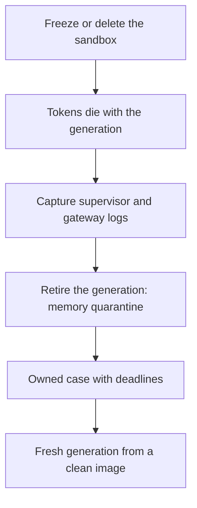
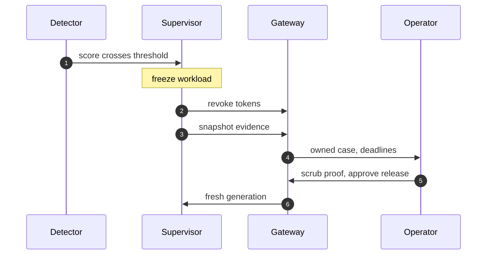

## Chapter 18: The quarantine workflow on OpenShell

Isolate is freezing or deleting the sandbox; revoke is token death by deletion; evidence is the supervisor and gateway logs; memory quarantine is generation retirement; handoff is the owned case with deadlines; remediation is a fresh generation from a clean image with policy re-review. Every step of the incident workflow has a runtime home.

Order matters: capture evidence before retiring the generation, because deletion destroys the crime scene along with the compromise, and the snapshot must fire automatically rather than heroically. Automate the first three steps so machines contain in seconds while humans decide in hours; only release waits for a named human with a scrub proof.

**Definition 1 (Runtime-homed incident).** The six-step incident is *runtime-homed* if each step executes as a supervisor/gateway operation: isolate = freeze/delete, revoke = token death by deletion, evidence = log snapshot, memory = generation retirement, handoff = owned case with SLA clocks, remediation = fresh generation from a clean image with policy re-review.

**Theorem 1 (Minutes from machines, judgment from humans).** Under a runtime-homed incident, containment latency (isolate, revoke, snapshot, retire) is bounded by runtime automation regardless of staffing — while attribution, root cause, and release remain human-gated with named owners and deadlines.

*Proof.* Freeze, token death, log snapshot, and generation retirement are supervisor/gateway acts: they execute on detection without tickets, queues, or business hours. Their latency is the runtime's — seconds to minutes — which is why the machine-speed SLAs (5/15/30/60) hold as deployment properties rather than staffing achievements. Handoff and remediation need what runtimes lack: attribution (who did it), employment consequences (what happens to whom), root cause (why it happened), and policy re-review (what changes). The named human with the scrub proof gates release because only a human can own those judgments. Walk one old incident through this mapping and find the step you could not have performed — that gap is the control to build next, and re-running one preset against the mapped workflow (comparing the clocks) measures whether the mapping holds or drifts. ∎

**Council deliberation.**

- **Continual-learning researcher:** I map the six quarantine steps onto OpenShell primitives and find every step has a home: isolate is deleting or freezing the sandbox, revoke is token death by deletion, evidence is the supervisor and gateway logs, memory quarantine is generation retirement, handoff is the owned case with deadlines, and remediation is a fresh generation from a clean image with policy re-review. My dispute is with teams that treat the workflow as paperwork; here each step is a runtime act. Monday morning, walk one old incident through this mapping and find the step you could not have performed.
- **Memory-systems researcher:** I insist on evidence-before-retirement ordering: capture the supervisor logs, event streams and context snapshots before the generation is deleted, because deletion destroys the crime scene along with the compromise. The audit trail must support a true snapshot read rather than hopeful reconstruction. Others emphasize speed of isolation, and I agree, and add that the snapshot must be automatic, not heroic. Monday morning, verify your evidence capture fires on delete without human action.
- **Evaluation methodologist:** I read the mapping as preserving the workflow metrics: time-to-isolate becomes time-to-freeze-or-delete, revocation becomes token-death confirmation, and SLA clocks keep running on the owned case. Counterfactuals still apply — remove one primitive and re-run to prove what carries the result. My caution is that primitives change the timings; re-baseline rather than importing old numbers. Monday morning, re-run one preset against the mapped workflow and compare the clocks.
- **Safety researcher:** I staff to the same deadlines with faster tools: automatic isolation via freeze needs no human, revocation via deletion needs no ticket queue, and only release — the fresh generation — waits for a named human with a scrub proof. Machines contain in seconds while humans decide in hours, the same division the rogue book prescribes. My disagreement is with fully manual quarantine playbooks; automate the first three steps or lose the minutes that matter. Monday morning, confirm freeze, revoke and evidence need no human in your deployment.
