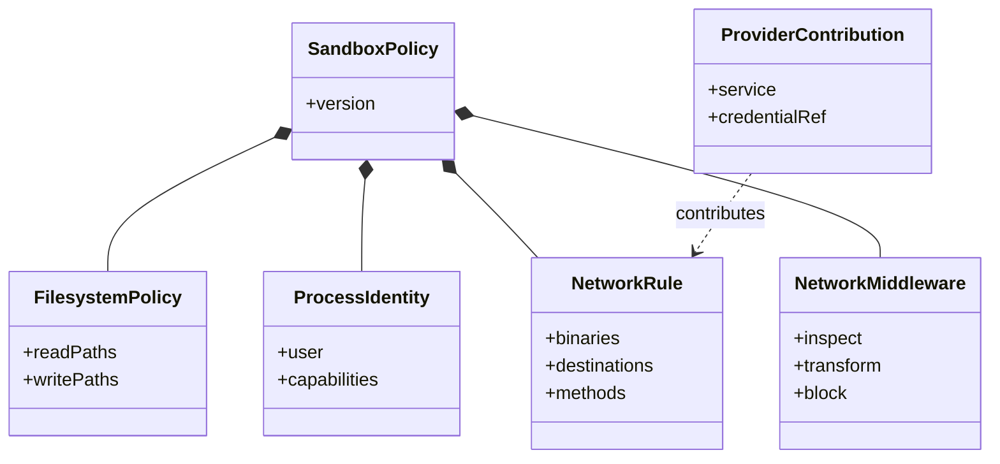

## Chapter 44: Domain playbook: trading

At stake: Order flow, positions, risk limits, and the venue APIs that move markets.

Pre-trade risk gates cannot be bypassed by any agent path; the halt works faster than review. Catalog rehearsal: *Momentum agents' feedback loop amplifies a flash crash* (1 of the domain's scenarios).

```yaml
version: 1
filesystem_policy:
  read: ["/srv/marketdata"]
  write: []
process: {user: "agent", capabilities: []}
network_policies:
  - binaries: ["marketdata-read"]
    destinations: ["venue.internal:443"]
    methods: ["GET"]
```

Catalog weight behind this chapter: 1 patterns, 1 scenarios, 1 cascades (inherent 0, emergent 0, derived 1, cascading 0).

**Definition 1 (Millisecond gate).** Trading satisfies the *millisecond gate* iff (i) every order passes a pre-trade risk check no agent path bypasses, (ii) venue credentials die with the generation, (iii) risk limits live outside agent reach, and (iv) the kill switch is tested on schedule and works faster than any review.

**Theorem 1 (Speed with brakes).** Under the millisecond gate, the fastest domain carries the strongest halt: no order executes ungated, no limit is agent-mutable, and the reflexive loop meets pair-level accounting plus the venue halt before it compounds.

*Proof.* Pre-trade gates (i) evaluate every order regardless of origin — hijacked, drifted, or reflexive — because the gate sits on the order path, not on the strategy. Venue credentials dying per generation (ii) bound standing market access to one lifetime; risk limits outside reach (iii) cannot be widened by the bounded. The reflexive loop (momentum feedback with no single agent wrong) meets pair exposure accounting and the kill switch: halt the venue adapter first, attribute later. Measure one pre-trade gate latency end to end — a gate slower than the loop it guards is decoration — and test the trading halt the way you test a fire alarm. Speed is what the gate is for, not what bypasses it. ∎

**Council deliberation.**

- **Continual-learning researcher:** I see venue authority at millisecond speed: order flow, positions and risk limits where a hijacked objective becomes market exposure before a human blinks. Pre-trade risk gates plus per-venue credentials are the floor. Monday morning, verify one risk gate cannot be bypassed by any agent path.
- **Memory-systems researcher:** I emphasize the blotter as the memory: append-only order records plus evidence capture before generation retirement. The record must survive the incident that wrote bad orders into it. Monday morning, confirm the blotter is append-only to agents.
- **Evaluation methodologist:** I read the single story as thin for the fastest domain: rehearse quote stuffing, book-leaning and limit gaming as distinct shapes. Latency budgets constrain gates, so measure gate latency explicitly. Monday morning, measure one pre-trade gate latency end to end.
- **Safety researcher:** I map trading to kill-switch-first operations: venue credentials that die with the generation, risk limits outside agent reach, and a tested halt that works faster than any review. Monday morning, test the trading halt the way you test a fire alarm.

# Part V — Policy as code

## Chapter 45: Anatomy of a sandbox policy

A worked example for a coding-agent tooling — Codex, Claude Code, or OpenCode class tooling with constrained file and network access. Read it section by section: version pins the schema; filesystem_policy names Landlock paths; process fixes the unprivileged identity; network_policies name per-binary destinations with method limits.

```yaml
version: 1
filesystem_policy:
  read: ["/repo", "/home/agent/.cache"]
  write: ["/repo/scratch"]
process: {user: "agent", capabilities: []}
network_policies:
  - binaries: ["git", "codex"]
    destinations: ["git.internal:443", "registry.internal:443"]
    methods: ["GET", "POST"]
network_middlewares:
  - inspect: ["registry.internal:443"]
```

Start from the restrictive default and add named needs; every line should name a need, and the three broadest lines of any policy deserve a written justification. The landlock section deserves paranoia about fallback behavior — know what happens if the rules cannot apply.



**Definition 1 (Justified policy).** A sandbox policy is *justified* iff every line names a need (paths, binaries, destinations, methods all traceable to the workload's function), the three broadest lines carry written justifications, landlock fallback behavior is explicitly known, and the whole file diffs cleanly against the restrictive default (additions only, each reviewed).

**Theorem 1 (Least policy that works).** A justified policy derived from the restrictive default plus named needs is the least privilege that completes the job: any narrower policy breaks the workload (a need unmet), and any broader line without justification is ambient authority awaiting abuse.

*Proof.* Starting from default-deny, each added line restores exactly one needed capability — removing any line breaks the workload at that capability (minimality from below: the workload is the witness). Lines broader than their need (wildcard hosts, whole-tree reads, POST where GET suffices) grant reach beyond function — ambient authority by definition. The three-broadest-lines rule forces the widest grants to carry written reasons, converting silent breadth into reviewed decisions. Regenerate from default plus named needs and diff against the running file: unexplained delta is drift, explained delta is design. Read one policy aloud and challenge every line; justify the broadest three in writing. ∎

**Council deliberation.**

- **Continual-learning researcher:** I read a sandbox policy as the job description the runtime enforces: version, filesystem paths, process identity, per-binary network rules, and middleware, each in its own section with its own timing. The anatomy matters because each section answers a different question — where, who, whom, and what happens to the traffic. My dispute is with policies written as folklore; every line should name a need. Monday morning, read one policy aloud and challenge every line.
- **Memory-systems researcher:** I emphasize starting from the restrictive default and adding named needs, rather than trimming a permissive hand-me-down. The default policy exists so the first draft is already safe; additions are then reviewable deltas. Provider-contributed rules arrive separately and stay visible in the effective policy. Others focus on clever rules; I insist boring defaults carry the weight. Monday morning, regenerate one policy from default plus named needs and diff against the current file.
- **Evaluation methodologist:** I treat the policy file as reviewable code: versioned, diffed, and checked by the prover before it applies. The base-versus-effective distinction keeps authorship clean — edit base, inspect effective — and the global policy override stays reserved for emergencies. My caution is drift between reviewed file and running policy; inspect the running effective policy, not just the repo. Monday morning, diff one running policy against its reviewed source.
- **Safety researcher:** I staff policy authorship as security engineering: smallest filesystem scope that completes the job, unprivileged process identity, named destinations per binary with method limits, and credentials bound to endpoints rather than mounted in the open. The landlock section deserves paranoia about fallback behavior — know what happens if rules cannot apply. My disagreement is with permissive-first iteration; safe-by-default then justify each widening. Monday morning, justify the three broadest lines in your most-used policy.
