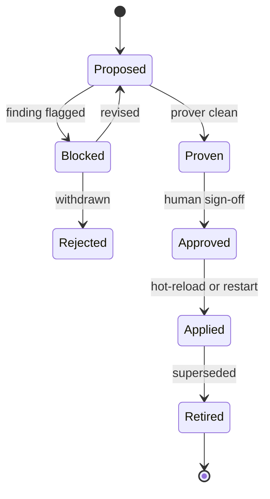

## Chapter 48: The prover in CI

The standalone openshell-prover command brings boundary checking to the pipeline that ships policies: every pull request touching network rules is verified against the declared boundary, with new credentialed reach, new methods, or metadata access flagged before merge. Findings must block; blocks are overridden only by named humans with recorded reasons.

Log every finding to its disposition and tune from the log — a verifier nobody trusts gets bypassed, and one that cries wolf gets ignored. The chain is the control: prover in CI, supervisor at runtime, freeze on disconnect.

**Definition 1 (Three-layer boundary chain).** The boundary chain has three links: (i) prover in CI (static verification before merge), (ii) supervisor at runtime (dynamic enforcement of the shipped policy), (iii) freeze on disconnect (liveness guarantee that enforcement is present). Each link covers the failure of the others' assumptions.

**Theorem 1 (No single-layer bypass).** Under the three-layer chain with blocking findings, no policy change reaches enforcement without passing verification, no runtime traffic bypasses the shipped policy, and no disconnect leaves an ungoverned workload — defeating all three requires compromising CI, the supervisor, and the freeze independently.

*Proof.* The prover gates the merge: unverified rules never ship (findings block; overrides need named humans with recorded reasons — an auditable exception, not a hole). The supervisor gates the traffic: shipped policy is enforced per request, so even a wrong-but-merged rule is still enforced as written (failures become visible, attributable policy errors rather than silent bypasses). The freeze gates liveness: disconnect stops the workload, so enforcement cannot silently vanish. Each layer assumes the others may fail — the prover assumes humans err (hence blocks), the supervisor assumes policies err (hence enforces exactly what shipped, visibly), the freeze assumes supervisors die (hence stops everything). Confirm all three layers exist for the highest-authority sandbox; log every finding to its disposition; tune from the log until findings are surgical. ∎

**Council deliberation.**

- **Continual-learning researcher:** I see the standalone prover command as the boundary test that runs on every policy pull request: proposed network rules checked against the declared boundary, with new credentialed reach, new methods, or metadata access flagged before merge. Policy becomes code with tests, not folklore with reviewers. My dispute is with review-only pipelines; mechanical checks catch what tired eyes miss. Monday morning, add the prover to one policy repo pipeline.
- **Memory-systems researcher:** I emphasize that verification composes with enforcement: the prover proves the intended boundary, the runtime enforces the shipped policy, and the effective-policy inspection closes the loop. Three views of the same promise, each catching what the others miss. Others focus on one layer; I insist the chain is the control. Monday morning, trace one merged policy from PR check through running effective policy.
- **Evaluation methodologist:** I insist the prover be measured like any control: flag precision, review latency, bypass attempts, and the false-positive rate that determines whether findings still get read. Findings must block, and blocks must be overridden only by named humans with recorded reasons. My caution is alert fatigue migrating into policy review; keep findings surgical. Monday morning, log every prover finding to its disposition for one month.
- **Safety researcher:** I confirm all three layers exist for the highest-authority sandbox: the prover stops bad rules from shipping, the supervisor stops bad traffic from flowing, and the freeze stops everything when the supervisor is gone. No single layer carries the claim. My disagreement is with teams that buy one layer deeply instead of three thinly. Monday morning, confirm all three layers exist for your highest-authority sandbox.

# Part VI — Measured notes and honest caveats

## Chapter 49: What was rehearsed locally

Measured, from the shipped catalog at build time: 107 patterns, 54 scenarios, 26 domains, and per-domain, per-archetype counts printed in every chapter. Rehearsal runs on mock and open data with local open-weight models — the right substrate for exercising policy paths without risking real records or sending anything anywhere.

Scope honesty: local rehearsal validates shapes and paths, never performance or scale. Sketches show configuration shape; they are labeled illustrative throughout and must be reviewed, prover-checked and drilled before anything resembling deployment.

**Definition 1 (Path-validated rehearsal).** A rehearsal is *path-validated* iff it exercises the policy path (grant check, egress decision, gate hold, freeze behavior) on mock data with seed-stamped determinism — and explicitly records what it does not validate (performance, scale, production fidelity, adversary novelty).

**Theorem 1 (Honest scope).** Path-validated rehearsal with recorded limits supports exactly the claims it ran: the wiring works, the gates hold, the freezes fire — and every claim beyond the ran configuration is labeled illustrative, never measured.

*Proof.* Deterministic seed-stamped runs on mock data prove the mechanism traversed (the path executed, the decision fired, the gate held) — reproducibility separates this from storytelling. Performance, scale, and adversary novelty were never executed, so no observation bears on them; claiming them would generalize beyond the executed configuration. The label is the honesty mechanism: measured for catalog counts and chapter mappings (read from shipped data at build time), illustrative for every YAML sketch and protocol flow. Separate every number quoted into measured versus illustrative before repeating it; record what the rehearsal cannot show alongside what it can; schedule the rehearsal with the seriousness of the deployment it precedes — wiring proof, not safety proof, and re-run on every policy change. ∎

**Council deliberation.**

- **Continual-learning researcher:** I frame the local rehearsal honestly: catalog counts are measured from the shipped data at build time, archetype mappings are recorded against named scenarios, and every configuration sketch is labeled illustrative rather than observed. Nothing here claims a fleet result the lab never produced. My dispute is with books that dress sketches as benchmarks; the label is the honesty. Monday morning, separate every number you quote into measured versus illustrative before repeating it.
- **Memory-systems researcher:** I emphasize mock and open data as the right substrate for rehearsal: synthetic scenarios exercise the policy paths without risking real records, and open models serve intelligence without sending anything anywhere. The lab stays air-gapped from production data by design. Others crave production fidelity; I insist rehearsal fidelity is about paths, not data. Monday morning, confirm your rehearsal touches no production system.
- **Evaluation methodologist:** I value the seed-stamped, deterministic style inherited from the sibling books: same catalog, same script, same numbers, every build. Reproducibility is what separates rehearsal from storytelling, even when the rehearsal is local and small. My caution is scope honesty — local rehearsal validates shapes and paths, never performance or scale. Monday morning, record what your rehearsal cannot show alongside what it can.
- **Safety researcher:** I treat local rehearsal as the minimum before production, never the proof of it: policy paths walked, quarantine steps practiced, freezes observed, gates timed. The lab proves the wiring, the way a fire drill proves the exits exist rather than that the building is safe. My disagreement is with teams that rehearse once; re-run on every policy change. Monday morning, schedule the rehearsal with the same seriousness as the deployment.
