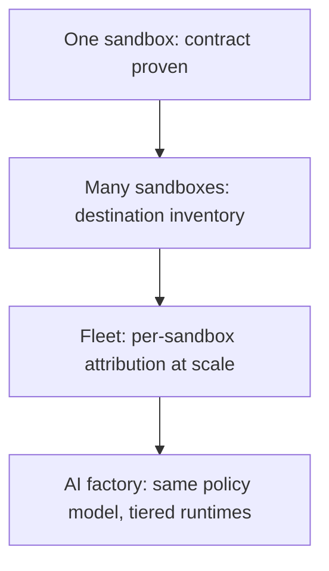

## Chapter 51: From one sandbox to AI-factory scale

The reference architecture pairs the sandboxed runtime with inference and compute platforms up through AI-factory scale: the same gateway-supervisor-sandbox contract and policy model, carried by container runtimes up through Kubernetes, with the fence built per tier from native tools. The contract scales; the tools change.

Scale the evidence pipeline before the tenth sandbox, aggregate per-sandbox attribution into fleet posture without losing it, and attach a named owner to every new authority before granting it. Sandbox by sandbox, policy by policy — never big-bang.

**Definition 1 (Attribution-preserving scale).** Scaling preserves *attribution* iff every new sandbox, authority, and theme carries its owner, its policy, and its drills from day one — fleet posture aggregates per-sandbox records without merging them into anonymity.

**Theorem 1 (Scale without blindness).** Under attribution-preserving scale with the evidence pipeline ahead of the workload count, a thousand sandboxes are as governable as one: every anomaly resolves to a sandbox, an owner, and a policy — because aggregation never discards the per-unit record.

*Proof.* Per-sandbox attribution (destination inventory, effective policy, generation history, drill records) is the unit of governability at any scale. Aggregating into fleet posture sums the units without merging them: the fleet view answers "how many," and each how-many resolves to named sandboxes with named owners. The evidence pipeline must scale first (audit reads fast at fleet volume, snapshots before the thousandth sandbox needs them) or aggregation lags reality and attribution decays into statistics. Owners scale with sandboxes — every new authority gets a named human before granting, every new theme gets its drills — because the reference architecture provides the enforcement surface while judgment stays human. What worked for one sandbox is a hypothesis for a thousand, tested the same deterministic way: sandbox by sandbox, policy by policy, never big-bang. ∎

**Council deliberation.**

- **Continual-learning researcher:** I read the reference architecture as the path from one sandbox to fleets: the same gateway-supervisor-sandbox contract, the same policy model, carried by container runtimes up through Kubernetes to AI-factory scale, with inference and compute platforms alongside. The contract is what scales; the tools change per tier. My dispute is with big-bang rollouts; scale sandbox by sandbox, policy by policy. Monday morning, pick the next workload to move and write its policy first.
- **Memory-systems researcher:** I emphasize that scale multiplies the memory problem: more sandboxes mean more context, more cached grants, more audit volume. Generations bound the first two by construction; the audit store must be designed for fleet volume from the start, with snapshot reads that stay fast. Others scale agents first; I insist the evidence pipeline scales first. Monday morning, load-test your audit reads before your tenth sandbox, not your thousandth.
- **Evaluation methodologist:** I value fleet-scale measurement: per-sandbox destination inventories aggregate into fleet posture, detector tuning compares across themes, counterfactuals re-run per tier. What worked for one sandbox is a hypothesis for a thousand, tested the same deterministic way. My caution is metric dilution at scale; keep per-sandbox attribution as the fleet grows. Monday morning, aggregate one metric fleet-wide without losing the per-sandbox breakdown.
- **Safety researcher:** I staff scale as more owners, not just more sandboxes: every new authority needs a named human, every new destination a reviewer, every new theme a drill. The reference architecture provides the enforcement surface; staffing provides the judgment. My disagreement is with scale plans that multiply agents while holding headcount flat. Monday morning, attach an owner to every new authority before granting it.
