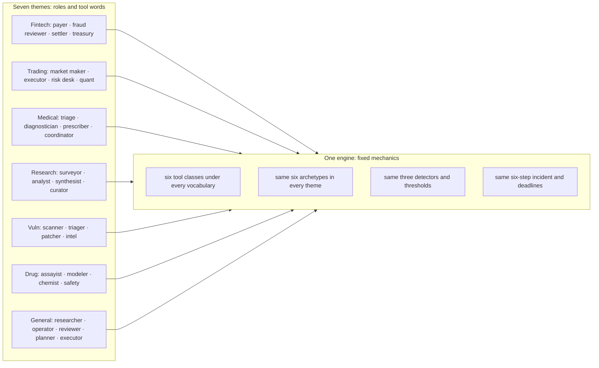

## Chapter 3: Seven themed swarms, one engine

A theme changes roles and tool vocabulary, never mechanics — the six tool classes underneath are fixed, only their names change. That is what keeps results comparable across domains: fintech's payment instruction and drug discovery's synthesis plan are the same write class wearing different clothes.

| Theme | Swarm | Tool vocabulary (search / write / external) |
|---|---|---|
| General swarm | researcher, operator, reviewer, planner, executor | search / write / external call |
| Fintech | payer, fraud-reviewer, settler, treasury | sanctions lookup / payment instruction / bank rail |
| Trading | market-maker, executor, risk-desk, quant | market-data scan / order entry / venue API |
| Medical advice | triage, diagnostician, prescriber, care-coordinator | guideline lookup / care-plan note / lab/pharmacy API |
| Research landscape | surveyor, analyst, synthesist, curator | literature search / review draft / repository API |
| Vulnerability detection | scanner, triager, patcher, intel | advisory search / patch / target scan |
| Drug discovery | assayist, modeler, chemist, safety | compound search / synthesis plan / lab instrument |

The themes are not costumes: each was run through the same guarded reference campaign, and every one of them detects 9/9 with zero false positives and full SLA compliance. That is the point of fixing the mechanics — a theme that changed detectability would be a different simulator wearing the same name.

| Theme (guarded) | Detected | False positives | Contained | Blast μ/max | SLA |
|---|---|---|---|---|---|
| General swarm | 9/9 | 0 | 9 | 0/0 | 100% |
| Fintech | 9/9 | 0 | 9 | 0/0 | 100% |
| Trading | 9/9 | 0 | 9 | 0/0 | 100% |
| Medical advice | 9/9 | 0 | 9 | 0/0 | 100% |
| Research landscape | 9/9 | 0 | 9 | 0/0 | 100% |
| Vulnerability detection | 9/9 | 0 | 9 | 0/0 | 100% |
| Drug discovery | 9/9 | 0 | 9 | 0/0 | 100% |

Uniform 9/9 across themes is evidence the detectors key off mathematics, not vocabulary — renaming write to order entry buys no stealth. The attack surface that differs per theme is the grant structure: the prescriber holds e-script authority the way the payer holds payment authority, so study the theme's grants, not its labels.

**Definition 1 (Theme parity).** Two themes satisfy *parity* if, run through the identical guarded campaign (same archetype mix, thresholds, deadlines), they produce identical detection, containment, and false-positive outcomes — differences confined to role names and tool vocabulary.

**Theorem 1 (Mechanics-vocabulary separation).** If all seven themes satisfy parity (measured: 9/9, zero false positives, full SLA on every theme), then detectability is a function of mechanics alone — vocabulary carries no detection-relevant information.

*Proof.* The themes differ only in role names and tool words; mechanics (tool classes, archetypes, detectors, thresholds, incident steps) are fixed across all seven. Identical outcomes across maximally different vocabularies implies the outcome function is constant in the vocabulary argument — any vocabulary-dependent detection effect would have produced a theme that deviates, and none does. The red-team corollary follows directly: renaming an attack's tools cannot evade detectors that never read the names. Study the grants, which do differ per theme and therefore carry the residual risk. ∎

The deployment consequence is an afternoon, not a science: when the eighth domain arrives, the work is four role mixes and six tool names — new vocabulary on the fixed engine — then the grant review where themes truly diverge (a prescriber and a payer share mechanics yet demand entirely different approval gates and human owners). Pick the theme that matches your fleet before reading any other number: the per-rogue names, the board cases, and the report all speak the theme's role ids, and a finding that cannot name your roles will not survive the handoff.

**Council deliberation.**

- **Continual-learning researcher:** I see the seven themes as proof that vocabulary can change while dynamics stay fixed. Fintech, trading, medical advice, research, vulnerability detection, drug discovery and the general swarm each rename roles and tools, yet the underlying action classes remain the same, so a payment instruction and a synthesis plan are the same kind of move. We disagree on how far this comparability travels, since real domains differ in stakes and tempo, but for rehearsal the fixed mechanics are the point. Monday morning, pick the theme closest to your fleet so findings name roles your team actually owns.
- **Evaluation methodologist:** I value theme parity because it lets one detector tuning and one response workflow serve many domains. When every theme is run through the same guarded campaign with comparable outcomes, a new domain becomes a modest authoring task of role mixes and tool names rather than a new detection science. My caution is that renaming is not threat modeling: grants, authority and irreversible actions still differ by theme and deserve separate review. Monday morning, treat uniform results as evidence the instruments key off mathematics rather than labels, then study the grant structure where themes truly diverge.
- **Safety researcher:** I read the themes as deployment guidance. Each theme tells the operator which authorities matter most, from payment rails to venue adapters to prescribing rights to scan targets, and therefore which controls deserve priority. The disagreement I have with the continual-learning view is that I think themes understate difference: a prescriber and a payer may share mechanics yet demand entirely different approval gates and human owners. Monday morning, use the theme to assign owners and deadlines in domain language, because a finding that cannot name your roles will not survive handoff.

**Council reading.**

- **Red team:** Uniform 9/9 across themes tells you the detectors key off mathematics, not vocabulary — renaming write to order entry buys no stealth. The attack surface that differs per theme is the grant structure: prescriber holds e-script authority the way payer holds payment authority, so study the theme's grants, not its labels.
- **Blue team:** Theme parity is a deployment argument: one detector tuning, one response workflow, seven domains. When the eighth domain arrives, the work is four role mixes and six tool names — an afternoon — not a new detection science.
- **Operator:** Pick the theme that matches your fleet before you read any other number in this book: the per-rogue agent names, the board cases and the report all speak the theme's role ids. A finding that cannot name your roles will not survive the handoff to the team that owns them.
