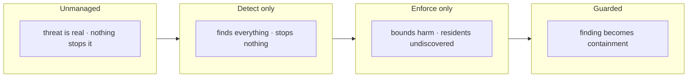

## Chapter 7: What the reference campaign measured

Reference campaign: default configuration (300 agents, 120 ticks, seed 20260401). Four presets answer the operator's four questions:

| Preset | Detected | False positives | Contained | Escaped | Blast μ/max | SLA |
|---|---|---|---|---|---|---|
| Unmanaged | 0/9 | 0 | 0 | 9 | 59.7/79 | — |
| Detect-only | 9/9 | 3 | 0 | 0 | 21.7/45 | 0% |
| Enforce-only | 0/9 | 0 | 0 | 9 | 0/0 | — |
| Guarded | 9/9 | 0 | 9 | 0 | 0/0 | 100% |

| Archetype (guarded) | Detected | Contained | Escaped | Mean ticks to detect | Mean blast |
|---|---|---|---|---|---|
| Goal hijack | 2/2 | 2 | 0 | 19 | 0 |
| Data exfiltration | 2/2 | 2 | 0 | 2.0 | 0 |
| Capability abuse | 2/2 | 2 | 0 | 2.0 | 0 |
| Collusion | 1/1 | 1 | 0 | 2 | 0 |
| Slow drift | 1/1 | 1 | 0 | 63 | 0 |
| Sybil / fleet spawn | 1/1 | 1 | 0 | 13 | 0 |

Slow drift is the last to be found and collusion the hardest shape to spot — both are contained once found, which is the argument for pairing patient detectors with an automatic response.

Read the four presets as a controlled experiment. Unmanaged proves the threat is real: 9/9 escape with a mean blast of dozens of peers. Detect-only proves monitoring without enforcement is observation, not defense: everything is found, nothing is stopped, and the SLA sits at 0% because cases with no workflow behind them breach every step. Enforce-only proves the mirror: every rogue is bounded, blast is zero, but nothing is ever found — the rogues are still in the swarm at the end of the run. Only the guarded combination converts detection into containment, and it does so with zero false positives on the reference run — enforcement changes what the detectors see next, so the two halves must be measured together, never separately.

**Definition 1 (Preset matrix).** The *preset matrix* is the $4 \times 6$ measurement of (unmanaged, detect-only, enforce-only, guarded) against (detected, false positives, contained, escaped, blast, SLA) at fixed seed 20260401 — the control group for every tuning decision, since any configuration change is measurable as a delta against these four rows.

**Theorem 1 (Halves interact).** Detection and enforcement interact: neither half's value is measurable alone, because each changes what the other observes — enforcement alters subsequent detector inputs (quarantined rogues stop emitting), and detection without enforcement breaches every SLA step (measured: detect-only SLA 0%).

*Proof.* Detect-only finds 9/9 with 3 false positives yet contains 0 and breaches 100% of SLA steps: finding without workflow is observation, and the 0% SLA is the measurement of cases with no one working them. Enforce-only bounds blast to zero yet finds 0/9: the swarm ends populated with undiscovered residents — harm bounded, rogues resident. Only guarded (9/9, zero false positives, 9 contained, 100% SLA) shows both halves, because enforcement's quarantines change the detector stream (fewer active rogues to find, cleaner baselines afterward) while detection's cases drive the enforcement workflow. Measure them together or misattribute both. The per-archetype pattern completes the picture: patient shapes found late (drift 63 ticks, hijack 19), loud shapes found fast (2 minutes) — yet all contained once found, because the response is automatic. Run these four presets on your own theme before changing anything; if your guarded row does not read 9/9 contained with zero false positives, stop and find which assumption differs. ∎

**Council deliberation.**

- **Continual-learning researcher:** I read the four presets as a controlled experiment about what each half of defense actually contributes. Unmanaged shows the threat is real, detect-only finds everything yet stops nothing, enforce-only bounds harm yet leaves residents undiscovered, and only the guarded combination converts finding into containment. My dispute is with anyone who reads detect-only as progress: observation without enforcement is theater. Monday morning, run these presets on your own theme before changing anything, since they form the control group for every later tuning decision.
- **Evaluation methodologist:** I emphasize that detection and enforcement interact, so they must be measured together rather than separately. Cases without a workflow breach every step, while bounds without detection leave the swarm populated at the end, and only joint measurement reveals which failure you inhabit. The per-archetype pattern also matters: patient shapes are found late while loud shapes are found quickly, yet both are contained once found when response is automatic. Monday morning, use the preset matrix to audit whether your organization reports detections but funds no response, or bounds harm but never finds residents.
- **Safety researcher:** I take the campaign as proof that automatic response is what makes deadlines reachable. Human-speed remediation cannot meet machine-speed isolation and revocation needs, and honest compliance math exposes that gap rather than hiding it. A guarded outcome shows the workflow is wired rather than showing the swarm is safe, a distinction the tab prints plainly. My disagreement with optimists is sharp here: passing rehearsal never predicts on-call reality. Monday morning, treat the guarded result as wiring proof and keep investing in staffing, drills and evidence infrastructure.

**Council reading.**

- **Red team:** The preset matrix tells you where the program is soft: detect-only is a security theater with perfect recall and zero containment — if your organization reports detections but funds no response workflow, you live in that row. Enforce-only is the opposite trap: zero blast, nine residents. Audit which row you actually inhabit before buying anything.
- **Blue team:** The 0% SLA of detect-only is the strongest argument in this book for automated response: human-speed remediation cannot meet machine-speed deadlines, and the compliance math counts that honestly. The guarded 100% is not a claim of safety — it is proof the workflow is wired, the same honest caveat the tab prints.
- **Operator:** Run these four presets on your own theme before changing anything: they are the control group for every tuning decision you will ever make. If your guarded row does not look like 9/9 contained with zero false positives, stop and find out which assumption differs — swarm size, archetype mix, or thresholds — before adding controls.

---

