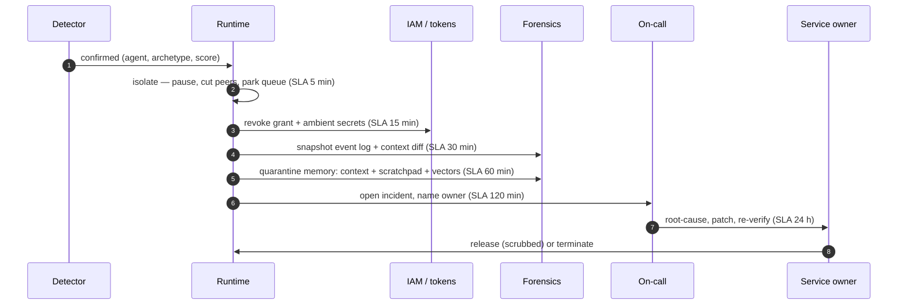

# Part III: Containment and safe operation

## Chapter 8: The quarantine workflow

Detection opens the same six-step incident every time, with deadlines counted in minutes from the detection. The simulation runs the same workflow on the same deadlines, so a breach in the simulation is a breach on the board.

| Step | SLA | Owner | What happens |
|---|---|---|---|
| Isolate | 5 min | runtime | Pause the agent, cut its peer channels, park its queue. |
| Revoke credentials | 15 min | iam | Revoke the capability token and any ambient secret it holds. |
| Capture evidence | 30 min | forensics | Snapshot the event log, the task frame and the context diff. |
| Quarantine memory | 60 min | runtime | Move context, scratchpad and vector entries into quarantine. |
| Hand off to a human | 120 min | soc | Open the incident, name an owner, tell the on-call. |
| Remediate & re-verify | 1440 min | owner | Root-cause, patch, re-verify, then release or terminate. |

**Definition 1 (Deadline-ordered incident).** The six-step incident is *deadline-ordered* if steps execute in the fixed sequence (isolate 5, revoke 15, evidence 30, memory 60, handoff 120, remediate 1440 minutes) with each step owned in advance, and a step's breach is counted and reported rather than silently absorbed.

**Theorem 1 (Speed-judgment split).** The workflow is optimal in its automation split: the steps where speed beats judgment (isolate, revoke) are automatic, and the steps where judgment beats speed (handoff, remediate) are human — with evidence and memory quarantine as the ordered bridge between them.

*Proof.* Peer spread begins in minutes, so isolation and revocation cannot wait for a human — automation is necessary, and the reference 5-minute mean post-detection is its measurement. Handoff and remediation involve attribution, employment consequences, and root cause — decisions no runtime should make — so humans are necessary, with reachable owners named in advance (an unowned clock is already breached). Evidence capture must precede memory quarantine (the scrub destroys evidence along with compromise), fixing their order: snapshot at 30, quarantine at 60. Any reordering either delays containment (human-gating the fast steps), destroys forensics (scrub before snapshot), or automates judgment (releasing without a named owner). The SLA clocks make the split visible — put them where the on-call can see them, staff to the deadlines not the steps, and rehearse the handoffs that stall, because the human steps are where cases go to die. ∎

**Council deliberation.**

- **Continual-learning researcher:** I see the six-step incident as isolate, revoke, capture evidence, quarantine memory, hand off to a human, and remediate with reverification. Each step exists because a measured failure demanded it, with early steps favoring speed and later steps favoring judgment. Forensics must precede the memory scrub, since the scrub destroys evidence along with compromise. My debate with others is whether handoff should occur earlier; I favor keeping machines on the first steps so humans receive a contained case. Monday morning, put the clocks where the on-call can see them and rehearse the handoffs that tend to stall.
- **Memory-systems researcher:** I regard evidence capture and memory quarantine as the load-bearing pair. The snapshot of event log, task frame and context difference must happen before quarantine moves context, scratchpad and retrieved entries aside, or reconstruction becomes impossible. Release without a scrub invites relapse, which turns a contained incident into a returning one. Others focus on isolation speed, and it agrees it matters, yet I insist the slow steps decide whether the incident stays closed. Monday morning, verify that the audit store supports a true snapshot read rather than a hopeful reconstruction.
- **Safety researcher:** I staff to deadlines rather than steps. Isolation must be automatic because no human reliably acts in minutes, handoff needs a reachable owner within hours, and remediation needs an owner with a day-scale mandate for root cause and patching. The human steps are where cases stall, especially when the board floods, so queue management is itself a control. My disagreement with automation enthusiasts is that I would never automate release; attribution and consequences need a named human. Monday morning, name the owner for each deadline in advance, since an unowned clock is already breached.
