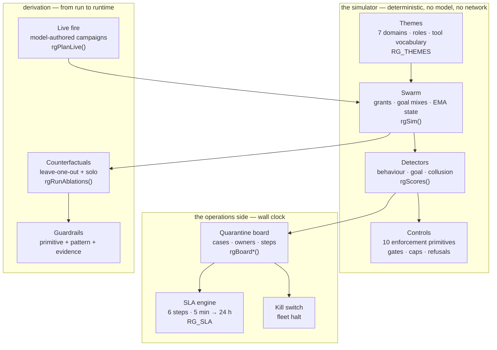

# Part VI: Operating the tab

## Chapter 25: Setup, results, board, guardrails

Setup picks the swarm, the injection rate, the detectors, the ten controls and the six rogue shapes — or one of four presets: unmanaged, detect-only, enforce-only, guarded. Results reports detection, containment, blast radius and the harm ledger with per-rogue rows; the board turns confirmed detections into cases with wall-clock SLA clocks, owners and a fleet kill switch; guardrails maps each control to its runtime primitive and its pattern, with leave-one-out and solo counterfactuals proving which controls carry the result.

Operate it as a loop, not a tour. Start from a preset (guarded for posture, unmanaged for the scare that funds posture), change one thing, re-run, and read the delta — the run header stamps seed, theme and timing so any delta is attributable. Seed the board from a run to turn a simulation into an incident drill: the same SLA clocks, the same owners, the same kill switch, but nobody's money is moving. Close the loop in guardrails: toggle a control, re-run the counterfactuals, and keep only what the numbers defend.

**Definition 1 (Attributable delta).** A re-run produces an *attributable delta* if it changes exactly one input (setup, threshold, control toggle) against the same seed, theme, and timing — so every output difference is caused by that change and nothing else.

**Theorem 1 (One change, one lesson).** If every re-run changes at most one thing and stamps seed, theme, and timing, then the sequence of runs forms a controlled experiment — each delta teaches exactly one lesson, and the board seeded from a run inherits the run's attribution.

*Proof.* Deterministic simulation at fixed seed, theme, and timing is a pure function of setup: same inputs, same outputs. Changing one input and re-running attributes all output differences to that input — the delta is the lesson. Changing two things at once confounds attribution (which change caused which difference?), which is why the discipline is one thing, re-run, read the delta. Seeding the board from a run carries the attribution into operations: the drill's cases inherit the run's seed and theme, so the drill teaches the same lesson the run measured. Skip a view and the loop breaks — results without setup is anecdote, a board without guardrails is triage without learning. Make it a cadence: weekly preset re-runs, monthly board drills, quarterly counterfactual reviews, with the report, board export, and ablation table as the evidence produced before anyone asks. ∎

**Council deliberation.**

- **Continual-learning researcher:** I view setup, results, board and guardrails as a loop rather than a tour. Setup fixes swarm, injection, detectors, controls and shapes or starts from a preset, results fuse evidence per rogue, the board turns detections into owned cases with visible clocks, and guardrails ties each control to its primitive and pattern with counterfactual proof. My dispute is with one-pass users; a single run is anecdote while deltas across runs are learning. Monday morning, change one thing at a time and read the delta, seeding the board from a run to drill without moving real value.
- **Evaluation methodologist:** I see the four views as defense in depth for attention. Setup constrains the experiment so results stay attributable, results prevent cherry-picking by showing per-rogue rows, the board paces response with explicit deadlines and owners, and guardrails prevents control rot by demanding proof for every control kept. Skipping any view reintroduces the failure it guards. My caution concerns reproducibility: stamps of seed, theme and timing must travel with every claim. Monday morning, establish a cadence of frequent preset reruns, periodic board drills and regular counterfactual reviews before budget decisions.
- **Safety researcher:** I emphasize that honest outputs also aid adversaries, since thresholds, persistence windows and deadlines are printed openly. Assume counterparts have run the same presets and know how long they hold between activation and quarantine under your settings. That transparency is still worth it because it forces real deadlines and owned cases. My disagreement with secrecy advocates is that hidden settings rot faster than open ones. Monday morning, use the board export and ablation table as auditor evidence, producing them before reviewers ask rather than after an incident demands them.

**Council reading.**

- **Red team:** The tab's honest outputs are also reconnaissance: thresholds, persist windows and SLA deadlines are printed in the open. Assume your adversary has run the same unmanaged preset you have and knows exactly how long they have between activation and quarantine on your settings.
- **Blue team:** The four views are defense in depth for attention: setup constrains the experiment, results fuse the evidence, the board paces the response, guardrails prevents control rot. Skipping any one view reintroduces the failure it guards — results without setup is anecdote, a board without guardrails is triage without learning.
- **Operator:** Make it a cadence: weekly preset re-run on your theme (five minutes), monthly board drill seeded from a run (one hour), quarterly counterfactual review before the controls budget (half a day). The artifacts — report, board export, ablation table — are the evidence your reviewers and auditors will ask for; produce them before they ask.
