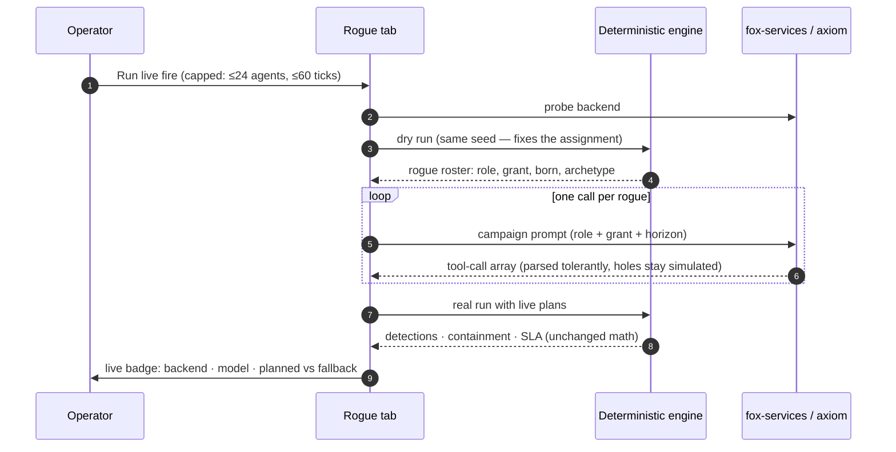

## Chapter 26: Live fire

Live fire hands the attack to the model backend (fox-services by default): a dry synchronous run fixes the rogue assignment, one model call per rogue writes its tool-call campaign, and the deterministic engine executes it. Caps keep it plannable (24 agents, 60 ticks); tolerant parsing turns unknown labels into holes the engine fills by drawing; anything the model never answers for stays simulated and flagged. If every call fails, no run starts — a fully simulated run must never wear a live badge.

Read live results differently from synthetic ones. A synthetic campaign is the same six shapes every run — comparable, repeatable, blind to novelty. A live campaign is whatever the model thought of this time: less comparable, more surprising, and the only rehearsal that can show you a shape you did not hand-write. The run badge records backend, model, planned and fallback counts so the provenance is never ambiguous, and the guardrails note reminds you the counterfactuals re-run simulated — read their deltas as control effects, not model effects.

**Definition 1 (Badged run).** A live run is *badged* if it records (backend, model, planned count, fallback count, seed, theme) — distinguishing model-authored campaigns from engine-filled holes, so every downstream decision knows which parts were imagined and which were drawn.

**Theorem 1 (No mislabeled runs).** Under badged runs with refusal on total model failure, no fully simulated run can wear a live badge, and no partially simulated run can hide its simulated fraction — provenance is preserved from campaign to conclusion.

*Proof.* Total model failure refuses to start (no run, no badge — the tab's explicit rule), so a live badge implies at least one model-authored campaign. Tolerant parsing flags every hole the engine fills by drawing, and the badge counts planned versus fallback, so the simulated fraction is printed on the run. Counterfactuals re-run simulated by design, and the guardrails note labels their deltas as control effects, not model effects. A decision calibrated to a threat that was never there requires misreading a badge that states the provenance plainly — possible only by ignoring the run's own label. Keep caps on, flag fallbacks, refuse to start on total failure; use synthetic runs for regression and tuning (cheap, comparable) and live runs for imagination (expensive, surprising) — one live campaign per theme per quarter, promoting the interesting shapes into archetype notes rather than thresholds. ∎

**Council deliberation.**

- **Continual-learning researcher:** I see live fire as handing campaign authorship to a model backend while keeping execution deterministic. A dry run fixes the assignment, one call per rogue proposes a tool-call campaign, tolerant parsing fills holes by drawing, and anything unanswered stays simulated and flagged. If every call fails, no run starts, so a simulated run never wears a live badge. My debate with enthusiasts is about novelty versus comparability; live campaigns surprise while synthetic campaigns repeat. Monday morning, use synthetic runs for regression and live runs sparingly to harvest shapes worth promoting into notes.
- **Evaluation methodologist:** I insist live results be read differently from synthetic ones. Synthetic campaigns repeat the same hand-written shapes for fair comparison, while live campaigns reflect whatever the model proposed this time, making them less comparable but more imaginative. Provenance must travel with every claim through badges naming backend, model and fallback counts, and counterfactuals must be labeled as control effects rather than model effects. My caution is about the live label itself; a mislabeled run corrupts every downstream decision. Monday morning, keep caps on and fallbacks flagged, refusing to start when model failure is total.
- **Safety researcher:** I treat live fire as an adversary preview that must stay fenced. The same model family that writes campaigns may resemble a real attacker, so its tool preferences and ramp choices are data about priors worth studying. Yet the fence matters more than the insight: capped scale, flagged fallbacks and honest badges prevent calibrating to a threat that was never there. I disagree with frequent live-fire advocates; imagination does not need weekly runs. Monday morning, run live campaigns on purpose per theme each season, then invest the learning in gates and pair-level accounting.

**Council reading.**

- **Red team:** Live fire is the adversary previewing your preview: the same model family that writes the campaigns may write the real attack. Study what it reaches for — which tools, which grants, how fast it ramps — because its preferences are data about the model's own priors, and your real adversary may share them.
- **Blue team:** Keep live fire fenced exactly as the tab fences it: caps on, fallbacks flagged, badges honest. The failure mode to fear is a 'live' label on a simulated run, because every decision downstream of it is calibrated to a threat that was never there. The tab refuses to start over total model failure for precisely this reason.
- **Operator:** Use live fire sparingly and on purpose: synthetic runs for regression and tuning (cheap, comparable), live runs for imagination (expensive, surprising). One live campaign per theme per quarter is enough to harvest novel shapes; promote the interesting ones into archetype notes, not into thresholds.
