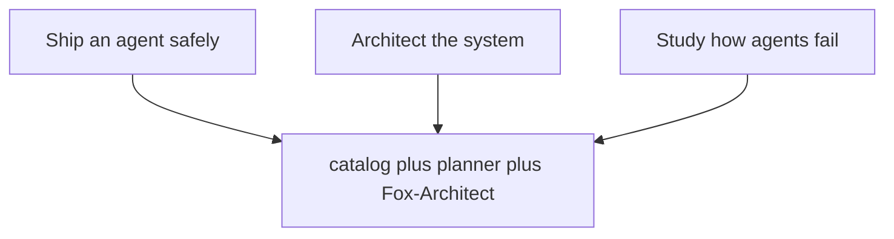

# Introduction: three jobs, one workbench

Three jobs, one shared backend: ship an agent safely, architect the system, study how agents fail — and all three draw on the same catalog plus planner plus Fox-Architect. The diagram's convergence is the point. Jobs differ in their questions and their artifacts, not in their evidence: the deployment plan, the blueprint, and the failure study all argue from the same 107 patterns, 54 scenarios, and 191 cascades. One catalog, three jobs, zero translation loss between them.

The catalog behind this book holds 107 patterns, 54 failure scenarios and 191 cascades across 26 domains, served through 15 tabs in six sections plus the command palette. Catalog edition: counts below are read from data/\*.json at build time. Every scenario below is assigned to the workflows that serve it by a stated rule; every domain chapter lists its real catalog scenarios.

## The assignment rule, and why it is printed here

The assignment rule, printed here so it can be argued with: every scenario starts in Scenarios, gets rehearsed in Rogue ops against its archetype, and is read against its domain gap in Coverage. Scenarios with mock runs add Live traces; boundary shapes (hijack, exfiltration) add the Guardrail lab; authority shapes (abuse, collusion, spawning) add Blueprints; high-stakes domains add the Deployment planner. Fox-Architect and design docs serve every scenario and get their own chapters instead of per-row mentions.

Printing the rule is a falsifiability device. Any reader can take any scenario, apply the rule, and check the chapter's served-by list — if a hijack shape lacks the Guardrail lab, either the rule or the chapter is wrong, and the book fails its build rather than drift. The rule is stated once, in one place, so that all 54 assignments are checkable consequences instead of 54 independent claims.

**Definition 1 (Assignment function).** Let $S$ be the set of 54 catalog scenarios. The assignment $A : S \to \mathcal{P}(W)$ maps each scenario to the set of workflows serving it, where $W$ is the workflow set, computed by the rule: base $\{ \mathrm{Scenarios}, \mathrm{RogueOps}, \mathrm{Coverage} \}$, plus $\mathrm{LiveTraces}$ if a mock run exists, plus $\mathrm{GuardrailLab}$ if the road is a boundary shape, plus $\mathrm{Blueprints}$ if an authority shape, plus $\mathrm{DeploymentPlanner}$ if the domain is high-stakes.

**Theorem 1 (Coverage completeness).** For every $s \in S$, $|A(s)| \geq 3$: no scenario is served by fewer than the three base workflows.

*Proof.* The rule assigns the base triple unconditionally — Scenarios for the story, Rogue ops for the archetype rehearsal, Coverage for the domain gap — before any conditional clause. The conditionals only add workflows. Hence $|A(s)| \geq 3$ for all $s$, by construction of the rule. The per-chapter served-by lists are the computed values of $A$, verifiable against the rule line by line. ∎

**Counsel of architects.**

- **Continual-learning architect:** I define the workbench as three jobs sharing one catalog: plan a deployment safely, architect the system, and study how agents fail. Every tab serves at least one job, and the palette jumps between them without losing context. My dispute is with tab-tour onboarding that shows everything and assigns nothing; start from the job and the tabs arrange themselves. Monday morning, name your job before opening the app.
- **Memory-systems architect:** I emphasize that all memory here is local: projects, libraries, runs, boards and drafts live in the browser store on your machine, exportable as JSON or Markdown, working from a static host with no backend at all. Nothing you rehearse has to leave the room. Others focus on features; I insist ownership of the working record is the feature. Monday morning, export one artifact and confirm you can read it without the app.
- **Evaluation architect:** I read the introduction as scoping what this book proves versus what it shows. What it proves: the inventory — every tab, every action name validated against the shipped code, every scenario assigned to workflows by a stated rule, every domain covered. What it shows: walkthroughs of each workflow in its canonical order. The honest line between the two runs through the whole book. Monday morning, restate that boundary whenever a walkthrough travels upward as a promise.
- **Safety architect:** I translate the workbench into an operating stance: plan before granting, rehearse before trusting, review before releasing, and write down who owns each step. The workflows below are the standing orders; the counsel readings are the debate behind them. My disagreement is with teams that improvise incident response from a catalog; rehearse the handoffs until they are boring. Monday morning, verify the halt works, the board is reachable, and the backlog has an owner.
