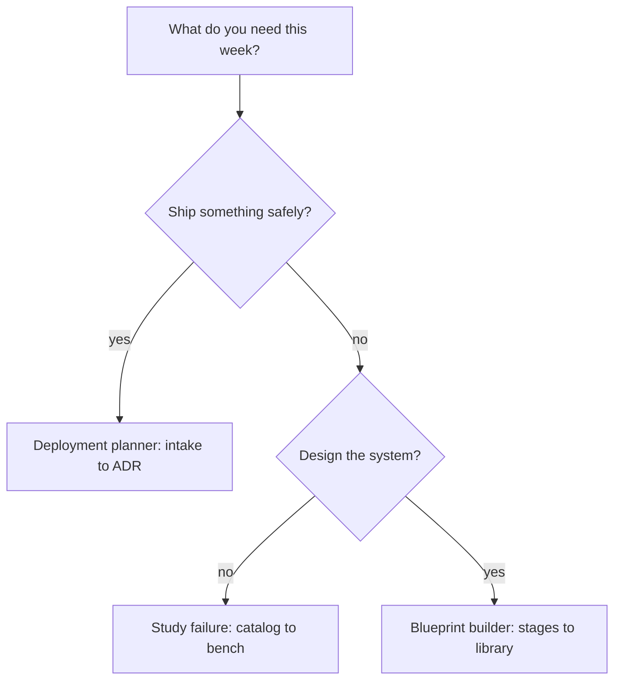

# Part I — The workbench and its three jobs

## Chapter 1: The three jobs

Ship an agent safely, architect the system, study how agents fail. Each job lines up a different slice of the catalog, the planner and Fox-Architect behind it, so the first click already has a purpose — and each job ends with an artifact, not a browse history: a readiness score with a rollout plan and an ADR, stages with controls and estimates in the library, or rehearsed shapes with measured bands.

The router above is the only onboarding that sticks, because it starts from the reader's week instead of the app's map. A feature tour ends at awareness; a job ends at an artifact. The three jobs are distinguished by what they keep, not by what they show: the deployment job keeps a readiness score, a stack, a rollout plan and an ADR; the architect job keeps stages, controls and estimates in the library; the study job keeps rehearsed shapes and measured bands. Name the artifact before starting the job, and the tabs arrange themselves around it.

**Definition 1 (Job acceptance).** A job $J$ is *complete* iff its acceptance artifact exists and is filed: the ship job requires (readiness score, rollout plan, ADR); the architect job requires (stages, controls, estimates) saved to the library; the study job requires (rehearsed shapes, measured bands) on record.

**Theorem 1 (No browse-history jobs).** If completion is defined by Definition 1, then no sequence of tab visits without a filed artifact counts as doing the job.

*Proof.* Completion is a predicate over artifacts, not over activity: the score, the library entry, and the rehearsal record either exist or they do not. Browsing produces no artifact in any of the three sets, so no amount of it satisfies the predicate. The onboarding cards are therefore routers with acceptance criteria, not marketing — entering through a job card and finishing what it starts is the only path to "done." ∎

The minimum viable program falls out immediately: every team shipping agents should be able to produce a deployment plan, a system architecture, and a recent failure rehearsal on demand. If any of the three is missing, that is the gap to work first — two of three is not coverage, it is a program with a named hole.

**Counsel of architects.**

- **Continual-learning architect:** I read the three jobs as the only onboarding that sticks: ship an agent safely, architect the system, study how agents fail. Each job lines up a different slice of the catalog, the planner and Fox-Architect behind it, so the first click already has a purpose. My dispute is with feature tours that end at awareness; a job ends at an artifact. Monday morning, enter through one job card and finish what it starts.
- **Memory-systems architect:** I focus on what each job keeps: the deployment job keeps a readiness score, a stack, a rollout plan and an ADR; the architect job keeps stages, controls and estimates in the library; the study job keeps rehearsed shapes and measured bands. Jobs are distinguished by their artifacts, not their clicks. Others emphasize the starting point; I insist the kept record is what makes it a job. Monday morning, name the artifact before starting the job.
- **Evaluation architect:** I value that the three jobs are testable claims: a deployment plan either scores readiness or it does not, a blueprint either estimates or it does not, a failure study either rehearses or it does not. Vague jobs produce vague outcomes. My caution is against treating the onboarding cards as marketing; they are routers with acceptance criteria. Monday morning, define done for the job you pick.
- **Safety architect:** I staff the three jobs as the minimum viable program: every team shipping agents should be able to show a deployment plan, a system architecture, and a recent failure rehearsal on demand. If any of the three is missing, that is the gap to work first. My disagreement is with programs that do two of three and call it coverage. Monday morning, check which of the three you cannot produce this week.
