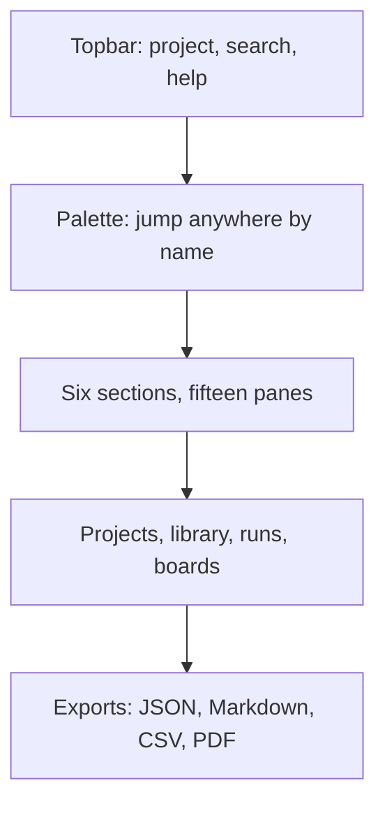
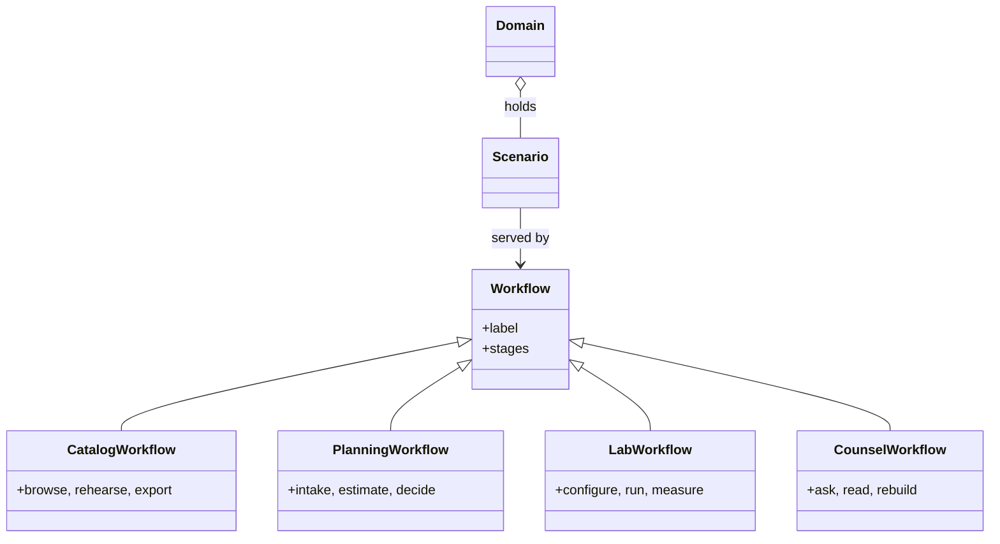

## Chapter 2: Shell, palette, and projects

Fifteen panes in six sections, one palette that jumps anywhere by name, keyboard shortcuts for the pointerless, and deep links for everything with an identity — drawers, cases, scenarios, runs. The shell is navigable at speed and linkable for handoff: send the link, not the screenshot.

Under the shell sits the memory: the current-project chip, per-tab save stamps, the blueprint library, saved runs and boards and promoted drafts — persisted in the browser, exportable as JSON, working from a static host with no backend at all. Context that survives is context that compounds.

The palette is the chapter's speed thesis. Fifteen panes in six sections is too many to browse efficiently and exactly enough to address by name — every jump you memorize is seconds back forever, while mouse-only operators pay the navigation tax on every visit. Keyboard shortcuts move without a pointer; deep links give every drawer, case, and scenario an address you can send. The handoff rule follows: a link carries the live object with its context, while a screenshot carries pixels with your interpretation baked in. Send the link.

The class diagram above is worth reading as an addressability claim: every workflow is a subclass with named stages, every scenario links to the workflows that serve it, every domain holds its scenarios. Addressability is what makes the shell a memory system with a search box rather than a dashboard with tabs — knowledge that cannot be linked rots in place, while linked knowledge compounds across sessions, machines, and teammates. The same palette, the same tabs, the same links mean the on-call and the auditor look at the same objects, which is a safety property when minutes matter: shared addressability is shared situational awareness.

**Counsel of architects.**

- **Continual-learning architect:** I see the shell as speed without loss of place: the command palette jumps anywhere by name, section tabs keep fifteen panes in six groups, and keyboard shortcuts move without a pointer. Fluency here compounds — every jump you memorize is seconds back forever. My dispute is with mouse-only operators; the palette is the fastest way to work this catalog. Monday morning, learn three palette queries by heart.
- **Memory-systems architect:** I emphasize the project layer that wraps the shell: current-project chip, per-tab save stamps, library persistence and JSON export mean the workbench remembers across sessions and machines. Context that survives is context that compounds. Others focus on navigation; I insist the shell is a memory system with a search box. Monday morning, export one project and confirm the round trip.
- **Evaluation architect:** I treat shell fluency as measurable: palette results ranked, shortcuts discoverable through the help overlay, tab state restorable from the address bar. The deep-link habit matters most — every drawer, case and scenario has an address you can send. My caution is link rot across versions; pin the version with the link. Monday morning, send one deep link instead of a screenshot.
- **Safety architect:** I map the shell to shared situational awareness: the same palette, the same tabs, the same links mean the on-call and the auditor look at the same objects. Consistency of address is a safety property when minutes matter. My disagreement is with private workflows that cannot be linked or exported. Monday morning, verify your current investigation is shareable as links and exports.
