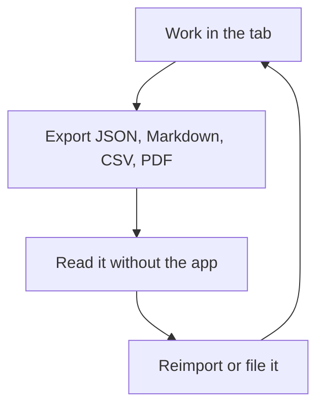

## Chapter 3: Yours: offline-first and exportable

Static hosting, browser persistence, deterministic fallbacks when backends are unreachable, and exports that stand alone: JSON for state, Markdown for reports, CSV for backlogs, PDF for books. Nothing rehearsed here needs production credentials or real customer data — mock and open data exercise the same paths.

The loop above is the chapter's portability proof drawn as a diagram: work in the tab, export to open formats, read the export without the app, reimport or file it, continue. Every arrow is checkable — open one export in a plain editor and confirm it stands alone; confirm what leaves your machine when you use each tab, and prefer the answer nothing. Local-first is the precondition for honest rehearsal: the lab fits inside your boundary, so sensitive work never depends on infrastructure you do not control.

**Definition 1 (Export independence).** An artifact is *export-independent* if it is complete, interpretable, and reusable with only commodity tools — no app, no backend, no account — carrying its versions and seeds with it.

**Theorem 1 (Round-trip integrity).** If every workflow emits export-independent artifacts and reimport accepts exactly those formats, then the full working record survives app loss, backend loss, and version change: the files are the program's memory, not its exhaust.

*Proof.* Consider each loss in turn. App loss: artifacts are readable in plain editors by Definition 1, so nothing is stranded. Backend loss: deterministic fallbacks serve the workflows, and the artifacts carry the versions and seeds needed to re-derive results when backends return. Version change: seeded runs plus versioned data files make outputs attributable to their inputs, so stale caches are detectable rather than silent — the shell checks its own freshness and says so. In all three cases the record persists because it never lived exclusively inside the thing that was lost. ∎

The containment corollary is for the safety reader: rehearsals of exfiltration, rogue behavior, and live fire run on mock and open data, never on production systems — the fence starts at the lab door, and local-first makes that fence cheap instead of heroic. Verify no rehearsal touches a production system on Monday morning; verify it again every Monday after.

**Counsel of architects.**

- **Continual-learning architect:** I read local-first as the precondition for honest rehearsal: static hosting, browser persistence, deterministic fallbacks when backends are unreachable, and exports that stand alone. You can run the whole program on your own machines with your own data. My dispute is with cloud-mandatory tooling for sensitive work; the lab should fit inside your boundary. Monday morning, confirm what leaves your machine when you use each tab — and prefer the answer nothing.
- **Memory-systems architect:** I focus on the export discipline: JSON for state, Markdown for reports, CSV for backlogs, PDF for books — every artifact readable without the app that made it. Vendor-neutral artifacts outlive every tool. Others celebrate features; I celebrate file formats. Monday morning, open one export in a plain editor and confirm it stands alone.
- **Evaluation architect:** I value determinism as the audit property: seeded runs, versioned data files, and builds that fail rather than drift. Reproducibility is what separates rehearsal from storytelling, and local-first makes it cheap. My caution is stale caches — the shell checks its own freshness and says so. Monday morning, confirm your outputs carry versions and seeds.
- **Safety architect:** I staff local-first as a containment boundary for the work itself: rehearsals of exfiltration, rogue behavior and live fire should never need production credentials or real customer data. Mock and open data exercise the same paths. My disagreement is with labs that rehearse on production; the fence starts at the lab door. Monday morning, verify no rehearsal touches a production system.
