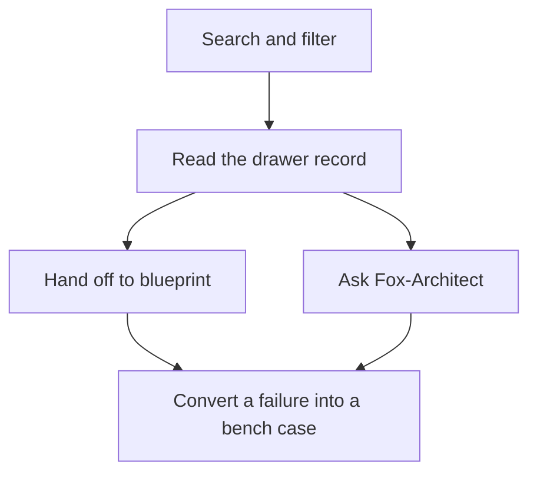
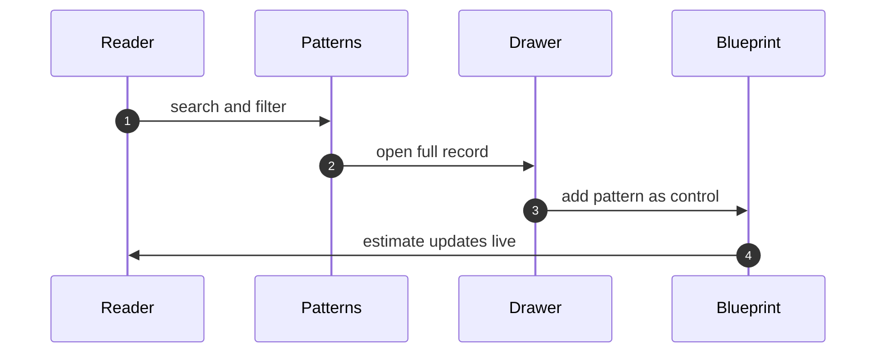

# Part II — Catalog workflows

## Chapter 4: Patterns: search, filter, drawer, handoff

Search by name, failure, or domain; filter by category; open the drawer for the full record — control flow, failures, protections, links — then hand it off: add it to a blueprint or ask Fox-Architect about it. The handoff is the workflow; a pattern that never leaves the drawer never ships.

The drawer is the unit of knowledge: control flow, failures, protections, and links live together, addressable by deep link, so a pattern can be cited in a review or pasted into a plan. Search narrows 107 patterns by name, failure, domain, or category; the drawer shows the full record with diagram and protections; the handoff sends it somewhere it does work. Two exits, and both end at the bench eventually — blueprint controls become bench-tested stages, Fox-Architect answers become red-team prompts.

Of the catalog's 107 patterns, each carries its protections as future blueprint controls and its failure modes as future bench cases. Convert at least one of each: a protection into a stage control, a failure into a test.

**Definition 1 (Drawer completeness).** A pattern record is *complete* if it carries all four: the control-flow shape, the failure modes it admits, the protections that answer them, and the links to scenarios and blueprints where it appears.

**Theorem 1 (Handoff convertibility).** If every pattern record is drawer-complete, then every pattern converts mechanically into at least one blueprint control (from its protections) and at least one bench case (from its failure modes) — no pattern is read-only.

*Proof.* Conversion is a function of record fields, not of reader ingenuity: protections map to stage controls one-for-one, failure modes map to bench cases one-for-one. Drawer completeness guarantees both fields are present for every pattern, so the conversion function is total over the catalog. A pattern that never leaves the drawer is therefore a reader failure, never a record failure — the record always supports the handoff. ∎

The generated-catalog caveat stands alongside the theorem: generated means computed, not complete — counts, categories, and cross-references derive from data files, which makes them consistent, but coverage gaps are themselves catalogued. Check the gap the catalog admits before trusting the part you need; completeness of records is not completeness of the world.

**Counsel of architects.**

- **Continual-learning architect:** I read the patterns workflow as search, filter, read, hand off: find the shape by name or failure, narrow by category and domain, open the drawer for the full record with diagram and protections, then send it to a blueprint or ask Fox-Architect about it. The handoff is the point — a pattern that never leaves the drawer never ships. Monday morning, move one pattern into a blueprint instead of just reading it.
- **Memory-systems architect:** I emphasize the drawer as the unit of knowledge: control flow, failures, protections and links live together, addressable by deep link, so a pattern can be cited in a review or pasted into a plan. Knowledge that cannot be linked rots in place. Others focus on browsing; I insist addressability is the workflow. Monday morning, link one pattern into a live document.
- **Evaluation architect:** I treat the catalog as generated from data files, which means counts, categories and cross-references are computed rather than typed. Trust the structure but verify the edges you rely on. My caution is that generated does not mean complete; coverage gaps are themselves catalogued. Monday morning, check the gap the catalog admits before trusting the part you need.
- **Safety architect:** I map patterns to the build workflow: protections listed per pattern become controls per blueprint stage, and failure modes become test cases for the bench. The catalog earns its keep when it changes what gets built. My disagreement is with reading the catalog as literature; it is a parts list with warnings attached. Monday morning, convert one failure mode into one bench case.
