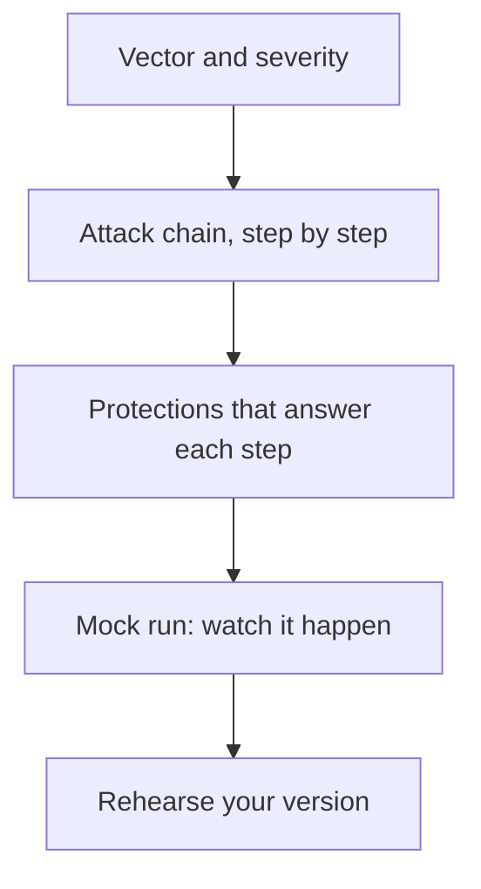
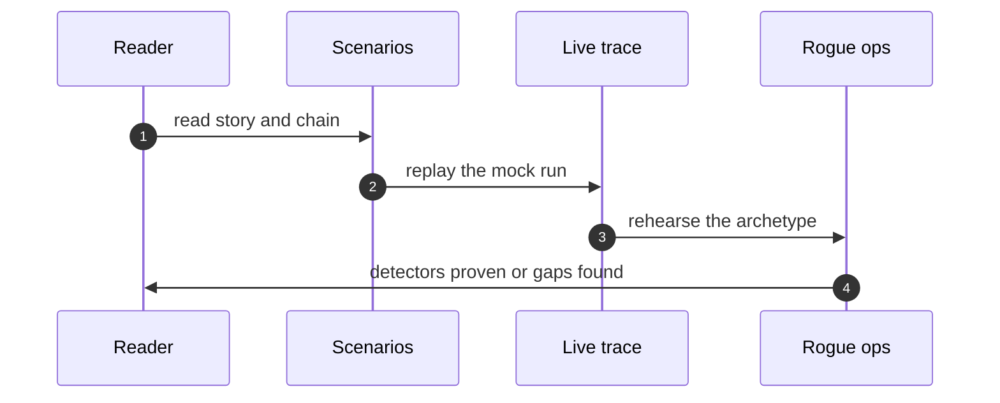

## Chapter 5: Scenarios: read the story, run the trace

Severity, vector and domain get you to the story; the attack chain shows the moves; protections show the answers; the mock run lets you watch it happen. Fifty-four scenarios, each with a road and an archetype, each assigned to the workflows in this chapter's table by the introduction's rule.

Scenarios are drills with names attached, not news to read. The attack chain is the durable artifact — entry, escalation, impact — because individual steps change with tooling while the shape transfers across stacks. Learn shapes, not screenshots: redraw one chain from memory and check it, and the part you misremember is the part to rehearse.

The mix: 32 emergent, 18 injected, 4 both — with hijack leading the archetypes at 19 scenarios. Weight rehearsal by these counts, not by drama.

That sentence is a resource-allocation rule disguised as a statistic. Emergent shapes outnumber injected ones nearly two to one (32 to 18), and hijack alone accounts for more than a third of all scenarios (19 of 54). A rehearsal program weighted by drama chases the scariest story; a program weighted by counts covers the likeliest shapes first.

**Definition 1 (Count-weighted rehearsal).** Let $c(a)$ be the scenario count for archetype $a$ and $R$ the total rehearsal budget. Count-weighted rehearsal allocates $R \cdot c(a)/54$ to each archetype — emergent shapes get roughly three-fifths of the budget, hijack alone more than a third.

**Theorem 1 (Coverage-optimal allocation).** If each rehearsed scenario independently covers its shape with probability $p$, then count-weighted allocation maximizes the expected number of covered catalog shapes for a fixed budget $R$.

*Proof.* Expected coverage is $p$ times the number of distinct shapes rehearsed (linearity of expectation, independence by the distinct-shapes assumption). Shapes per archetype are bounded by $c(a)$, so the allocation maximizing distinct shapes rehearsed fills archetypes in proportion to their counts until the budget binds — exactly count-weighting. Any drama-weighted deviation rehearses a low-count shape while a high-count shape goes uncovered, strictly reducing expected coverage. ∎

The mock-fidelity caveat travels with the theorem: synthetic replays prove wiring, not adversary behavior — restate every replay result as wiring proof, never as safety proof. And every story maps to authorities: where money, production, prescribing, or publishing is involved, the corresponding protection is a gate requirement, not advice. Trace every story to its control.

**Counsel of architects.**

- **Continual-learning architect:** I see scenarios as the rehearsal scripts of the catalog: severity, vector and domain get you to the story, the attack chain shows the moves, protections show the answers, and the mock run lets you watch it happen. Read the story, run the trace, then rehearse your version. My dispute is with teams that read scenarios like news; they are drills with names attached. Monday morning, run one mock trace end to end.
- **Memory-systems architect:** I focus on the chain as the durable artifact: individual steps change with tooling, but the shape — entry, escalation, impact — transfers across stacks. Learn shapes, not screenshots. Others emphasize the narrative; I insist the attack chain is the part to memorize. Monday morning, redraw one chain from memory and check it.
- **Evaluation architect:** I value that every scenario carries its protections and a replayable trace, so claims are checkable rather than asserted. The trace is the experiment you can re-run. My caution is mock fidelity; synthetic replays prove wiring, not adversary behavior. Monday morning, note what each trace cannot show before citing it.
- **Safety architect:** I map scenarios to authorities: where the story involves money, production, prescribing or publishing, the corresponding protection is not advice but a gate requirement. Each scenario ends at a grant or a gate that would have bounded it. My disagreement is with reading without mapping; trace every story to its control. Monday morning, map one scenario to your own grants.
