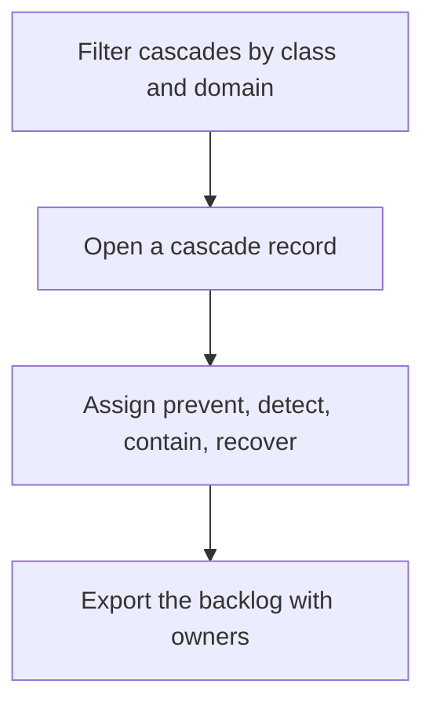

## Chapter 6: Cascades: browse by class, plan mitigations

Filter by the four classes first — inherent, emergent, derived, cascading live in different places and demand different controls — then domain and blast radius. Page through the ranked list with progress shown; the pager never loses your place across 191 records.

The mitigation planner is where browsing becomes work: prevent, detect, contain and recover controls per cascade, owned and exportable as a backlog. A cascade without a mitigating control is a finding, not a reading.

The four-class taxonomy is the chapter's analytical prior, and the class filter is the fastest triage in the tab: inherent failures live in components (harden them), emergent failures live in interactions (review them), derived failures live in second-order effects (model them), cascading failures live at boundaries (cap the amplification). Misclassification sends you to the wrong instrument — a boundary control applied to a component flaw, an interaction review applied to a second-order model gap — so classify to start, not to stop. Real failures straddle classes; the taxonomy orients the first response and the planner covers the rest with all four control families per cascade.

**Definition 1 (Class-matched mitigation).** A cascade record is *class-matched* if its assigned controls include the family its class demands: hardening for inherent, interaction review for emergent, second-order modeling for derived, boundary controls with amplification caps for cascading — plus detect, contain, and recover in all cases.

**Theorem 1 (No single-family mitigations).** If every cascade record is class-matched and exported with an owner, then the backlog contains no cascade defended by only one control family.

*Proof.* Class-matching requires the class-demanding family plus detect, contain, and recover — at minimum four families per record by construction. The export carries the assignment with its owner, so an incomplete record is visible as a missing family rather than hidden as an assumption. A cascade defended by a single family can therefore only exist as an explicitly incomplete record, which is a flagged finding rather than a silent gap. ∎

Sixty records at a time with progress shown beats an infinite scroll that forgets — the pager is a small mercy with a large effect, because triage across 191 records happens over days, and a pager that loses your place loses the triage. Promote one cascade into a bench case or a review checklist; assign one control an owner; verify one mitigation matches its class.

**Counsel of architects.**

- **Continual-learning architect:** I read the cascade explorer as the catalogs second-order view: classes first, then domains and blast radii, then the ranked list with a pager that never loses your place. Sixty at a time with progress shown beats an infinite scroll that forgets. My dispute is with browsing cascades as trivia; each one is a test case for composition. Monday morning, promote one cascade into a bench case or a review checklist.
- **Memory-systems architect:** I emphasize the mitigation planner as the backlog end of browsing: prevent, detect, contain and recover controls per cascade, owned and exportable. A cascade without a mitigating control is a finding, not a reading. Others focus on taxonomy; I insist the planner is where browsing becomes work. Monday morning, assign one cascade control an owner.
- **Evaluation architect:** I treat the four-class taxonomy as the analytical prior: inherent, emergent, derived and cascading failures demand different tests and different controls, and misclassification sends you to the wrong instrument. The class filter is the fastest triage in the tab. My caution is that real failures straddle classes; classify to start, not to stop. Monday morning, classify your last incident and check the controls matched.
- **Safety architect:** I map cascade classes to control families: inherent to component hardening, emergent to interaction review, derived to second-order modeling, cascading to boundary controls and amplification caps. The class tells you where to spend. My disagreement is with one-size-fits-all mitigations; match the control to the class. Monday morning, verify one mitigation matches its cascade class.
