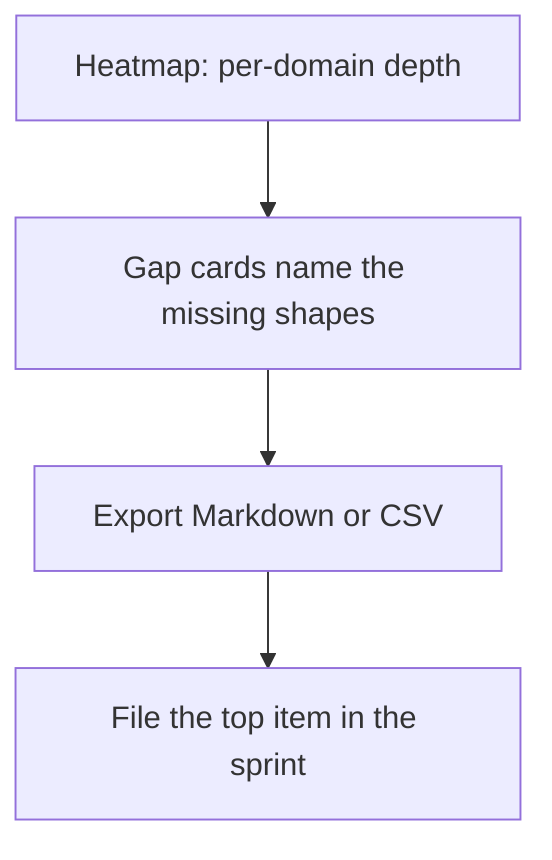
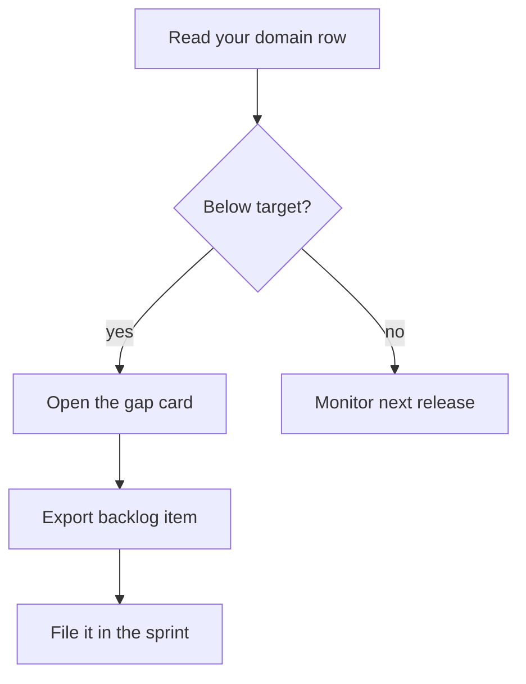

## Chapter 7: Coverage: heatmap, gap cards, backlog

Read your domain row in the heatmap first: cell shading is coverage versus a heuristic target (patterns at least 3, scenarios at least 2 per domain). Gap cards name what is missing; the export turns gaps into assignable Markdown or CSV.

Targets are advisory, printed beside the verdicts — a met target is not a defended domain. Fund by gap: thin domains get rehearsal priority, missing cascade classes get authoring priority in discovery.

The heatmap is a map of what the catalog actually defends, and maps are honest only when their methodology is printed beside them. Patterns-at-least-3 and scenarios-at-least-2 per domain are heuristics, not guarantees — derived and cascading minimums alongside them, all labeled advisory. The honest reading has two halves: first your domain row, read plainly; then the target line, re-derived from your own incident history rather than worshipped. A met target is a starting assumption that survived one check, not a defended domain.

**Definition 1 (Funded gap).** A gap $g$ (thin domain, missing cascade class, uncovered scenario) is *funded* if it holds exactly one of: rehearsal priority (thin domains), discovery authorship (missing classes), or sprint assignment via the exported backlog (named shapes).

**Theorem 1 (No unfunded known gaps).** If every gap card is exported to the backlog and the top item is filed per sprint, then every known gap is either funded or explicitly deferred — none is silently held.

*Proof.* Gap cards enumerate the known gaps completely by construction of the heatmap (every below-target cell produces a card). Export converts each card into a backlog item; filing the top item per sprint funds gaps in priority order. A gap that remains unfunded after this process is one the team saw, exported, and chose not to file — an explicit deferral, visible in the backlog's ordering, rather than an unknown unknown. The discipline converts ignorance (no card) into backlog (card, unfunded) into work (filed) — and each state is inspectable. ∎

Uniform investment is the failure mode the theorem prevents: weight by adversary interest and blast radius, move one unit of effort to your thinnest domain, and let the budget view say which domains meet the scenario minimum. Coverage work that does not produce tickets does not happen — the export is the workflow, and the filed top item is its proof.

**Counsel of architects.**

- **Continual-learning architect:** I see coverage as the map of what the catalog actually defends: the heatmap shows per-domain depth, gap cards name what is missing, and the backlog export turns gaps into assignable work. A catalog you cannot audit is a comfort object. Monday morning, open your domain row and read it honestly.
- **Memory-systems architect:** I focus on the backlog as the artifact: Markdown checklist or CSV, each gap with its fix, ready for a sprint rather than a slide. Coverage work that does not produce tickets does not happen. Others admire the heatmap; I insist the export is the workflow. Monday morning, export the backlog and file the top item.
- **Evaluation architect:** I value that targets are explicit and heuristic: patterns and scenario counts per domain, derived and cascading minimums, with the methodology printed beside the verdicts. Advisory, not authoritative — and labeled as such. My caution is target worship; a met target is not a defended domain. Monday morning, re-derive one target from your own incident history.
- **Safety architect:** I staff coverage as the planning input: thin domains get rehearsal priority, missing cascade classes get authoring priority, and the budget view says which domains meet the scenario minimum. Fund by gap, not by comfort. My disagreement is with uniform investment across domains; weight by adversary interest and blast radius. Monday morning, move one unit of effort to your thinnest domain.
