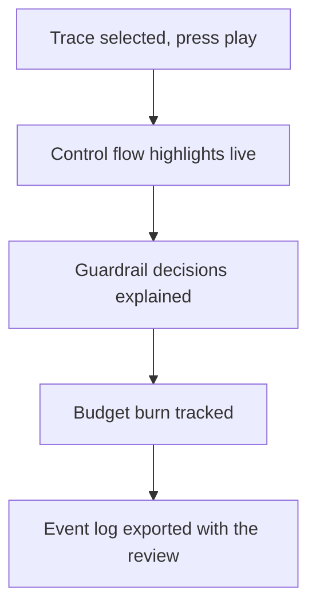

## Chapter 8: Live traces: press play, keep the log

Pick a trace and press play: control flow highlights while steps, guardrail decisions, budget burn and the event log stay in sync. Step through for briefings, enlarge for war rooms, replay at speed for drills. The same trace serves onboarding, review and incident prep.

Reading about a control is knowing; watching it fire is believing. The trace player synchronizes four views that diverge in incident review when they are captured separately: where the control flow was, what each guardrail decided and why, how much budget burned, and what the event log recorded. Step-through serves briefings (one decision at a time), enlarge serves war rooms (one diagram for the whole table), replay-at-speed serves drills (the whole incident in minutes). One trace, three audiences, zero re-capture.

Mock runs are wiring proofs with the limits printed beside them — synthetic replays validate the control path, not adversary ingenuity. Keep the log: timestamped, exportable, attachable to the review instead of a memory.

**Definition 1 (Wiring proof).** A mock replay is a *wiring proof* for control $C$ on path $P$ if it demonstrates that $C$ fires on $P$ with the recorded decision, budget, and log — and states explicitly the set of paths and adversaries it does not cover.

**Theorem 1 (Replay containment).** A passing mock replay licenses exactly one claim: the control fires on the replayed path. It licenses no claim about novel paths, adaptive adversaries, or production conditions.

*Proof.* The replay executes $C$ on the fixed recorded path $P$ — the observed firing is evidence about $(C, P)$ only. Novel paths, adaptive adversaries, and production conditions are outside the executed configuration by construction of the mock, so no observation bears on them. Restating the result as wiring proof (what fired, where, with what log) stays inside the evidence; promoting it to safety proof (the control holds) steps outside it. The verdict box that says what was decided and why is the boundary made visible: auditable within, silent beyond. ∎

Replay theatre is the failure mode the theorem names: a passing mock mistaken for a held control. Rehearse the trace three ways for three audiences, export the log with the review, and restate every replay result as wiring proof — then the trace is an asset instead of a performance.

**Counsel of architects.**

- **Continual-learning architect:** I read live traces as the catalogs executable half: pick a trace, press play, watch control flow highlight while steps, guardrail decisions, budget burn and the event log stay in sync. Reading about a control is knowing; watching it fire is believing. Monday morning, replay one trace for the control you trust most — and watch it earn the trust.
- **Memory-systems architect:** I emphasize the event log as the durable record: timestamped, exportable, replayable, the thing you attach to the incident review instead of a memory. Logs beat recollection. Others watch the diagram; I insist the log is the takeaway. Monday morning, export one replay log and file it with a control review.
- **Evaluation architect:** I treat mock runs as wiring proofs with explicit limits printed beside them: synthetic replays validate the control path, not adversary ingenuity. The verdict box says what was decided and why, which is auditable. My caution is replay theatre; a passing mock never means the control holds under novelty. Monday morning, restate one replay result as wiring proof, not safety proof.
- **Safety architect:** I map the replay controls to drill design: speed settings for walkthroughs, step-through for briefings, enlarge for war rooms. The same trace serves onboarding, review and incident prep. My disagreement is with single-use tooling; rehearse the trace three ways for three audiences. Monday morning, run one trace at briefing speed for your team.
