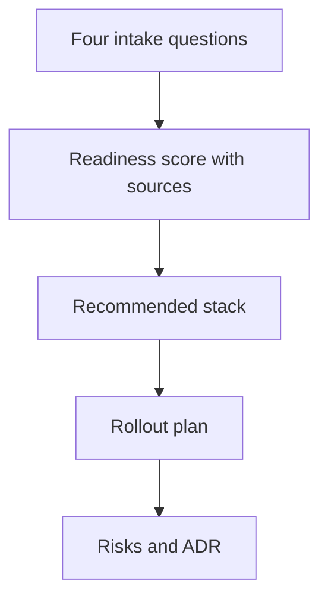
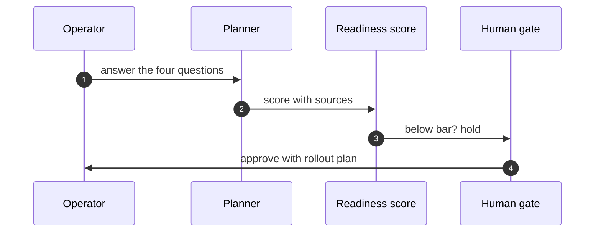

# Part III — Planning workflows

## Chapter 9: Deployment planner: four questions, one ADR

Describe the agent and its authorities; read the readiness score with its sources; take the recommended stack and rollout plan; record risks and file the ADR. Four questions that refuse to be skipped, in order, ending in a document that outlives the meeting.

The score is a checklist with arithmetic — coverage, cost, threat exposure and cascade analysis computed from the catalog, inspectable all the way down. Improve the inputs, not the number; halve rollout steps until nothing breaks.

That sentence contains the whole evaluation discipline in two clauses. "A checklist with arithmetic" means every point in the score traces to a source row — coverage from the coverage tab, cost from the estimate, threat exposure from the catalog, cascades from the cascade records — so any challenged point resolves to its inputs rather than to an argument about the number. "Improve the inputs, not the number" is the anti-gaming rule: score-chasing tunes the weights, input-improving fixes the deployment, and only the second survives contact with production.

**Definition 1 (Inspectable readiness).** A readiness score $R = \sum_i w_i x_i$ is *inspectable* if every term $(w_i, x_i)$ links to its source row (coverage cell, cost line, threat record, cascade entry), and recomputation from sources reproduces $R$ exactly.

**Theorem 1 (Score disputes resolve downward).** Under inspectable readiness, any dispute about the score resolves to a dispute about a source row — never about the arithmetic — and fixing the row fixes the score.

*Proof.* Recomputation from sources reproduces $R$ deterministically, so the arithmetic contributes no degrees of freedom: two parties with the same sources compute the same score. Disagreement therefore implies differing sources, and tracing the differing term identifies the row. Correcting the row (better coverage, truer cost, a missed cascade) recomputes to the corrected score with no residual argument about weights or method. ∎

The rollout plan applies the same logic to exposure: sequence the release so the blast radius grows only as evidence accumulates, halve one step and watch nothing break, and hold below-bar deployments at the human gate — no readiness review, no production credentials. Big-bang launches of agentic systems are bets that the score was right; staged rollouts are the hedge that pays when it was not.

**Counsel of architects.**

- **Continual-learning architect:** I read the deployment planner as four questions that refuse to be skipped: what are you building, how ready is it, what is the stack, and what could go wrong on day one. Answer in order and the planner returns a readiness score, a recommended stack, a rollout plan, risks and an ADR. My dispute is with deployment by vibes; the intake makes the implicit explicit. Monday morning, answer the four questions for your riskiest agent.
- **Memory-systems architect:** I focus on the ADR as the artifact: a decision record outlives the meeting, the chat thread and the engineer who wrote it. Readiness without a record evaporates. Others celebrate the score; I insist the document is the deliverable. Monday morning, file one ADR from the planners output.
- **Evaluation architect:** I treat the readiness score as a checklist with arithmetic, not a verdict: coverage, cost, threat exposure and cascade analysis computed from the catalog, inspectable all the way down. A score you cannot audit is a mood. My caution is score-chasing; improve the inputs, not the number. Monday morning, trace one readiness point to its source row.
- **Safety architect:** I staff deployment planning as the last gate before grants: no readiness review, no production credentials. The rollout plan sequences exposure so the blast radius grows only as evidence accumulates. My disagreement is with big-bang launches of agentic systems; roll out like the blast radius matters, because it does. Monday morning, halve one rollout step and watch nothing break.
