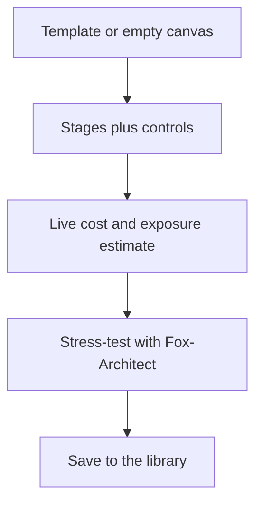

## Chapter 10: Blueprint builder: compose, estimate, stress-test

Start from a template or an empty canvas: compose stages, attach controls per stage, watch cost, coverage and exposure estimate live, stress-test with Fox-Architect, then save to the library or export. A blueprint is a system you can price and attack on paper before building it.

Re-estimate before approving — estimates rot as the catalog moves — and stress-test before granting. The cheapest control is the one drawn before code exists.

The library is the chapter's compounding mechanism: saved blueprints, templates, and palettes mean the second system starts where the first ended. Reuse is how small teams outbuild large ones — but only if the library holds priced, estimated, stress-tested systems rather than sketches. An architecture diagram without an estimate is a sketch; a blueprint without a stress test is a hope. The builder enforces both by making estimation live (recomputed per edit, assumptions inspectable) and stress-testing one click away.

**Definition 1 (Priced blueprint).** A blueprint $B$ with stages $s_1, \dots, s_n$ and per-stage controls is *priced* if it carries a live estimate triple $(C(B), V(B), X(B))$ — cost, coverage, threat exposure — recomputed from the current catalog on every edit, with each figure traceable to its inputs.

**Theorem 1 (Estimate freshness).** If estimates recompute on every edit from the current catalog, then a blueprint approved at time $t$ carries the catalog's knowledge at $t$ — and any catalog change after $t$ is detectable as estimate drift on re-run.

*Proof.* Live estimation is a pure function of (blueprint, catalog version): same inputs, same triple. Approval pins the triple alongside the catalog version. A later catalog change alters the function's second argument, so re-running recomputes a different triple exactly when the world changed underneath the blueprint — drift made visible rather than silent. The discipline "re-estimate before approving" is therefore checkable: the approval is fresh iff its triple matches a recomputation against the current catalog. ∎

Design review happens on the blueprint, not in the incident: stress-test with Fox-Architect before the next review, let the threat exposure number set the approval tier, and price one blueprint you already drew — the number it returns is the start of the review, not the end of it.

**Counsel of architects.**

- **Continual-learning architect:** I see the blueprint builder as composition with receipts: stages, controls per stage, cost and threat exposure estimated live, then saved to the library or stress-tested by Fox-Architect. A blueprint is a system you can price and attack on paper before building it. My dispute is with architecture diagrams that cannot be costed or faulted; if it has no estimate, it is a sketch. Monday morning, price one blueprint you already drew.
- **Memory-systems architect:** I emphasize the library as compounding memory: saved blueprints, templates and palettes mean the second system starts where the first ended. Reuse is how small teams outbuild large ones. Others focus on the canvas; I insist the library is the product. Monday morning, save one working blueprint as a template.
- **Evaluation architect:** I value live estimation as the honest part: cost, coverage and exposure recomputed per edit, with the assumptions inspectable. An estimate without visible math is a guess with formatting. My caution is stale estimates after catalog updates; re-estimate before approving. Monday morning, re-run one old estimate against the current catalog.
- **Safety architect:** I map blueprinting to pre-mortems: stress-test with Fox-Architect before granting anything, and let the threat exposure number set the approval tier. Design review happens on the blueprint, not in the incident. My disagreement is with build-first-review-later cultures; the cheapest control is the one drawn before code exists. Monday morning, stress-test one blueprint before its next review.
