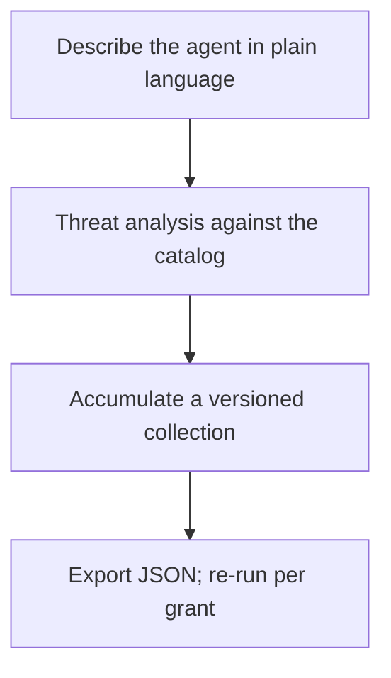
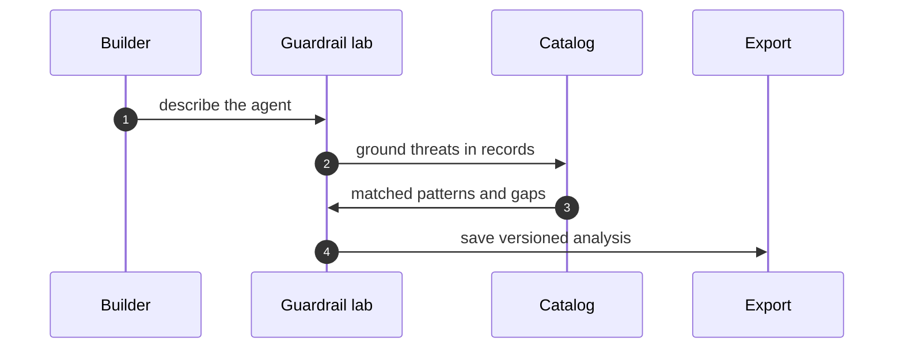

# Part IV — Lab workflows

## Chapter 11: Guardrail lab: describe, analyze, collect

Say what agent you are building in plain language; get a threat analysis grounded in catalog records; accumulate a versioned collection instead of one-off analyses. Export as JSON when it is solid — and re-run before every grant widening, not just at launch.

The collection is the unit: analyses accumulate instead of evaporating, versioned, timestamped, exportable — last quarter's reasoning as this quarter's baseline. One-off analyses are amnesia with extra steps; the versioned collection is longitudinal memory. An hour of structured analysis before granting beats a quarter of incident response after, which is why the re-run rule keys on authority rather than calendar: every grant widening deserves a fresh analysis, because the threat surface changed even if the quarter did not.

**Definition 1 (Grounded analysis).** A guardrail analysis is *grounded* if every named threat cites the catalog record (pattern, scenario, cascade) it derives from, and every recommendation traces to a matched record or an explicitly marked gap.

**Theorem 1 (Generic-advice impossibility).** A grounded analysis cannot be generic advice that fits any agent and therefore none: each claim carries its record citation, so vacuous claims have nowhere to hide.

*Proof.* Generic advice ("validate inputs," "use least privilege") cites no specific record — it holds vacuously across agents precisely because it derives from none. Groundedness requires a record citation per threat; a claim without one fails the definition and is rejected at review. The export carries the citations with it, so downstream readers audit the grounding without re-running the lab. Trace one lab claim to its catalog record: if the trace ends nowhere, the claim is decoration. ∎

Start one collection for your current build on Monday morning; re-open your oldest analysis and update it; demand record-level grounding for every claim. The cheapest review in the building is only cheap if it happens — launch-only analysis leaves every later grant unexamined.

**Counsel of architects.**

- **Continual-learning architect:** I read the guardrail lab as describe-then-test: say what agent you are building in plain language, get a threat analysis grounded in the catalog, and export the collection as JSON when it is solid. The collection is the unit — analyses accumulate instead of evaporating. My dispute is with one-off analyses; guardrails need a collection with history. Monday morning, start one collection for your current build.
- **Memory-systems architect:** I focus on the collection as longitudinal memory: saved analyses, timestamps, export and re-import mean last quarters reasoning is this quarters baseline. Amnesia is the default without it. Others run analyses; I insist the versioned collection is the workflow. Monday morning, re-open your oldest analysis and update it.
- **Evaluation architect:** I treat the lab output as falsifiable or it is not output: threats named against catalog records, with the catalog behind every claim. The export carries the evidence with it. My caution is generic advice that fits any agent and therefore none; demand record-level grounding. Monday morning, trace one lab claim to its catalog record.
- **Safety architect:** I staff the guardrail lab as the cheapest review in the building: an hour of structured analysis before granting beats a quarter of incident response after. Run it before every authority expansion, not just at launch. My disagreement is with launch-only reviews; every grant widening deserves a fresh analysis. Monday morning, analyze the next grant before approving it.
